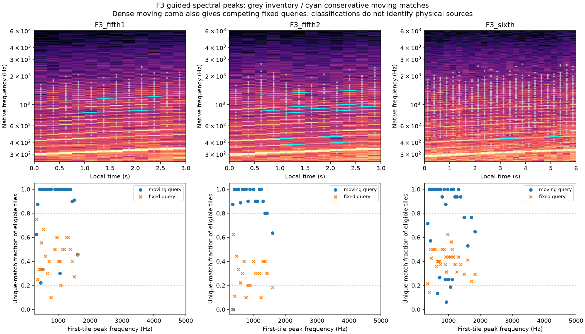

# 加速谱峰对应与误判 V1

继续分析已批准F3车内三段固定挡位加速。此前约15%的整体频率轴升高，现在进一步核对逐条谱峰。结果支持保留一组随升速移动的声线候选；**当前分类仍不足以识别固定／移动的物理声源，未导出加速音色或改变Demo。**

## 实际观察

沿用159–162、190–193、194–200秒原生48kHz双声道及全部48个不重叠0.25秒窗。原有整体谱形比例和支持标记原样使用，无重拟合、插值、降噪、归一化或新素材下载。

先记录200–7000Hz内全部满足8dB突出度、6Hz峰间距及相对最强峰−42dB条件的谱峰，无top64截断。每段首窗300–5000Hz的峰为参考，分别查询后窗中沿原比例移动的位置和固定Hz位置。匹配半径含两窗原生4Hz分辨率与比例网格半步，仅是工程对应半径，不是测量误差界。一个峰只能在图中形成唯一的一对一对应；缺失／多义保留，不择近替代。

只有两个预测位置相距足够大、且整体比例已通过原判据的窗参与比较；每条至少5窗。首版分类要求目标支持≥80%、另一查询支持≤20%，并连续至少5窗；规则执行后原样保留。

| 片段 | 首窗参考峰 | 沿升速查询支持≥80%的峰 | 首版分类moving／fixed／uncertain |
|---|---:|---:|---:|
| F3 5挡第一段 | 24 | 19 | 2／0／22 |
| F3 5挡第二段 | 20 | 18 | 6／0／14 |
| F3 6挡 | 30 | 17 | 1／0／29 |

“查询支持”说明预测附近有唯一谱峰，不证明同一条物理声源或相位连续。6挡仍保留此前5个整体比例不确定窗，不插值接回。

## 找到的混淆

首轮中许多声线沿升速查询的支持达100%，但固定频率查询仍间歇命中，于是被分类为不确定。增加已知密集移动谐波控制：60Hz基准的第5–30条、线性升速，全部26条都在移动。结果全部26条的移动查询支持≥80%，首版却只留下8条moving，另18条不确定。

原因是其他移动谐波会先后经过同一固定频率位置。跨窗零散命中不能当作持续固定声源，也不能据此删除主声线。本次没有调整80%／20%或窗口门槛，而是保留首次结果，追加控制与限制。该规则可作谱峰对应诊断，不能推广为声源分离器。

在这套固定首窗／突出度条件下，三段参考峰均低于2kHz。这不表示2–5kHz没有声音：图中可见宽谱能量和其他窗的峰；强度、展宽与筛选均可能影响峰清单。此结果不支持再凭空增加一组高频OSC去补“机械感”，也不证明高频全部属于风噪。

## 对后续合成的意义

下一步应在原生样本上联合拟合实际升速的独立声线，先用已知密集移动谐波、缺线／邻线和变化频率验证，再用保留窗口核查频率／幅度预测。相对比例只作为声学坐标，不能直接称为曲轴时钟或换算RPM。固定共振／细谱应另估，不能由某个固定坐标处偶尔有峰来认定。

同一生成系统的模块边界维持：声线频率／相位、随工况变化的幅度／共振、连续细谱、驾驶状态／包络、空间路由分别维护。F2尾排怠速与F3车内加速仍分档，不能跨车型／机位拼成未经标定的同一排气音色。现有怠速起伏试听仍待反馈，本轮不重复问题。

## 验证与留痕

已知四移动＋四固定声线、幅度缩放、全固定声线配错误移动导引、缺线后出现偏移邻线、独立Stereo噪声、同源Mono噪声、静音和多义图均核查；密集谐波的18条假不确定作为方法限制保留。噪声控制的结果不证明普适声源识别能力。

另一实现复算144个原生FFT／逐峰突出度和间距筛选、288张匹配图、339条分类，全部对应；频率最大差9.095e−13Hz、突出度2.331e−8dB。它验证计算，没有将分类不足或听感变好“测通过”。

`tools/accel_ridges_v1/{observe,checks}.py`分别负责观察与已知控制；独立审计、只读绘图、归档为外部脚本。`references/analysis/accel_ridges_v1`保留observe1、追加密集控制的observe2、audit1、plot1与精确执行源。600份C/H、67声音配置与F2／行驶35%参数逐哈希保持；未重跑未修改的61项C测试。冻结`baselines/accel_ridges_v1`，摘要见同名JSON。
