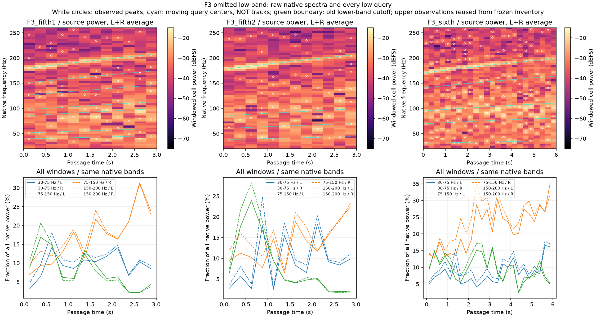
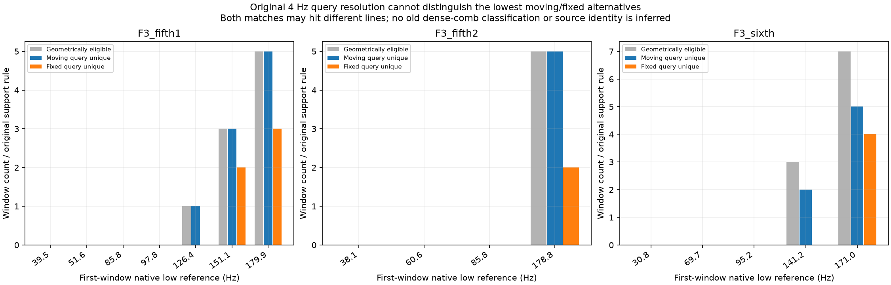

# 加速遗漏低频清点 V1

**30–200Hz确实是明显缺口，但不能把全部低频能量直接做成发动机轰鸣。** 本轮清点全部48个原生F3车内加速窗，恢复低频峰清单，并修正随升调越过200Hz后被观察边界漏掉的问题。没有生成新音色或替换驾驶默认。

## 原生观察

| 片段 | 窗口 | 30–200Hz／全部原生功率L | 同项R | 低频峰观察次数 |
|---|---:|---:|---:|---:|
| 第一次5挡 | 12 | 33.83% | 36.76% | 70 |
| 第二次5挡 | 12 | 30.50% | 34.82% | 62 |
| 6挡 | 24 | 39.32% | 44.10% | 133 |

分母是0至Nyquist全部原生窗功率，包括DC及低于30Hz；不是发动机声源总功率。265次观察不是265个声源。保存所有频带功率、占比、谱平坦度、最大原生频格和连续三格最大集中度；它们是描述指标，不能单独区分燃烧、风、路面或车内传递。

仅为原遗漏域新增30–200Hz清单，复用原8dB峰突出度／6Hz间距／−42dB相对带内最大峰条件，不限峰数。4Hz原生频格使6Hz间距实际取整为2格。没有新时间选择、重采样、音频处理或局部声线拟合。

图中青线仅为按原声学比例计算的查询中心，白圈是观测峰，不是已识别连续声轨。约170–180Hz一带可见上升结构，较低频段还存在其他峰及宽带能量，尚未物理分离。

## 边界修正和可分辨性

`observe1/2`的对应只查询低于200Hz的观测节点，179Hz参考升高到200Hz以上后被清单边界截断，造成假缺失。`observe3/4`把**新增低频清单与已有冻结200–7000Hz清单合并**后查询，参考仍取原第一窗低频清单。没有重新搜索上频段、改变原检测器范围／门槛或补造峰；两个清单原相对峰值floor语境分别保留。

原查询分辨条件为移动与固定中心距离大于两倍最大查询半径，并保留原guide支持。最低约30–100Hz的参考在这段约15%升调中全部没有合格分辨窗；即使精确75Hz声线真的升高15%，原4Hz误差邻域仍重叠，不能按这个规则区分移动和固定。这是已知几何反例，不是声轨提取测试。

| 首窗低频参考 | 可分辨窗 | 移动查询唯一命中 | 固定查询唯一命中 | 边界修正前移动命中 |
|---|---:|---:|---:|---:|
| 第一次5挡179.876Hz | 5 | 5 | 3 | 0 |
| 第二次5挡178.758Hz | 5 | 5 | 2 | 2 |
| 6挡171.014Hz | 7 | 5 | 4 | 5 |

移动、固定查询可能分别命中不同声线。原高频研究已经有密集移动梳状谱被误判不确定的已知反例，所以本轮**不运行原移动／固定分类器**，也不把表中命中当作物理发动机身份、共同相位或可持续OSC参数。

## 独立核对与保留失败

独立periodogram复核绝对功率，显式扫描峰／突出度／子格公式、标量频带与描述公式、全一对一图及分辨条件复核全部48窗；父输入逐项对冻结manifest验证。包括已知控制共267次峰、98张图通过，最大功率差1.777e−15、描述公式差1.066e−14，峰公式差0。

前三次审计失败完整保留：已知纯音在理论零能量频带仅剩浮点残差，直接比较两种等价窗实现的归一平坦度或log突出度出现0.113／7.107／1.842量级差异。原库存使用逐点cos周期Hann，描述统计使用`np.hanning(n+1)[:-1]`；它们数学等价，零点附近浮点结果不同。不是实录低频增减或新音色收益。

最终分别保存两种原计算的完整功率格，由独立periodogram核对绝对功率，再从各自保存格独立重算描述／峰公式；原比较精度不变。理论零带的归一量不称物理精确。`observe1`至`observe4`所有实录功率／描述／低峰清单逐项完全相同；只补充诊断数组和修正图的观测上下文，没有据失败调参。

`observe_`入口读取素材、记录原生观察；`audit_`独立核对；`plot_`只读展示；`package_`冻结四次观察、三次失败及最终审计。原生执行源码／参数／所有结果一并留痕。

612份C/H、67份旧配置、怠速待听候选、行驶35%、驾驶／空间／旧take保持，没有新音轨／运行声音模型、默认更换、旧61测试重复或听评问题。当前仍是同一已观察F3录音，非实测RPM／负载、独立新素材验证或共同发动机相位，原共同相位资格不豁免。

下一步对低频候选做原生局部联合幅相拟合，保留所有邻线和数值失败，以固定／移动混合及同源单声道噪声反例检查连续性与留段预测，再决定轰鸣层配方。怠速候选继续待原听评，不盲调或默认推广。

完整证据：`E:/VehicleSoundLab/baselines/accel_low_inventory_v1`。
