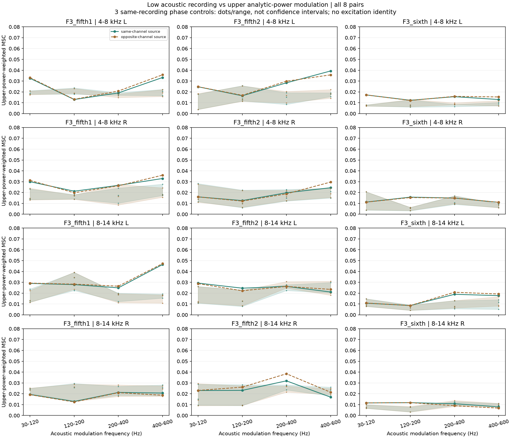
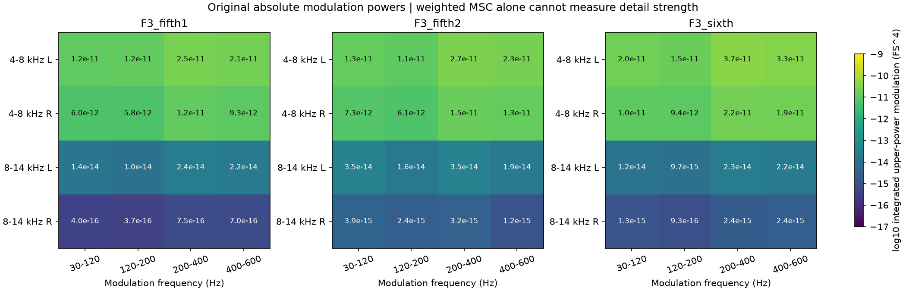

# 加速高低频关联 V1

本轮核查F3加速录音的高频细节是否跟随低频声线。**结果不足以支持用同一个低频波形调制所有高频层**：关联随片段、频带和声道变化，许多结果落在相位对照范围内。没有据此生成新声音。

## 范围与方法

沿用已批准的三段F3车内连续加速、全部九条同频谱相位对照，原生48kHz。它们来自同一录音，不是十二次独立实车试验。

完整片段经原四阶4–8／8–14kHz带通，求解析信号模平方，再裁去两端100ms，得到四路高频瞬时功率。原始L/R作为两个声学参考；没有提取真实曲轴或物理低频声源。

固定100ms周期Hann窗、50ms步进，每窗去均值。保存全部2401个原生频点的两路参考PSD、四路功率调制PSD、全部2×4复交叉谱与平方相干MSC，共900窗，原素材225窗。交叉谱约定为`mean(conj(X) * Y)`。零分母标为未定义，不补地板。

按预定30–120／120–200／200–400／400–600Hz调制频带汇总：

```text
加权MSC = sum(MSC * 高频功率调制PSD) / sum(高频功率调制PSD)
```

参考PSD单位FS²/Hz，功率调制PSD为FS⁴/Hz，交叉谱为FS³/Hz。加权MSC是录音内观察指标，不是样本外解释比例或可直接写入合成器的耦合系数。

## 结果及生成约束

| F3片段 | 同声道四路×四调制带的加权MSC范围 |
|---|---:|
| 第一段5挡 | 0.01292–0.04637 |
| 第二段5挡 | 0.01258–0.03931 |
| 6挡 | 0.00791–0.01895 |

48个同声道组合有25个高于全部三条相位对照，另外23个没有；这不是显著性检验、独立样本计数或置信区间。全部跨声道结果也保留，没有选择最大频点或最佳窗口。固定频率观察不能排除随转速变化的周期关系，**也没有恢复出可靠的发动机激励时序**。



高频功率起伏本身的强度必须单看。4–8kHz的带内积分约6e−12至4e−11FS⁴，8–14kHz右声道部分低至约4e−16FS⁴；不能因相干值相近就加同样大的高频细节，更不能把这些量当作音频声压功率。



前轮“高频各带存在共同快变化”仍成立，但不等于“快变化由低频直接控制”。后续生成层继续分开慢速谱色、快速相关激励和各带独立成分；绑定发动机时钟仍需另有合格的周期／状态证据。本轮没有把F3车内关系套给F2尾排怠速。

## 验证与留痕

先做已知AM、增益／声道置换、常量零功率和高斯三阶矩控制。另有明确反例：5000与5300Hz两条高频正弦的拍频，与300Hz低频参考的功率相干可达1，却不存在共享随机调制器。因此本方法不是燃烧／机械激励探测器。

独立FFT因果IIR与手写Hilbert重建全部十二份原生特征，功率样本最大差1.19e−17FS²；独立Welch/CSD核对全部PSD与复交叉谱，峰值归一化误差不超过6.15e−15。全部48份固定频带汇总通过，30–600Hz内MSC差不超过2.23e−16。

**全2401频点MSC的原2e−8门槛未通过。** audit1首例即停；audit2只改为收集全部失败，未放宽门槛或改数据。十二例均有超限，最坏2.61e−7，最大差位置在23.77–23.97kHz，功率调制谱约峰值的1e−21至1e−19。近零归一化会放大FFT／求和差异；不能宣称全频MSC独立验证通过。原频谱、全部MSC代数闭合及预定频带检查分别通过，两次报告／精确源码完整保留。九条原相位音轨及PSD／左右CSD资格仅按父归档哈希复用，未重跑冒充新审计。

模块：`tools/accel_upper_link_v1/spectral.py`负责特征／频谱；`observe_`、`audit_`、`assess_`、`package_accel_upper_link_v1.py`负责适配、独立复核、汇总和冻结。冻结在`E:\VehicleSoundLab\baselines\accel_upper_link_v1`。

619份C/H、67份旧声音、已认可行驶35%与实时默认均逐项保持。新怠速联合起伏候选继续待听评；不重复提问、不盲增力度、不接入未听候选。完整驾驶、多发动机与stereo／7.1.4目标继续，原共同相位资格要求未被本轮代替。
