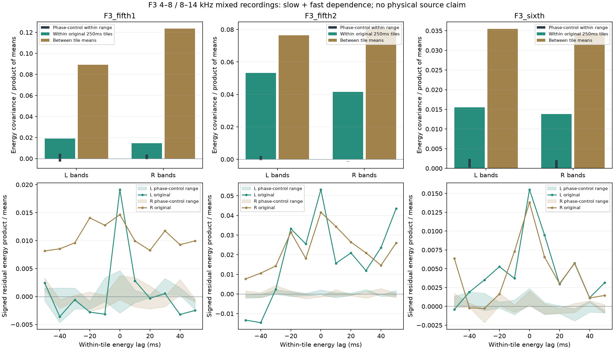

# 加速高频共同细节 V1

新怠速候选等待听评期间，继续推进已批准F3车内加速的高频层。**素材中4–8kHz与8–14kHz的起伏既有慢速共同变化，也有较快的共同细节；独立频带各自随机生成会漏掉这部分关系。** 尚未导出新声音或修改驾驶默认。

## 完整范围与算法

复用前轮三条F3连续片段及全部九组同频谱相位对照，原48kHz双声道、原四阶Butterworth带通、两端100ms裁切。对照保持完整左右交叉谱，改变时间组织；属于同一录音，不是独立实车录音。扩展到两个频段×L/R共四路，原左声道滤波样本逐点不变。

每10ms计算原生均方能量，以原250ms分析块分组，首末块较短。按实际组长加权，精确分解：

```text
总能量协方差 = 块内协方差 + 各块均值之间的协方差
```

全部4×4矩阵保留符号，不把负相关置零。块内能量再减去本块均值，记录−50到+50ms的全部11个滞后；只使用同块内配对，不选择最高峰作为发动机事件时序。“块内／块间”是观察尺度的分组，不是严格频率分离或平稳性证明。

另计算全片段和全部192个片段块的四阶关联：`cum(x,x,y,y)=E[x²y²]−E[x²]E[y²]−2E[xy]²`，每份先去均值。减去最后一项是为了避免把普通高斯声道相关误认为非高斯共同激励。已知相关高斯控制的平方协方差0.72、四阶关联0；共享稀疏尺度与独立尺度有相同边缘峰度12，但跨路四阶关联分别4／0。仅看各带峰度无法确定该如何关联生成。

## 实际结果

下表采用同一声道中两个高频带的10ms能量，协方差除以两带平均能量乘积；不是相关系数、功率占比或音质分。

| F3片段／声道 | 总协方差 | 块内部分 | 块间部分占总值 | 相位对照块内最大值 |
|---|---:|---:|---:|---:|
| 第一段5挡 L | 0.10820 | 0.01913 | 82.3% | 0.00466 |
| 第一段5挡 R | 0.13820 | 0.01463 | 89.4% | 0.00377 |
| 第二段5挡 L | 0.12956 | 0.05317 | 59.0% | 0.00205 |
| 第二段5挡 R | 0.12216 | 0.04161 | 65.9% | −0.00118 |
| 6挡 L | 0.05098 | 0.01552 | 69.6% | 0.00238 |
| 6挡 R | 0.04818 | 0.01380 | 71.4% | 0.00207 |

慢变化解释了很大一部分，但去掉块均值之后，较快的共同起伏仍高于这三组对照。它们是描述性的有限观察，三组对照范围不作置信区间。块内仍可能包含平滑趋势、转速变化与录音影响。

左右不能简单复制：三个片段左声道的按时长加权局部跨带四阶关联约0.285／0.240／0.071，右声道约0.006／0.045／0.019；第一段右声道已接近对照范围。第二段8–14kHz左右能量共变又主要来自块内。这些关系需要分别保留，不把声道直接称为左右汽缸列或物理声源。



## 对后续生成层的约束

高频层应分开维护**慢速谱色／能量控制、快速相关激励、各频带独立细节**。只匹配平均频谱或每带峰度不够，也不能将同一个AM包络直接套满全部声道与频带。先通过完整滤波器验证共享与独立激励的功率、相关与四阶矩预算，再考虑一个有限候选，避免重演独立OSC云的电子感。

这是生成结构的依据，还不是实车负载参数。共同起伏可能来自道路、风、话筒、编解码或行驶非平稳变化，不能据此命名机械摩擦、燃烧事件或设定实际延时。F3车内、F2尾排和A车外继续分库；本轮不替代原共同相位／RPM资格。

## 工程留痕

`tools/accel_upper_joint_v1/moments.py`负责统计与已知控制；`observe_`、`audit_`、`assess_`、`package_accel_upper_joint_v1.py`分别负责素材适配、独立核对、图表和冻结。没有把计算塞入实时声音核。

全部12份连续输入／4路滤波、192块四阶矩、能量分解与11个有符号滞后独立核对通过；滤波最大差1.02e−15FS，归一化矩最大差1.55e−14。九组相位音轨及全部PSD／左右交叉谱也已重建核对。图已目视，619份C/H和67份旧声音逐项哈希保持，未重复无关驾驶测试。

冻结目录：`E:\VehicleSoundLab\baselines\accel_upper_joint_v1`。新怠速候选继续待听评，未重复提问或接入未听候选；完整驾驶、多发动机与实际7.1.4目标仍在进行。
