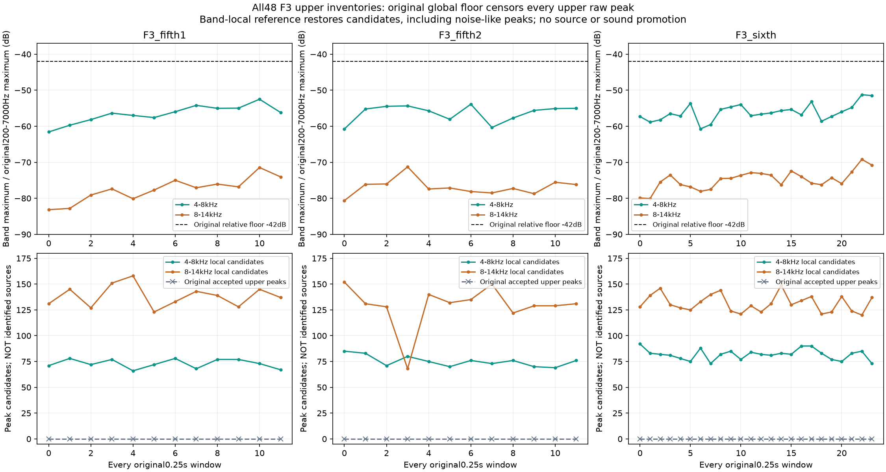
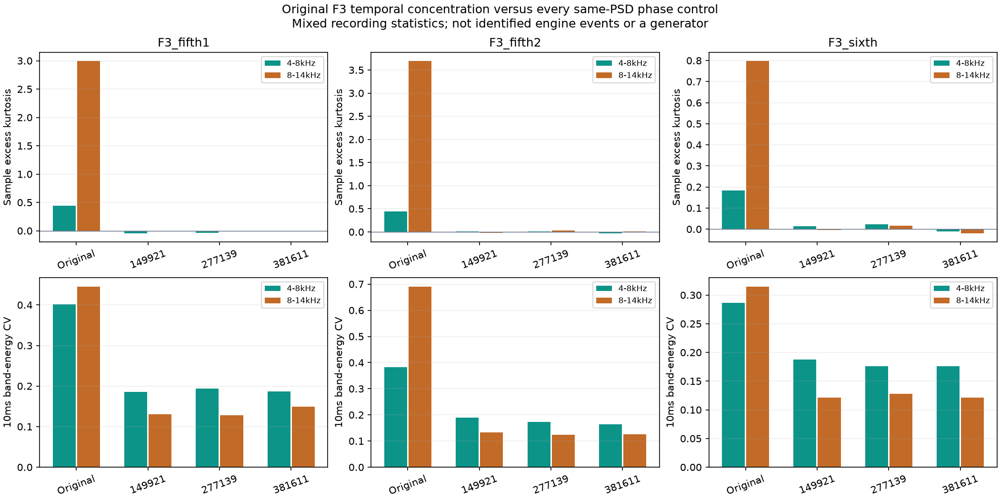

# 加速高频漏提与颗粒 V1

本轮收尾已运行的F3高频调查，**没有改怠速、驾驶默认或导出新音色**。当前用户优先项仍是怠速听感；已完成的[怠速颗粒候选](怠速颗粒激励提取V1.md)另行试听，不能用本轮加速统计代替它的听评。

## 找到的漏提原因

复核同一批准F3录音的全部48个原生0.25秒窗，原200–7000Hz谱峰清单在4–7kHz始终为空。原因明确：以整个原域最强格为参考的−42dB功率门槛，挡掉了全部高频局部极大值。4–8kHz最大格相对原参考为−61.6至−51.2dB；8–14kHz为−83.2至−69.2dB，且7kHz以上本就在原清单范围之外。这说明旧调查漏观察，不代表录音或整个C系统没有高频。

新观察清单保持8dB突出度、6Hz间距和−42dB常数，但**改用各自频带最大格作参考**；这是新的观察架构，不是原接受规则不变。全部48窗保留3744个4–8kHz及6361个8–14kHz局部候选。它们不是10105个发动机振子。

反例同样重要：三组独立双声道高斯噪声也给出171–178个候选，单声道噪声给出305–317个；只有低音的数值尾部也有194个。局部突出度既不能识别发动机，也不能把数值空点的比值当物理精度。原清单、每个峰的多种拒绝原因与全部已知控制均独立保存。

## 高频还包含时间结构

将原窗按顺序还原三条连续F3片段，使用原生48kHz、四阶Butterworth观察带通，去掉两端各0.1秒。对照为每段三组完整频谱随机相位版本：保留完整频率格幅度及左右交叉谱，改变时间排列。它们仍来自同一录音，不是新的独立录音。

| F3片段 | 4–8kHz超额峰度 | 8–14kHz超额峰度 | 10ms能量CV，低／高带 |
|---|---:|---:|---:|
| 第一段5挡 | 0.445 | 2.993 | 0.401／0.445 |
| 第二段5挡 | 0.445 | 3.691 | 0.383／0.690 |
| 6挡 | 0.184 | 0.797 | 0.286／0.314 |

全部九组相位对照的超额峰度约−0.045至0.027。原声的细节更集中，仅匹配平均频谱会漏掉这部分时间特征。但道路、风、麦克风、编解码与整体非平稳变化都可能参与，不能直接命名为燃烧或机械摩擦。4–8kHz左右归一化交叉幅度约0.403–0.691，8–14kHz约0.237–0.525；这是录音左右关系，不是汽缸列或物理位置。

## 工程结论与留痕

下一步加速声源研究应区分持续可预测的上频段谱线、有关联及非高斯分布的细节激励、录音影响；不能把局部峰全堆成独立OSC云，或直接挪用F2怠速的稀疏参数。F2尾排与F3车内仍各自建模。原共同相位资格36／全部17／完整33／逐线14k／原E仍未豁免，本轮没有建立实际RPM、负载或多发动机音色能力。

`tools/accel_upper_inventory_v1/observe.py`负责清单与拒绝原因，`temporal.py`负责时间观察，`checks.py`负责已知反例；入口、独立审计、绘图、打包各自独立。全部48窗与12已知输入的谱功率、峰、门槛、左右描述独立核对通过；已知波形另行重建通过。另有全部12个时间观察的独立滤波／矩／相位谱核对，最大滤波误差1.02e−15FS、矩误差1.46e−13。两张完整图已目视。

612份C/H、67份旧声音配置、行驶35%认可配方、怠速候选、旧播放器与take均保持。没有新音频、C配置、额外下载或重复旧61项驾驶测试。全部证据、精确执行源码、输入身份与三个独立核对报告冻结到`E:/VehicleSoundLab/baselines/accel_upper_inventory_v1`。
