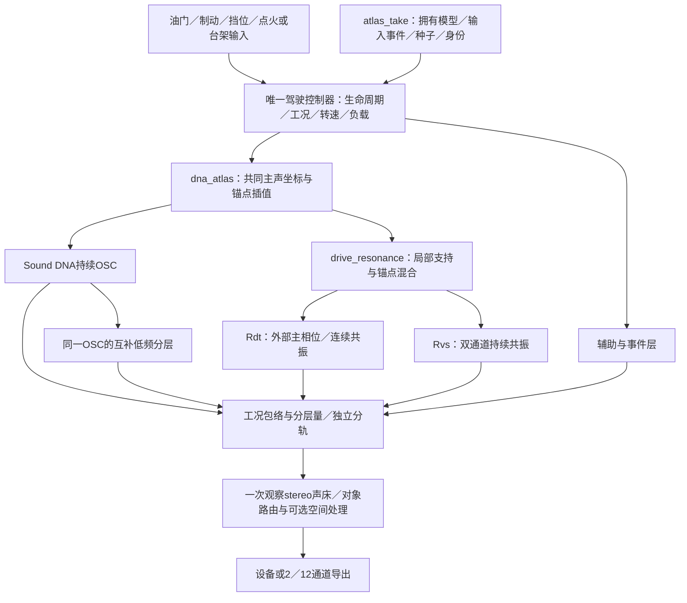

# 双声道细节统一驾驶 V1

2026-11-12。已有双声道细节核接入**同一个驾驶器、DNA声源、原生监听和自包含行程**。没有重新拟合音色；热怠速、中低转带载、同RPM负载声纹仍未标定。行驶35%完整替换配方继续在独立完整声源监听中保留。

## 使用

运行`Launch-Stereo-Drive-Study.cmd`，或构建后运行：

```powershell
./build-stereo-drive-v1/bin/Release/VslAtlasMonitor.exe --stereo-resonant-study
```

默认停止、未点火、连续细节0%、房间0。先开始监听再点火；“连续共振细节”调整独立分轨，模拟驾驶使用油门／制动／挡位，台架设置转速。录制／保存／载入回放沿用原功能。研究入口锁定A启动趋稳车内语境；原车外研究入口保留。

仍使用A38.48–39.51秒启动后车内稳定段的原DNA和双声道参数。沿用该语境已有`base_hz / 850`工程映射，**不是实测热怠速RPM**。局部支持外缘0.9–1.1、内缘0.96–1.04保持；升转离开范围后细节淡出，不向全转速外推。主DNA继续变调，但端点声线不能当作已拟合的加速声线。

## 模块链



| C模块 | 本轮职责 |
|---|---|
| `drive_resonance/bank.*` | 每锚点Rdt或Rvs类型、拥有参数与稳定证书；NULL留空；非实时堆暂存事务构造 |
| `drive_resonance/voice.*` | Rdt保持旧seed／预热相位；Rvs复用原核；共享主DNA锚点／局部支持与量平滑，静音继续推进 |
| `stereo_resonance/*` | 原2×2 VAR／新随机激励／SOS核，字节保持，无私有RPM或新增周期调制 |
| `atlas_take_io/codec.c` | schema7存核类型、有效系数、创新根、SOS与证书；控制仍28项 |
| `atlas_take/assets.*` | 原资产拷贝拥有扩展库，回放无外部模型依赖 |
| `atlas_monitor_v1/ui.c` | 同一滑条／驾驶／录放，研究语境锁定 |
| `drive_resonance_v1/device.c` | 原设备宿主增加`--stereo`，可与`--pedals`组合 |
| `stereo_drive_v1/checks.c` | 混合核／缺口／直接核oracle／零路径／拥有参数与2／12一致 |

音频回调没有新增分配、加载或文件IO；大参数库事务暂存移到非实时堆，避免Windows栈溢出。复用一个共振细节通道和量跟随器，Rvs内部量固定1。没有加入房间处理；车内录音的座舱／话筒传递仍可能嵌在参数中，不能声称已物理剥离。

## 实际验证

53项CTest通过。原529份C/H中519份保持，10份具体适配，新增1份契约，共530份。所有DNA与拟合参数保持；84条旧WAV和3条控制CSV逐字节一致。混合核类型、缺锚点、稳定证书拒绝、事务失败、直接核输出、静音继续推进和零量旁路均已核查。

| 实际静音设备流程 | 帧数 | 录／放最大块耗时 |
|---|---:|---:|
| 原Rdt台架 | 144123 | 6.34／5.60ms |
| 双声道台架 | 144123 | 4.49／4.51ms |
| 双声道踏板驾驶 | 768123 | 5.27／5.08ms |

三流程录／放的队列空和处理预算超限均0。保存／加载后销毁所有外部模型再设备回放，并检查取消；离线重放、分轨、2／12前L/R及源哈希一致。支持函数独立核对最大误差2.23e−16。12通道其余10路为0，保留接口，不代表实测环绕／高度或实体7.1.4验收。

踏板流程中工程IDLE32160帧全部有局部支持；PULL224880帧支持为0。**新车内研究映射在工程怠速处有支持，不代表原车外怠速或真实带载加速已经做好。** 本次短设备运行和自身控件检查也不代表长时／人工操作／听感验收。

原schema6播放器、窗口和实际设备行程保存在`references/analysis/stereo_drive_v1/before1`；新旧播放器严格互拒，旧文件不会静默换算法。严格构建身份加入双声道实时源码。

所有尝试保留：`verify1`两处测试失败（旧格式头恢复值、新测试早于接火结束）；修复后`verify2`的53项／零路径／旧Rdt设备通过，但独立脚本漏算支持度平方；`verify3`校验源码／构建不变后复用已完成证据并完成设备／UI检查。截图又发现研究音色被误标为行程音色，`ui_fix1`只修复该下拉框映射并新增断言；实际DSP／设备二进制一致，复用53项及设备证明，仅重跑两种研究窗口控件／截图。详细绑定见[摘要](stereo_drive_v1_summary.json)。

## 素材诊断与剩余工作

600–850Hz缺口另做无损左右基变换诊断，两个留出方向的形状改善约54.7%／74.8%，但第二半录音的必要特征值条件失败：无损旋转不足以满足两半的可加预算。没有导出修正音频或自动压低DNA，见`stereo_joint_v1/analysis1/report.json`。

D32–59秒检查14帧／两张图：32.032–52.052秒所见后轮仍旋转，随后片尾，未建立稳定怠速证据。40.040秒蓝色尾焰仅作画面观察，不据此设定回火／踏板／喷油；读数单位仍未确认。见[dyno_tail_v1_annotations.json](dyno_tail_v1_annotations.json)。

下一步补明确的车外怠速、中低转带载、相同转速不同负载的独立证据与参数，随后沿此接口接入；行驶35%保持，原低转听评不重复提问。核类型扩展和参数更换能力不等于已经验证多款发动机。

构建`handoff`后运行`tools/verify_stereo_drive_v1.py`；`--reuse`仅用于源码／构建一致的证据脚本修正。UI补充核查、发布、冻结分别见`verify_stereo_drive_ui_v1.py`、`finalize_stereo_drive_v1.py`、`freeze_stereo_drive_v1.py`。
