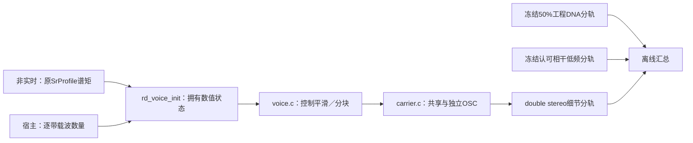

# 可变载波密度 V1

2026-11-12。新增独立 C 模块，验证上轮残差云的高频载波过疏问题。**64条带来主要谱线分散变化，128至256条趋于平缓；密度增加也改变拍频，尚不能判断自然度更好。** 保留认可DNA／相干低频，不接驾驶默认。

## 方法与 C 边界

- `modules/residual_dense/carrier.*`负责数量校验、选频、相位推进与L/R复相关；`voice.*`负责拥有状态和控制跟随。继续使用旧 `SrProfile` 文件／谱矩契约和 `SrOscillator` 类型，不扩大旧结构或改变旧常量。模块的逐带数量支持8–256，独立宿主采用按带宽增长的规则。
- `experiments/residual_dense_v1/probe.c`只做模型／WAV I/O、选择旧核或新核、计时。`checks.c`验证兼容与运行契约。没有新增UI、驾驶控制器、空间渲染或行程格式。
- 选频分层、随机数、64帧调谐、1024帧归一化及18ms参数跟随与旧核相同。所有频带设32时，四种子／变动控制下的样本和活动载波状态精确兼容。
- 每档固定上轮50%高频工程DNA、同一残差谱矩和已认可LF；**不重新拟合、不逐密度归一化**。密度变化会改变PRNG使用位置和固定频率集合，同seed不代表逐载波配对的独立物理试验。32／64／128／256用8121907、23117、61927三个seed，DNA／LF仍为48271。

八带数量依次为：

| 最高带共享数 | 各带共享数 | 总分配OSC |
|---:|---|---:|
| 32 | 32,32,32,32,32,32,32,32 | 512 |
| 64 | 32,32,32,32,32,32,39,64 | 590 |
| 128 | 32,32,32,39,52,64,77,128 | 912 |
| 256 | 39,52,64,77,103,128,154,256 | 1746 |

每条共享线另分配一条独立右声道支路。A参考近双mono，独立支路能量近零；总分配数不能当有效每声道载波数。所有密度的 `RdVoice` 都占524352字节，由调用者在音频线程外预分配；当前实现尚未优化为按用量存储。

## 结果与拍频

同上轮16周期Hann、每谐波邻域可移动3bin支持、6–8kHz左观察声道：

| 最高带共享数 | 三seed集中度范围 | 6–8kHz细节层功率包络CV |
|---:|---:|---:|
| 32 | 0.653–0.678 | 0.013–0.014 |
| 64 | 0.549–0.560 | 0.081–0.088 |
| 128 | 0.539–0.546 | 0.115–0.124 |
| 256 | 0.537–0.541 | 0.133–0.137 |

固定参考集中度约0.406；此数值仅描述谱线结构，**不是噪声比例／真实度评分**。保留的50%工程谐波限制了密度试验的结果，继续翻倍载波并未让整体结构等同录音。8／16周期与3／5bin结果均在原始报告中。

本轮没有额外AM。密集固定OSC本身也产生带内起伏：细节独奏最高带主包络峰从原32条的约31–34Hz，变为64条约26–31Hz、128条约14–16Hz、256条约7–15Hz。测量采用2048帧STFT、256帧hop、线性去趋势、0.5–40Hz峰值；窗平滑和包络抽取也会影响读数，低CV时的大峰值占比不表示强颤动。不能把这些峰叫作真实燃烧频率。

已知固定音／双音／显式AM控制通过：独立时域窗平方能量得到的CV与STFT结果最大差1.77e−12，直接三角和复核调制峰占比。双音没有显式AM仍产生包络，证明仅凭CV／峰值不能识别声源AM。最终是否有可闻颤动仍需试听。

## 性能与验证

30次交替运行包括旧核、四种新密度、240／512帧块、三种顺序；每次5秒，排除首1秒，只计process，不写WAV。相对同轮旧核的处理总时长中位比：

| 最高带共享数 | 240帧 | 512帧 |
|---:|---:|---:|
| 32 | 1.004× | 1.012× |
| 64 | 1.166× | 1.159× |
| 128 | 1.848× | 1.841× |
| 256 | 3.598× | 3.607× |

隔离声源没有块预算超时，256条的最大单块240帧1.62ms／512帧2.51ms；不含驾驶、DNA、空间、设备与调度，不是完整实时资格。已有A驾驶5ms超时问题仍在。

既有统一构建**40项CTest通过**；独立新构建**1项CTest通过**，根构建没有自动增加到41项。新契约覆盖旧32输出／状态、多分块、精确mono、无效调用事务、模型拥有和静音时钟。旧436份C/H及其职责／哈希全部保留，索引新增6份，共442份。

同一已知八带stereo模型在四密度下，独立直接OSC与C前2048帧最大误差2.98e−8满幅，16秒功率误差至多0.311dB／复相关误差0.00256。12条实际混音重新读盘后，最大功率误差0.248dB／复相关误差3.57e−8，均过预先登记门槛。三种子32条FLOAT细节及混音与上轮冻结样本精确相同。原认可DNA／LF、旧模块、默认模型、驾驶和严格行程播放器未替换。

## 交接与下一步

试听[载波密度对照V1](http://127.0.0.1:8789/research/载波密度对照V1.html)含认可基准、四档完整声音和四档细节独奏，共9条8秒PCM24，统一0.5增益／相同淡入淡出，预定首seed而非挑最好者。HTTP字节和FFmpeg解码通过，最大峰0.541满幅；浏览器交互、新听评及原生设备集成未验证。既有试听问题继续待回复，本轮不重复提问。

先判断64／128相对32的自然度、沙感及持续颤动，再决定是否需要一个可选实时适配器。没有听感收益时，先分析固定选频结构／剩余谐波和包络采样影响，不把256直接设为默认，也不盲目加深AM。车型／视角、驾驶状态映射与物理对象仍是不同边界；本轮仅A固定移动尾排，不证明其他发动机、宽RPM负载或7.1.4。

构建与使用见[模块说明](../modules/residual_dense/README.md)和[独立宿主](../experiments/residual_dense_v1/README.md)。摘要／来源哈希：[residual_dense_v1_summary.json](residual_dense_v1_summary.json)。原始证据在 `E:/VehicleSoundLab/references/analysis/residual_dense_v1`，冻结至 `E:/VehicleSoundLab/baselines/residual_dense_v1`，包含实际源码、二进制、所有命令、谱统计、计时、试听和交接源码压缩包。
