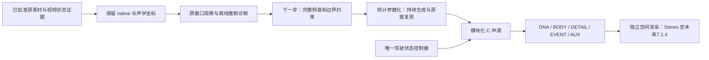

# 同窗逆问题与边界诊断 V1

本阶段实现并核查“复包络节点 → 实 OSC → 原 Hann 观察器”的正则化反演，保存原始、预条件和继续校正三个轮次。它用于判断现有声纹统计遗漏了什么，**不是新音色，也不是把拟合轨迹当成可持续声源**。六份输入来自同一台 V10 的两次 F3 升速、各取早／中／晚位置，不是六种发动机。

上一轮 ADI V10 仅完成资源复估，本阶段回到源信号表示：现有 C、82 份音色参数、认可 moving35、唯一驾驶器、owned／录放、房间和待听候选均保持。

## 固定的数学问题

每个阶次、左右声道都有复包络节点；节点线性插值，乘各自 OSC 后求和成为实波形。节点覆盖原整数采样跨度，间隔约 256 个归一化采样；每周期 1024 点。观察器保持原 Hann4096、hop256、全部 288 阶次和全局相位解调。

令 `s` 为各阶次原观察系数的双声道联合 RMS，最低为最大阶次 RMS 的 `1e-6`，求解：

```text
J(q) = ||F(s*q)/s - y/s||²
       + 0.001 ||D2 q||²
       + 0.000001 ||q||²
```

`D2` 使用真实非均匀节点间距及参考步长 256。所有源共享同一正则化，不逐源挑参。正 ridge 使这个指定的数值问题唯一，不代表推断出了唯一物理发动机轨迹。实波形对应实线性算子，伴随使用复内积的实部。

保留六个频带：0–3、3–6、6–8、8–10、10–14、14–21.6 kHz。还保存六个名义载频组的完整 12×12 复 Gram、有符号交叉项、全频／时域 Parseval 和三个连续窗口分段。载频组不是物理进气／排气／摩擦声分离。

## 已实现模块

| 模块 | 职责 |
|---|---|
| `observer_forward_v1/operator.py` | 直接节点插值、OSC、原窗口观察及实伴随 |
| `observer_forward_v1/polyphase.py` | 相同模型的 FFT 等价实现；实际求解使用它 |
| `observer_forward_v1/batched.py` | 批量 FFT 对照；数值通过，当前 PC 尺寸更慢，未选用 |
| `observer_inverse_v1/regularizer.py` | 按实际距离构建曲率惩罚 |
| `observer_inverse_v1/fit.py` | 增广线性系统、原始 LSMR、原空间梯度检查 |
| `observer_inverse_v1/precondition.py` | 同一时间惩罚的 Cholesky 白化、精确列归一化 |
| `observer_inverse_v1/refinement.py` | 读取原可逆右映射，从已保存解继续校正同一目标 |
| `observer_inverse_v1/diagnostics.py` | 分组重建、原观察器统计、内部／边界波形误差 |
| `observer_inverse_v1/visibility.py` | 完整有限窗口的采样覆盖及盲区 |
| `observer_inverse_v1/audit_oracle.py` | 独立逐阶次 OSC、SciPy 观察器及目标／梯度核查 |
| `observer_inverse_v1/metrics.py` | 全部轮次描述性比较和完整退步计数 |

运行、独立审计、发布、打包宿主分开。历史执行源保留在各轮 `exact_sources`；旧计划／宿主与当前文件不同，按历史快照核查，不能让后续修改覆盖原执行身份。

## 数值控制与实际素材

等价 FFT 的八项已知控制、三项显式稠密正则化解，以及可逆预条件的独立核查通过。继续校正另外测试三组目标各自的零／非零初值，共六项；独立标量 OSC／直接 DFT 组装矩阵，对照最终解及校正恒等式。

原始和预条件轮次均对全部六源运行 4000 步，均以迭代上限退出。继续校正保留原解和原右映射，每源最多三阶段、每阶段 4000 步；全部检查点及未通过结果保留。目标函数、全部阶次、节点、尺度和验收标准没有变化。

验收仍要求 LSMR stop 属于 1／2／4／5，且原空间相对梯度小于 `2e-7`。部分继续校正结果虽达到梯度门槛，但 stop 仍是 7，不能把它标成完整收敛。完整数值和所有改善／退步以同目录 summary 及本地 `review1` 为准。

最终三轮全部结束：每源继续校正三阶段、累计 16000 步，保留 18 个校正检查点。第三轮五源达到原空间梯度门槛，一源为 `3.346e-7`；六源 stop 均为 7，三轮完整收敛数均为 0。独立审计确认这个未通过状态，没有放宽门槛。

| 六源平均描述性误差 | 直接插值观察系数 | 原始4000步 | 预条件4000步 | 继续校正后 |
|---|---:|---:|---:|---:|
| 整段波形 NRMSE | 0.43140 | 0.28030 | 0.35706 | 0.34731 |
| 内部波形 NRMSE | 0.37718 | 0.18849 | 0.19701 | 0.19134 |
| 谐波点功率 MAE，dB | 1.04614 | 0.00158 | 0.00077 | 0.00076 |
| 完整频带功率 MAE，dB | 3.53277 | 0.75324 | 0.80621 | 0.80155 |
| 完整频带左右复相干误差 | 0.04545 | 0.02236 | 0.02133 | 0.02129 |

更接近原优化目标并没有单调改善原波形：原始轮次的整段波形误差仍比后两轮低。继续校正相对插值基线有 1／6 整段、7／36 左右频带及 24／72 功率 CV 坐标退步。14–21.6 kHz 平均功率仍有约 3 dB 误差，功率起伏也没有因近零谐波点误差而完整恢复。不能把这些诊断轨迹推广为新音色；下一步需要改善数据约束本身。

预条件轮次相对于直接插值观察系数，六源内部波形 NRMSE 从约 `0.31–0.47` 降至 `0.14–0.24`，但边缘可显著恶化；第二次升速晚段的整段误差反而更大。它只说明本次样本内推断的局部变化，不能证明持续声、音色自然度或跨工况泛化。

逐频带补查不再用全局最强值掩盖弱带：原始功率按各声道均值、复交叉量按双声道均值几何平均、协方差及滞后协方差按均值外积归一化，统一底限 `1e-24`。已知控制证明：一个弱带的 2% 错误可通过旧全局尺度，却会被新尺度检出。真实记录的逐带数值检查通过不等于听感通过。

三轮共 54 份源／重建记录的弱带核查通过；原始和后两轮共 36 份重建、17280 个频带 Gram 矩阵的独立核查通过。24 个不重复发布结果、18 个最终求解记录、全部汇总和改善／退步计数另行从原始数组复核，两张科学图逐张目视确认。所有结果均为样本内、归一化坐标诊断。

## 明确的窗口盲区

原分析只取完整窗口，不填充。实际源长对应的末尾未覆盖采样数为：

| F3 源 | 帧数 | 完整观察窗数 | 末尾未覆盖样本 |
|---|---:|---:|---:|
| 第一次，早 | 14335 | 40 | 255 |
| 第一次，中 | 14338 | 41 | 2 |
| 第一次，晚 | 14334 | 40 | 254 |
| 第二次，早 | 14078 | 39 | 254 |
| 第二次，中 | 14080 | 40 | 0 |
| 第二次，晚 | 14335 | 40 | 255 |

此外第一个采样位于 Hann 的零点。三个已知脉冲控制分别放在起点、未覆盖尾部和内部，前两者在**所有 DFT 频点**上都为零，内部则与闭式响应相符。独立标量 Hann 覆盖和逐样本误差预算再次核查。

在预条件轮次，第一次早／晚和第二次晚段，未覆盖位置分别贡献整段波形误差能量约 40.2%／42.6%／33.4%。这是这些明确位置的误差预算，不表示其他误差都来自边界，也不是对实际发动机声的物理因果分解。模型和正则化会对这些位置作推断，但观察数据本身没有直接约束。

此反例针对有限窗口对**波形**的可见性；不推翻带 ridge 的指定节点优化问题唯一性，也没有证明其他所有特征完全不可识别。

## 后续如何接回产品



下一步先做已知控制：加入显式的完整频谱／端点观测，区分“改进可见范围”与“改变先验”，再对全部冻结源比较，继续使用原观察器作统一回测口径。不能仅再增加迭代，或把稀疏谐波系数误差低当成完整声音被保留。

可检验的方案是覆盖归一化的完整 STFT：显式处理有限片段边缘，保留所有频点，通过 Parseval 对照波形误差，先验证端点脉冲、相邻阶次、非对称左右、静音及伴随。它是待验证的新数据项，不属于本阶段原目标的等价优化；不能悄悄更改旧结果或验收口径。

之后才从可解释的推断结果提取联合幅相、左右关系和时间统计，生成无原片段时间线的新持续声源，验证原生 48 kHz／带限／调参／跨锚点，再接同一个 C 驾驶系统。现在尚未达到这些条件。本阶段没有新听评、素材下载、目标 DSP 移植或推送；多发动机、全驾驶状态和实际 7.1.4 目标继续保留。

录音中的左右关系包含收音位置和传播影响；保留其统计不等于提取了物理声源指向性，也不代表已从录音中剥离房间／车厢传递。产品的独立空间渲染合同继续保留，不能把录音自身的宽度直接当作未来 7.1.4 布局。
