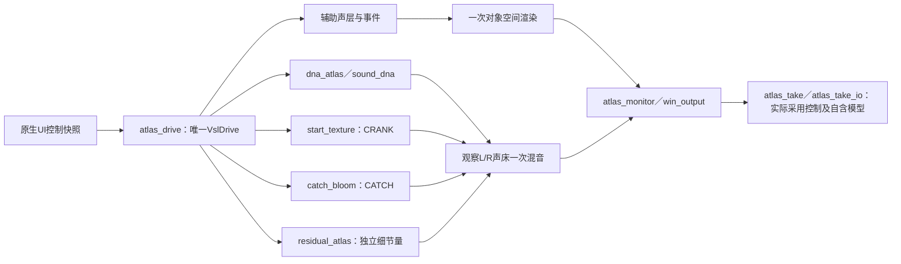

# 启动细节原生接入 V1

2026-11-12。**统一C系统能运行，完整多状态音色尚未验收。** 同A启动车内DNA、启动纹理、接火低频及可选细节已接到同一驾驶控制器、原生监听和行程录放。入口 [Launch-Startup-Detail-Study.cmd](../Launch-Startup-Detail-Study.cmd)，独立构建，默认停止／点火关闭；启动50%、接火50%、细节0%，可逐项对照。

## 其他状态有什么可听

| 状态 | 已批准参考 | 当前可比较内容与边界 |
|---|---|---|
| 启动／接火 | A车内33–40秒 | [启动前段](http://127.0.0.1:8789/research/启动机械纹理V1.html)、[接火低频](http://127.0.0.1:8789/research/接火低频统一驾驶V1.html)、[趋稳DNA及细节](http://127.0.0.1:8789/research/启动车内细节V1.html)已有分层对照；快速接火音高、真实时长与谱形演化未完整还原。 |
| 驻车低转／补油 | A车外208–211、238–248秒 | [局部录音／C对照](http://127.0.0.1:8789/research/驻车状态局部对照V1.html)包含低转与降转DNA；近似声学音高，未标定真实RPM／踏板，不是完整同动作复刻。 |
| 收油／减速 | E车内52–54.4秒，B另有候选 | 有参考与控制功能回放，专项状态声纹拟合未完成。 |
| 换挡 | E车内82–94秒、D台架20–32秒 | 有可见挡位变化与声学分析，自动／手动换挡功能已实现；专项切扭／恢复音色未完成验收。 |
| 进气／排气／机械 | A机舱270–277秒等混合录音 | 有工程辅助层，独立物理源尚未分离，不能将混合录音称为单独进气样本。 |
| 熄火／独立回火 | 暂无确认干净的专项参考 | 有控制及工程事件，未完成素材驱动音色对照。 |

[状态素材与功能回放总页](http://127.0.0.1:8789/research/状态素材与系统回放V1.html)保留六段实录和两条C功能回放。各页录音语境与动作有差异，应按页内标注比较；已认可的是固定A移动尾排DNA＋相干低频，新的启动及驻车候选仍待听评。

## 统一链和C边界

新增宿主配方复用旧DSP，不新增控制器或声源算法。`models.c`的非实时 `am_models_load_variant` 只为A趋稳语境装入已冻结12带细节模型，载入失败不修改原资产；UI负责控件／音色切换，`audio.c`仍负责音频线程，行程仍独立持有全部模型。600–850Hz维持原候选的零新增量。没有将此单锚点模型当作宽RPM音色标定。

原469份C/H中464份字节相同；5份宿主／验证文件修改，3份接入检查文件新增，当前472份。原`src/`、`modules/`及已认可模型保持逐字节一致，职责索引见 [C文件索引](../handoff/C文件索引.csv)。旧schema5播放器和源码已保存在本地 `startup_detail_host_v1/before`。

## 已核对的功能

- 独立构建46项CTest通过；普通模型与新变体、失败载入事务及12带资产拥有检查通过。
- 本程序原生控件消息自检：原接火模式12项、新细节模式14项通过；细节50／100%、音色来回切换、无模型时禁用及驾驶／台架切换绑定正确。未声称完成鼠标操作、对话框或目视验收。
- 实际stereo设备、48kHz／512帧、静音测试四场景：点火／台架6秒，驾驶／换挡／收油／制动／停火12秒，以及手动停止、模型重启；队列断流及块预算超时均为0，最大处理6.04ms。实际采用控制重算与float输出逐样本相同。
- 144123帧行程经设备记录、保存、载入和回放；录放hash均为 `f64c649328dc2dae`。取消与手动停止检查通过；旧schema5行程输出／声源hash保持。新行程2／12通道离线源hash相同，未改变渲染身份或协议。

这是短时功能证据；长期稳定性、完整UI交互、多发动机音色和实际12扬声器仍未验证。设备高转动作验证了调用链，不能证明单一启动模型在高转时音色真实。声床只保留FL／FR，未凭空复制至LFE／环绕／高度。

## 复现和留痕

`prepare_startup_detail_host_v1.py`保留旧源／播放器；`build_startup_detail_host_v1.py`记录实际源码、构建和46项测试；`verify_startup_detail_host_v1.py`记录控件、设备及录放；`finalize_startup_detail_host_v1.py`核对清单并冻结。`prepare_failure1`保留首次前置条件失败，成功执行在`before`；没有删除失败尝试。

本地证据 `E:/VehicleSoundLab/references/analysis/startup_detail_host_v1`，冻结 `E:/VehicleSoundLab/baselines/startup_detail_host_v1`，机器摘要 [startup_detail_host_v1_summary.json](startup_detail_host_v1_summary.json)。原声音试听页保留，新接入没有音色晋级；后续重点是完整非行驶状态的素材／合成对照与听评。

五张状态／分层试听页和32条音频已重新核对HTTP内容与本地字节一致，记录于`review_links1/report.json`；这只确认链接可取，不代表已操作网页或完成听评。
