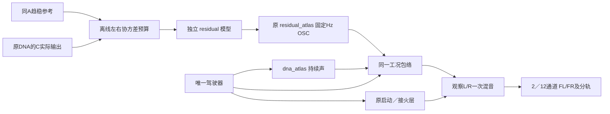

# 启动车内细节 V1

2026-11-12。从同A启动车内趋稳段补充独立OSC细节候选，[8条试听](http://127.0.0.1:8789/research/启动车内细节V1.html)包含录音短参考、持续DNA原版／50%／100%、细节独奏和统一驾驶链两次启停。**尚未替换原生窗口或获得音色听评。**

## 素材及能量边界

复用批准A的38.48–39.51秒及已校验共同慢坐标，绑定`startup_catch_v1`冻结清单中的固定音高参考、原C持续声和模型。原raw／float主文件仍经批准目录读入并校验哈希。没有新下载、降噪、全DNA增益或系数时间轴。

原DNA的300Hz以上训练频带少约2–5dB。本轮不是把差额全部叫噪声：对300–8000Hz的12带分别计算2×2左右谱协方差，要求 `目标 − 原DNA` 为半正定，才允许用独立声源补入。保留复交叉项，不独立调整左右总音量，也不把L/R解释成缸列。

11带允许独立叠加；600–850Hz虽然左右各有正功率差，矩阵最小特征值仍为目标总功率的−0.0201，因此该带新增量为0。没有通过降低原DNA或裁掉交叉项来强行补满。允许带仅去除数值舍入造成的负特征值；这不是物理声源分离。

短参考前后半段各频带差0.3–3.9dB，独立可加带数也由10变11。单段均值模型不能据此恢复时间演化，分半结果只作局部敏感度记录，不是独立录音／跨工况验证。

## 模块与运行方式

`tools/startup_detail_v1/budget.py`负责可加预算，`controls.py`负责已知矩阵及显式DFT核对；不是实时库。模型沿用`SrProfile`，12带、每带32个共享／32个独立正弦；没有新FM、随机相位调制或PCM循环。固定载波自身可能产生拍频，数值验证不代表消除了听感问题。

新增`experiments/startup_detail_v1/probe.c`只加载模型、配置原`atlas_drive`并导出分轨／CSV；**原468份C/H逐字节及职责保持，当前469份。** 原声源／驾驶／空间／UI／行程源码均不改，也没有为了叠层另开驾驶控制器。独立单锚点`RaBank`由当前声学根音选谱形，载波不随RPM整体变调，不能据此宣称宽转速细节已标定。

`starts`模式两次启停、六生命周期，共6秒；启动层50%、接火低频50%、主增益0.25，细节量独立0／50／100%。`hold`模式保留同一驾驶器启动后持续至10秒，后8秒用于声源统计。原始DNA、细节raw、包络后细节及完整混音均独立保存。12通道只加前置L/R，不复制到LFE／环绕／高度。

## 实际C验证

七组已知控制通过：六个可加／不可加／复相关矩阵及相位旋转不变性，另有解析stereo纯音和显式DFT／Welch能量、共轭方向核对。

三组seed均使用同一个模型，没有按每条输出补增益。在11个允许叠加频带内，实际C raw声源叠加的训练统计为：

| seed | 原平均绝对功率偏差 | 新平均偏差 | 新最大单带／声道偏差 | 最大复相关误差 |
|---|---:|---:|---:|---:|
| 48271 | 3.97dB | 0.077dB | 0.249dB | 0.0304 |
| 62017 | 4.11dB | 0.120dB | 0.470dB | 0.0369 |
| 91009 | 3.98dB | 0.125dB | 0.724dB | 0.0297 |

这些是训练段的平均统计，不是自然度评分；600–850Hz不计入该改善，保留其缺口。原C与参考约1秒／8秒长度不同，不能把短窗随机差异都解释成真实状态差异。

六次统一链导出为2／12×0／50／100%。量0与上一轮接火50%场景的mix／raw／DNA／启动／接火／驾驶CSV六文件字节相同；不同细节量的原DNA、启动、接火、raw细节和驾驶轨迹字节相同。FL/FR跨布局相同、其余10通道为0；独立分轨一次相加误差最大7.35e−9满幅。没有复用旧45项CTest作本轮新通过宣称，因为原库未改；没有新设备、原生UI、行程协议或实际12扬声器验收。

试听共同0.5增益、5ms首尾淡化，无逐条响度补偿、EQ、压缩或限幅；持续声按源单位，启停混音另有0.25主增益。8条音频均经FFmpeg解码及HTTP字节核对；未声称已操作网页或听评通过。已有接火问题继续等待原反馈，不重复提问。

## 复现与留痕

`fit_startup_detail_v1.py`生成预算及模型；`render_startup_detail_v1.py`独立构建探针、导出并检查；`review_startup_detail_v1.py`发布对照；`finalize_startup_detail_v1.py`核对身份、登记模型和冻结。脚本统一`--workspace E:/VehicleSoundLab`，每次`--out`须新目录。渲染脚本绑定上一阶段冻结索引，加入新探针后仍可复现。

证据`E:/VehicleSoundLab/references/analysis/startup_detail_v1`：`fit1`、`render1`、`render2`、`render3`、`review1`保留实际执行源。`render1`有宿主有符号比较警告，`render2`修正后音频／CSV全部字节相同；`render3`改用冻结源索引，确认清单更新不破坏复现，输出再次一致。未删除早期执行。

模型`voices/startup_detail_v1`为同A启动候选，未接原生默认；摘要`startup_detail_v1_summary.json`，冻结`baselines/startup_detail_v1`。后续需分别判断平均细节听感、拍频及时间演化，再决定可选实时接入。快速接火音高、不可加频带、完整驻车／收油／换挡、不同发动机、长期和实际7.1.4继续完成，完整目标保持未完成。
