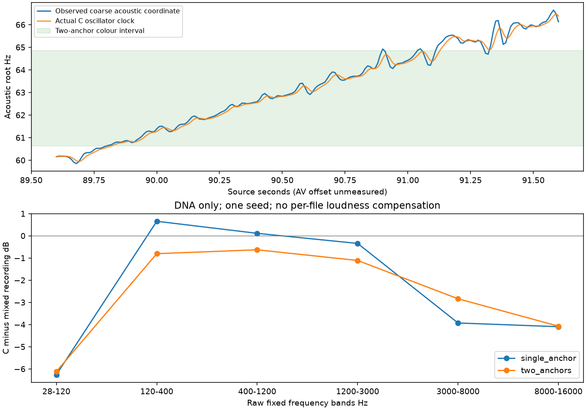

# 固定挡位加速：当前 C 声源核查

2026-11-12。**当前系统能连续升转、插值声线，但加速音色仍未标定完成。** 本轮生成的是现有C的诊断对照，没有新增优化配方。驻车低转候选仍待原先那一条听评；行驶音色固定在用户保留的离线35%。

[同一播放器：原录音／单锚点／双锚点](http://127.0.0.1:8789/references/analysis/acceleration_passage_v1/review1/index.html)。三条完整声音及三个分频，共12文件；只有一个播放器。

## 动作与转速依据

重新目视E原PTS仪表接触表04／05／06。89.00–92.75秒共16帧均显示第5挡，车速从194增至235km/h，转速条上升；表速不作为真实车速／加速度遥测。此前4→5／5→6显示边界为88.75–89.00／92.75–93.25秒，声学诊断标记88.45／92.85秒不能当作离合或切扭时间。

选择音频89.6–91.6秒。若共同“显示时刻−音频时刻”在工程假设±0.6秒内，整个音频段仍落在所观察的同挡位区间；这只是敏感性边界，不是已测AV偏移或置信区间。踏板、扭矩负载及喷油状态仍未知。

复用冻结的粗声学路径60.157→66.129Hz，201行中132行另有至少两条谱线支持；没有重新拟合相位、补线或将其称为真实曲轴时钟。**原phase_clock_v1联合资格仍未通过。** E现有1/120工程映射对应名义约7200→7900RPM，不能当作精确实测，也不套用至A／B／D。

## 同一算法实际做了什么

复用`experiments/state_passage_v1`宿主和当前`dna_atlas`／`sound_dna` C库。共同声学Hz驱动一组OSC，18ms跟随持续推进；双锚点按根音插值谐波幅度与平均相位，统计幅度生成新的变化，不播放录音。此宿主只诊断声源，没有替换统一驾驶器的转速／负载输入。

两档E车内参数来自89.3–90.3／90.6–91.6秒，与本轮区间重叠，**不是独立验证素材**。色彩范围仅60.634–64.847Hz；双锚点401条有效遥测中65.3%位于此范围，其余使用端点声线，音高仍继续变化。这个比例不是全车转速覆盖率。单锚点对照使用同一轨迹，只保留低锚点声线。

未加入A车外低频、行驶35%细节、其他残差、源响度轨迹或额外房间模型；原录音的车内／话筒传递仍嵌在拟合参数中。录音为完整车内混合声，C为DNA单层。统一0.5增益与5ms淡化，没有逐条响度补偿；不能把两者全部差值指定为某个物理层的增益。

| 双锚点相对原录音的平均功率 | 左／右 dB |
|---|---:|
| 28–120Hz | −6.23／−6.01 |
| 120–400Hz | −0.87／−0.74 |
| 400–1200Hz | −0.58／−0.68 |
| 1.2–3kHz | −1.24／−0.99 |
| 3–8kHz | −2.69／−2.99 |
| 8–16kHz | −4.23／−3.92 |

低频和高频预算仍缺，起落声纹是否自然也未验收。双锚点确实改变了声线，但不能仅凭均值变近就判定更好听，或直接用EQ补齐所有差额。

## 工程边界与下一步

`tools/acceleration_passage_v1/evidence.py`绑定批准素材、冻结路径、原PTS和模型；`diagnostics.py`只量化未变换录音的宽频带预算。运行／试听／汇总／冻结各有独立入口，职责不进入实时声源。C/H的478份内容保持，未重复47项既有CTest。

本次重新构建当前C宿主；两次4秒生成均含2秒预热，实际音高跟随与独立递推误差≤1.08e−12Hz。相对输入粗路径的0.150Hz RMS差是跟随器滞后，不是实车测量精度。已知250Hz功率控制误差3.50e−7dB、独立标量FFT核对3.47e−18；12文件HTTP／FFmpeg与播放器JS语法通过。未做新设备、浏览器交互或长时运行验收。

证据`E:/VehicleSoundLab/references/analysis/acceleration_passage_v1/{run1,review1,final1,final2}`；final2另核对原冻结clock报告与验证SHA连接，不重算音频。摘要[acceleration_passage_v1_summary.json](acceleration_passage_v1_summary.json)，冻结`E:/VehicleSoundLab/baselines/acceleration_passage_v1`。

下一步先判断低转连续细节候选；加速按固定挡位补中低转及不同负载的独立声纹证据，避免继续把窄区间参数全音域拉伸。沿用同一控制器／参数化生成核，DNA、低频、连续细节、事件与空间各自维护；本轮不能据此接入新的状态音色。
