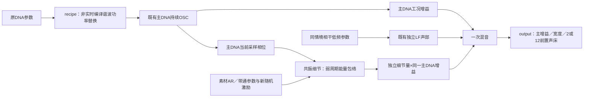

# 完整共振声源 C 接入 V1

2026-11-12。已将原DNA、同情境相干低频和连续共振细节组成一个可控C声源，验证完整混音。**未重新调音，也未接入原生监听、驾驶或行程。** 行驶35%保持原配方；两个低转候选继续等原听评，尚未确认热怠速／实车RPM。当前不是全转速／负载发动机模型。

## 新模块做了什么



`modules/resonant_source/recipe.*`按素材实际根音，将1.2–1.9kHz平滑mask作用于各谐波，mean／basis／root共同乘`sqrt(1−amount×mask)`。编译到独立模型，低阶和相关统计保持；原模型不改。原来的35%意味着谐波**功率**削减，不能误作线性幅度削减35%。

`voice.*`复用原`dna_scene`与已移植`resonant_detail`。只在非实时初始化时预热细节滤波器2秒，主DNA／LF仍从相位零点启动；预热相位从负时间推到未来源零点。进入播放后，细节每帧使用DNA实际采样相位，不另造时钟。变调控制平滑、各层增益独立；细节另乘主DNA包络，静音不冻结随机／滤波／主声状态。相位微扰保持关闭。

`output.*`独立处理一次主增益／宽度。2／12通道都保留录音观察FL/FR，另外10为0；没有把左右录音当作缸列／扬声器，也没有新增LFE、房间或沉浸式上混。未来空间处理及驾驶接口仍在声源边界之外。接口见[模块说明](../modules/resonant_source/README.md)。

## 实际验证范围

| 验证 | 结果 |
|---|---|
| 完整混音逐样本比较 | 行驶35%／低转add／低转35%，各3个seed、各8秒，共9组 |
| 完整mix对冻结离线float文件最大差 | 1.179e−7 FS以内；不是逐样本位级相等 |
| DNA原始分轨最大差 | 5.956e−8 FS以内，包含离线float保存舍入 |
| 独立LF原始分轨最大差 | 7.444e−9 FS以内 |
| 细节C对原Python双精度生成最大差 | 8.251e−13 FS以内 |
| 主声相位对独立时间坐标最大差 | 8.816e−12周期以内；不代表实车RPM精度 |
| 2／12输出 | 三配方首seed、各8秒；前置输出及全部分轨／相位精确相等，其他10通道为0 |
| C契约 | 49项通过，包括原48项及新完整配方契约 |
| 源码索引 | 原492份C/H字节不变，新增8份，现500份 |

沿用种子8121907／23117／61927、DNA／LF种子48271、主增益0.5和原固定LF校准量。没有逐条匹配响度、重新拟合或用房间掩盖差异。比较对象是已有离线配方，**不是对独立原始录音的新增自然度验收**。离线混音先将DNA／LF保存float再混合；新核保留double分轨后混音，因此完整mix按预定浮点误差界核对，不能声称WAV字节相同。

新契约另外验证已知功率mask、低阶／AR参数保持、事务失败、无细节时旧源一致、静音内部时钟持续、0.9↔1.1变调的共用相位、主DNA包络同时门控细节和一次前置路由。没有新增实际设备／回调预算、长期或实体7.1.4测试。

## 复现与留痕

```powershell
python tools/verify_resonant_source_v1.py --workspace E:/VehicleSoundLab --build E:/VehicleSoundLab-Git/build-resonant-source-v1 --out E:/VehicleSoundLab/references/analysis/resonant_source_v1/verify-new
```

输出目录须不存在，Python需本工程分析依赖。该命令自行配置／构建当前handoff、运行49项及实际混音比较。宿主命令与f64列定义见[探针说明](../experiments/resonant_source_v1/README.md)。

`verify1`已通过49项和3组行驶混音，随后因低转冻结包的路径多一层`idle_resonant_v1`而中断；只修证据路径及加入明确的构建证明复用，C算法及门槛不变。`verify2`核对未变C源码、二进制和通过的构建／测试日志，再完成全部9组／3组路由；不重复已通过C测试。`final1`更新索引与[汇总](resonant_source_v1_summary.json)。失败及各次执行源码、实际C原始输出均保存。

证据`E:/VehicleSoundLab/references/analysis/resonant_source_v1/{verify1,verify2,final1}`；冻结`E:/VehicleSoundLab/baselines/resonant_source_v1`。C原生生成的三条8秒float WAV在`verify2`，供后续宿主核对，未发新的行驶听评问题。

## 尚缺什么

现在完成的是便携完整配方，不是整个驾驶系统的接入。下一步将相同接口接原生监听及唯一驾驶器／行程，保留原版基线并验证实际采用帧控制与输出。低转自然度仍待原问题；加速仍需中低转、同RPM不同负载及动作／RPM证据。当前固定Hz共振器与0.9–1.1有限变调不能替代该声纹图谱，不将车内／车外参数互相套用。
