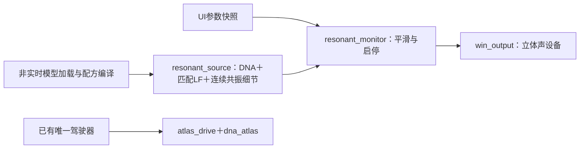

# 完整声源原生监听 V1

2026-11-12。沿用已有参数，将完整C声源接入独立监听。**怠速／带载加速音色尚未标定完成；没有把功能验证当成音色验收。**

运行根目录`Launch-Resonant-Source.cmd`。默认停止，五配方为低转原版／补细节／35%替换、行驶原版／保留35%。音高0.90–1.10、连续细节、已配相干低频、输出电平均可调。切配方先停机；不含房间模型，不播放录音循环。程序内部控件自检和窗口截图通过，人工鼠标操作尚未验证。

下方驾驶链已能识别怠速／带载升转／换挡，上方是新配方独立监听；**本次没有将它们连接，也没有新增第二套驾驶器**。旧驾驶行程协议保持。`audio`里的成功提交帧记录仅用于工程核对，不能当作正式`.vslrun`。

| 模块 | 职责 |
|---|---|
| `modules/resonant_monitor/render.*` | 声源适配、18ms主增益／宽度跟随、10ms启停、分轨；实时无I/O／分配 |
| `experiments/resonant_monitor_v1/models.*` | 拥有模型，非实时事务加载与原配方编译 |
| `audio.*` | 复用已有Windows输出；控制快照、成功提交后记录、停止后重绑 |
| `ui.c`／`ui_checks.*` | 简洁界面及程序内部控件检查／自身窗口截图 |
| `checks.c`／`verify.c` | 监听边界契约；实际静音设备与离线逐样本核对 |

没有重拟合参数、改变行驶35%或恢复被否决的共同相位微扰。低转保持原DNA低频，不强套车外行驶LF。它只是驻车低转候选，真实RPM和冷热怠速未确认。

50项CTest全部通过。原500份C/H保持字节，新增11份，共511份。四次静音设备检查：行驶／低转各144123帧，停止25088帧，重启24637帧；实际采用控制帧的离线重现逐样本完全一致，队列空和512帧预算超限均为0。本次最大生成块4.375ms，短测结果不代表长期实时保证或物理7.1.4验收。

行驶35%／低转补细节／低转35%的8秒dry输出与冻结完整C配方逐样本一致；设备抓取为静音前送出样本，不是声卡回录。程序内控件自检覆盖五配方、调参、停止、重启和关闭；两张自身窗口截图已检查。

证据：本地`references/analysis/resonant_monitor_v1/verify1`及`final1`；结论见[摘要](resonant_monitor_v1_summary.json)，完整源码与证据冻结在本地`baselines/resonant_monitor_v1`。

后续顺序：等待既有低转听评；补独立中低转／带载升转依据；再将参数族接入唯一驾驶相位及既有行程。当前固定Hz共振器和有限变调不等于全RPM×负载声纹库。
