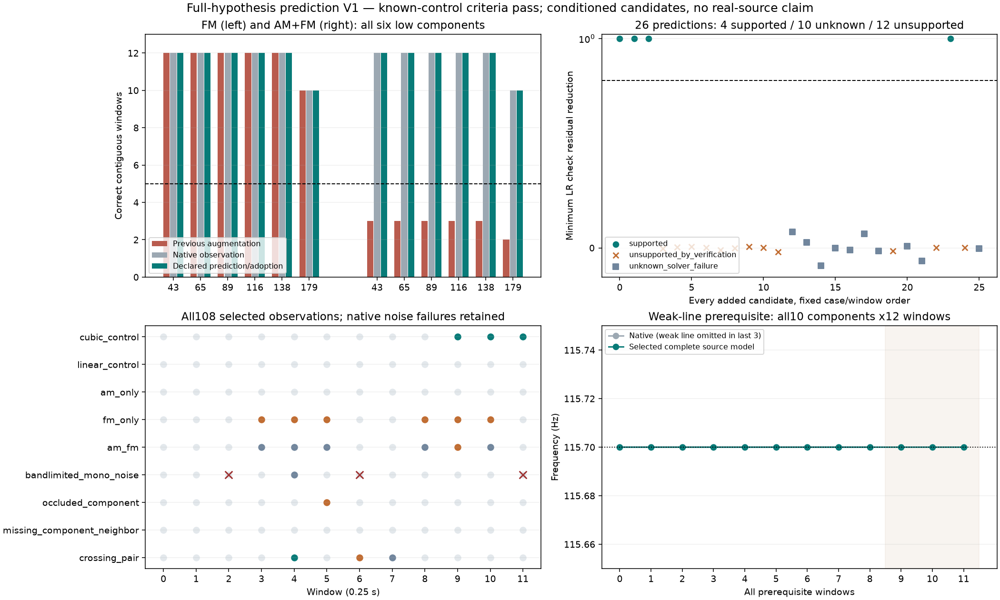

# 完整模型与保留数据预测 V1

**本轮108个已知窗通过预声明的连续性/缺失/噪声条件，尚未用于真实素材、声音或C。**这是参数提取方法的验证，不是怠速音色已改善或原共同相位资格已通过。

## 改动

上轮固定原生参数的残差检查会误拒真实弱线。本轮每个新增候选分别比较完整“有线/删除该线”模型，**两边所有剩余频率、变化率、曲率、幅度和相位均重新优化**。

训练用原0.25秒窗的前9000帧（187.5ms），所有参数固定后预测末3000帧（62.5ms），双声道分别计算加权误差；检查段不重新求幅相系数。每次仍从原观测频格/邻线变化率开始，原±2Hz/±500Hz/s/60次/容差保持，不用全窗拟合参数热启动训练模型。

原候选清单和邻窗初始已经观察过全窗及后续窗，因此这是**给定这些观察条件下的参数保留预测，不是干净独立留出、因果在线识别或独立录音检验**。固定原Hann权重乘训练/检查掩码，不重新归一。

新增声线需要同时满足完整全窗原局部/条件残差/唯一前驱检验，以及双声道检查误差改善≥0.8、训练秩/触界/相对功率条件。只有本窗**全部**新增候选都获得支持，才采用完整扩充模型；不做子集重试。

**采用规则明确改变：**扩充失败或未获支持时，原生局部观察作为原有证据保留，所有扩充尝试另存；不会把失败当不存在、不会改写失败状态或隐藏回退。未确定候选不能传播。这不保证原生模型已经正确识别物理声源。

每窗K个新增候选，最多K+2次新非线性拟合，若原生也重算则总预算上界60×(K+3)，还包含线性检验成本。不能称总算力不变或实时可用。

## 已知结果

| 情况 | 本轮结果 |
|---|---|
| 弱115.7Hz被邻线遮住 | 三个遗漏窗全部补回；原10线×12窗、f/q/曲率/波形及完整对应条件通过 |
| 仅调频、幅频同时变化 | 六低线的正确连续长度均12/12/12/12/12/10窗；不再被扩充失败清空 |
| 同源低频噪声 | 无≥5窗轨迹；原生3个失败窗保留，不宣称普遍误报率为零 |
| 窗5声线消失 | 不桥接；缺失候选未采用 |
| 永久缺线＋邻线、两线交叉 | 评分明确的区域无身份切换；交叉仍存在歧义/缺失，不称完整恢复 |

26个新增候选：4个获支持并采用（弱线3窗、交叉1窗），10个求解未确定，12个未获支持。AMFM扩充全窗求解仍有5窗失败；它们保留为未知，而原生观察继续保留。此结果部分来自明确的新证据保留规则，**不是优化器全部变好了**。不把未知候选当成已验证不存在。

## 模块和验证

`tools/candidate_prediction_v1/fit.py`是固定训练掩码的通用三次相位求解；`decision.py`只决定整个模型是否采用。候选、全窗求解和最终存在检验仍来自原独立模块；未改旧内核。`audit_fit.py`独立重建复数基底、掩码、训练法方程/界梯度及原样预测；`audit_decision.py`独立核对采用和未知状态。

独立核对108窗924条原生、950条尝试和928条最终观察线、46个训练求解/428条训练线、26项预测、全部原峰/初始/条件检验/图/评分。非零残差掩码Jacobian与SVD/有限差分误差1.51e−12；全窗波形最大差5.43e−14FS、训练/预测波形4.87e−14FS、成本9.11e−18。首次审计将布尔掩码送入减法比较导致TypeError，保留audit1与执行源；仅改为精确布尔比较，audit2通过，提取/决策/数组未重跑或改动。

完整证据冻结`E:/VehicleSoundLab/baselines/candidate_prediction_v1`，图已目视。612份C/H、67旧voice、行驶35%/怠速候选/旧take/默认不变，无新音频、运行profile或旧61测试重复。下一步另立同一F3原生全48窗的真实验证方案，保留原机位与全部失败；不能把已知控制或这次有条件预测当实测RPM/负载、真实声源身份、多音色或物理7.1.4能力。怠速仍以原待听候选为先，不重复提问或盲调晋级；原共同相位资格和完整目标继续。
