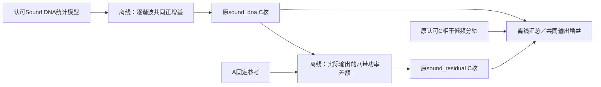

# 局部谱线与高频密度 V1

2026-11-12。在允许局部峰值移动后，A录音的高频仍比固定相位C声源更分散。本轮用现有C核生成两组有界密度候选，平均频带能量和谱线集中度检查通过；**自然度尚未听评，不替换认可模型或驾驶默认**。

## 局部测量避免什么混淆

此前平均复系数的相干占比会把纯净失谐音误判成非相干功率，本轮不用它做分配。用8／16周期原生Hann FFT（171／341ms），共同中心处，把每条名义谐波的半阶邻域作为不重叠单元，寻找其中能量最大的连续3／5个bin。局部峰值可以平移；单元总功率是分母，跨单元按功率汇总。

12组包含五个已知控制、A固定归一化参考、同一C生成器四个等长片段，以及先前幅度候选50／100%。窗口／支持宽度改变基准，不能互换数值；位移支持不抵消窗内快速扫频。

以16周期／3bin、6–8kHz左观察声道为例：

| 声音 | 局部集中度 |
|---|---:|
| 已知固定纯谐波 | 1.000 |
| 已知0.1%固定失谐纯谐波 | 0.994 |
| 已知慢线性扫频纯谐波 | 0.985 |
| 已知平稳噪声 | 0.404 |
| 固定A录音 | 0.406 |
| 原C四段 | 0.827–0.834 |
| 先前直接幅度100%候选 | 0.760 |

纯音／失谐控制跨频带最低0.9834，平稳噪声最高0.6269；预先登记的控制门槛通过。3–8kHz四带在两种窗下均超过预先登记的0.05集中度差，允许进入独立工程试听。**集中度不是物理噪声份额或真实度分数**；窗内FM、AM、录音传递和多声源都可铺开谱线。这里仅支持试做另一种声源分配，不识别其物理成因。

## C候选与模块边界

高频工程量0／25／50%分别试验，不从集中度反算功率。共同正增益为`sqrt(1-amount*mask)`，mask在1.2–1.9kHz平滑过渡；同时乘DNA均值、共同basis和残差root，保持平均相位、AR维度／相关系数及低谐波。已有C核读取派生模型，独立低频原始分轨与scale不变。

对每组**实际C输出**重新拟合非负Welch差额，再由已有512载波OSC云持续生成。每组用8121907／23117／61927三个细节seed，DNA与LF仍为48271。0量组用于区分单纯补差额与高频重分配；各版统一0.5输出增益，无逐版增益补偿。

| 试听主seed | 6–8kHz集中度 | 八带最大功率误差 |
|---|---:|---:|
| 只补原差额 | 0.827 | 0.294 dB |
| 候选A：25% | 0.721 | 0.058 dB |
| 候选B：50% | 0.678 | 0.094 dB |

两组新候选跨三个seed最大功率误差0.248dB；三组对照的复相关误差见摘要，近mono关系保持。全部残差coherence投影记录保留，本轮最大超界仅3.61e−10，但投影并不保证任意完整谱矩阵精确还原。功率接近也不保证等感知响度或自然度。

**尚未解决**：高频集中度仍高于录音。现有OSC云每带只有32条共享线，6–8kHz平均间隔62.5Hz；近mono时独立右侧载波近零，总分配数512不能解释成每声道每带512条有效线。固定载波的稀疏性与拍频需另做密度／性能对照，不能只继续增加幅度调制。A该段原本近双mono，本轮不证明立体声宽度或7.1.4；各层独立捕获与现有空间边界保留。

## 验证与交接

- 原DNA C输出前8秒与冻结float样本精确相同；0量派生模型与原16秒样本精确相同。候选削减部分的独立直接OSC和C差值最大误差5.94e−8满幅。低模型行及独立LF分轨保留；高谐波AM侧带仍可能改变混音低通结果，不能声称整体低通波形逐样本相同。
- 九条实际FLOAT混音重新读盘后复现全部频带门槛；7条共同增益PCM24试听经HTTP字节一致／FFmpeg解码，最高峰0.538满幅。没有浏览器交互或新增主观听评验收。
- `analysis1`保留直接DFT在Hann空频点处的精度失败（约1.60e−9，大于1e−9门槛）。`analysis2`以整数模约简三角相位，修正大角度的数值抵消，门槛不变；冻结旧模块可重现失败。`render1`与最终核验保留实际源码／二进制哈希／全部命令。
- Git的`-text`属性会把新残差模型的CRLF计为行尾空白；提交前已拦下。`publication1`保留换行修复包装器误判Git退出码的前置失败（Git返回2，非1），尚未改变模型。`publication2`保留原CRLF副本和发布前摘要，将Git副本改为LF；token序列相同，三份模型经C读取后的前4800帧与原完整渲染精确相同。未重写原实验导出文件。
- 436份C/H与认可DNA／LF哈希未变，既有40项CTest无新C变更因此未重跑。派生模型只存入独立[实验模型目录](../voices/line_density_v1/README.md)，不接驾驶锚点、不改变旧行程算法。

`tools/line_density_v1/{measure,controls,profiles,review}.py`分别负责谱线观察、已知控制、模型缩放、试听输出。分析、C导出、最终核验与冻结入口各自独立；C声源核没有文件／UI／分配职责变化。

摘要／输入SHA：[line_density_v1_summary.json](line_density_v1_summary.json)。证据：`E:/VehicleSoundLab/references/analysis/line_density_v1`；冻结：`E:/VehicleSoundLab/baselines/line_density_v1`；试听：`http://127.0.0.1:8789/research/高频密度对照V1.html`。既有幅度试听仍待回复，本轮另页不重复提问，也不推定认可。
