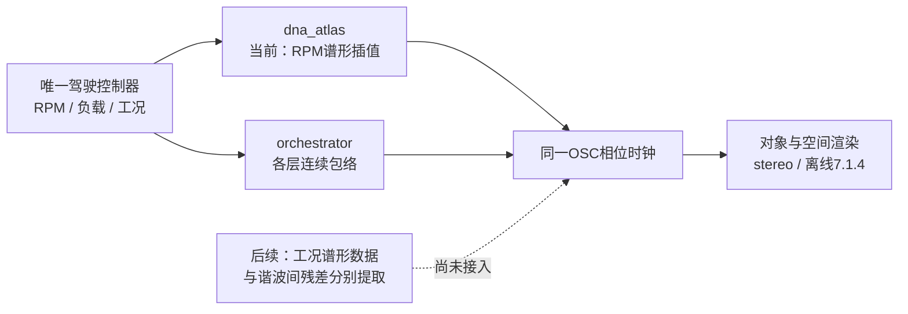

# 工况声纹分离 V1

2026-11-11。本轮只增加离线分析、三组同核心 C 诊断渲染及复核页。发现两件应分别处理的事：**同音高的起落声纹有谱形差异；四周期分析会漏掉大量谐波间能量。** 新驾驶程序、已认可 DNA／相干低频及冻结版本保持原样。

## 高频缺口的具体原因

`tools/sound_dna/windowed.py` 用四周期 Hann 窗，却只读取整数声学谐波所在的中心 FFT bin。对周期吻合的 OSC，幅度校正正确；对分布在谐波之间的成分，只读中心值会遗漏能量。

已知信号实验得到：纯 OSC 的表示功率／完整频谱单元功率为 **1.000**；白噪声为 **0.3774／0.3751**（L/R），理论值 **3/8，即 −4.26 dB**。A 三个真实观察中，3–8 kHz 的稀疏读取损失约 **4.13–4.37 dB**；对应 C 生成相对归一化录音少约 **4.24–4.58 dB**，主要缺口已能在分析端观察到。

这解释了当前加窗模型的一项系统性高频不足，**不是旧64OSC“低质感”的完整归因，也不证明所有差额都是某个物理噪音源**。不能将整个 DNA 乘以 `sqrt(8/3)`：吻合的发动机谐波本来就没有这项损失。下一步应提取谐波间的剩余能量与声道关系，作为独立残差声层拟合，和主 DNA 分别验证；保留平均相位的主体不因补高频而重训。

## 同音高的工况颜色

使用已批准 A 的同一驻车后侧视角；独立第5／10条声线跟踪、共同L/R相位校正后，以四周期 Hann 分析。比较声学根频率45–50Hz内的窗口，再将频率表示在共同根音46.875Hz下。它是相对声学坐标，未测实际RPM、油门、负载或喷油状态。

| 观察 | 相位校正后源时间 s | 完整周期 | 重叠观察窗 | 非重叠四周期窗上限 |
|---|---:|---:|---:|---:|
| 第一次声线下落 | 238.387–238.884 | 21.25 | 70 | 5 |
| 第二次声线上升 | 240.660–240.812 | 7.01 | 13 | 1 |
| 第二次声线下落 | 240.977–241.597 | 28.00 | 96 | 6 |

上升段与两段下落在45–50Hz区间的平均根音分别约47.428／47.472／47.457Hz。扣除整体音量差后，上升段400–1200Hz分别高约 **8.94／9.39dB**（左观察通道）。仅用一个总音量包络无法表达这组观察。

但两段下落在3–8kHz也相差约9.55dB；因此不能把所有高频差异归给加减速，更不能从这一个上升段固化完整负载映射。上升模型只有约一个非重叠四周期窗，三组`.model`只作诊断，未进入`voices/`或新驾驶窗口。它们复用同一 C 二进制持续生成8秒，没有录音循环；短参考只播放一次。

已知扫频 OSC 的零颜色反例，五个有效频带最大假差异0.00091dB；已知+6.02／+3.01dB谱形变化的最大误差0.00095dB；带±2%时变时钟偏差的控制最大假差异0.090dB。这验证分析机制，不是实录误差的置信区间。真实快速上升窗仍同时覆盖一段变化音高；窗重叠也不能当独立样本。

每组源抗混叠滤波的可用上限不同，保守诊断约9.55–11.26kHz；8–14kHz的完整差异不用于工况标定。该上限采用滤波截止减600Hz的工程余量，不是实际滤波器砖墙。

## 与 V6 及当前 C 的关系

本轮`git ls-remote`复核上游HEAD仍为`ac2b37d8639027d79934a2023cf8d1d37d3b2f96`。保存的`v10_state_renderer~`含steady／accel／decel×六档锚点，其参考纹理支路有`buffer~`／`groove~ @loop 1`。借鉴其工况维度和模块增益；本项目需要用无采样声源表达，而不能将这条上游支路全部称为OSC。

| C 模块 | 现有能力 | 尚缺的声音标定 |
|---|---|---|
| `src/drive/` | 启停、踏板／车速／RPM、运动自动挡、切扭／恢复、收油资格 | 物理参数及精确工况边界仍为工程设定 |
| `src/core/orchestrator.c` | 各状态独立增益、起落和切扭包络 | 新DNA不消费旧DNA的谱倾斜／截止值 |
| `modules/dna_atlas/` | 一组OSC按根频率插值幅度与确定性相位 | 没有已标定的负载／工况谱形轴；不能仅靠音量代表音色变化 |
| `modules/atlas_drive/` | 唯一控制器、DNA工况增益、可选旧程序事件、统一分轨／空间 | 独立相干低频、进气、机械与残差尚未接入 |
| `modules/dna_scene/` | 已认可A移动尾排DNA／低频的独立空间适配 | 其低频不能直接套给驻车或车内锚点 |

下一步实现保持共同相位时钟的工况谱形表达；先保留数据的“声线上升／下落”标签，再用足够的画面／时钟／重复片段建立驾驶工况映射。补高频时将“谐波主体／谐波间残差／独立低频”分别管理，避免把自然变化压成一条静态EQ曲线。

## 四份素材目前能证明什么

| 素材 | 已有用途 | 当前不足 |
|---|---|---|
| A Performante | 驻车、补油、移动尾排；本轮颜色比较 | 镜头分别建模；未测RPM／负载；短上升段不足独立重复 |
| B Tecnica | 车内双耳频谱、声道差异、动态片段 | 本地只有MP3，无已检查视频；不能确认踏板／挡位 |
| D Performante台架 | 封闭台架录音及过渡语境 | 屏幕标签／单位未辨清；不直接拟合车外传递函数 |
| E Performante车内 | 五次可见升挡、宽转速读数、两档高转DNA | A/V偏移和显示延迟未知；无精确切扭、回火或独立进排气标注 |

合计四份批准录音，并非四种发动机。A／D／E与B的车型、位置和录音链分别保留。E的五次挡位变化是状态证据，不等于五个已生成的新事件音色。

复核页：[工况声纹分离V1](http://127.0.0.1:8789/research/工况声纹分离V1.html)。页面功能和六个音频的HTTP／本地文件载入、单播放器、窄屏布局已静音检查并查看截图，不构成音色听评。

复现入口依次为`explore_state_dna_v1.py`、`run_state_dna_v1.py`、`verify_state_dna_v1.py`、`verify_dna_energy_budget_v1.py`、`summarize_state_dna_v1.py`，参数见`--help`，数据根传`--workspace E:/VehicleSoundLab`。每次使用新输出目录，保留初次失败／修订结果。[精简数值与哈希](state_dna_v1_summary.json)绑定代码、原始素材、C二进制与证据。本轮没有改实时C，因此没有重跑此前30项CTest；新增已知信号、实际C输出与页面检查针对本轮变化完成。
