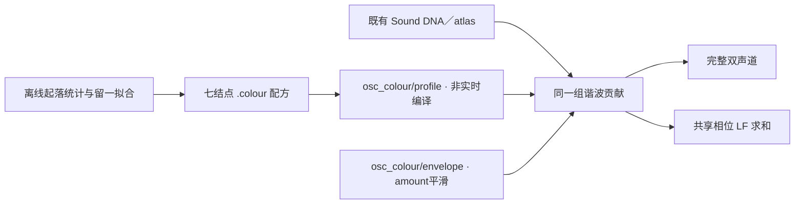

# 工况声线诊断 V2

同一录音位置、相近音高下，A三次补油的上升／回落具有重复的谱形差异。新增独立 C 谐波增益轴用于听辨这项差异，**尚未成为驾驶负载映射或已认可音色**。已有相干低频认可仍限于原A移动尾排情境。

## 素材与证据

本轮只扩查已批准A的 `[231,247.5)` 秒，无新增下载；视频接触表在 `state_colour_v2/context_exploration`。尾部视角、开门可见，但不能证明固定话筒、无剪辑、挡位、踏板、RPM或扭矩。B／D／E继续承担各自车内／台架／驾驶参考，不混用录音传递。

第5条声线在7个短段形成完整路径，第3次上升段仍失败并排除；第10条在所有段都没有完整独立路径。第5条随后参与相位校正，不能再把它的相干度当作独立验证。其他声线的相干度保留在原报告。

选择根音45–50Hz、方向符合起落的四周期Hann窗；比较共同坐标46.875Hz下的谐波功率，扣除28–6000Hz整体标量。重叠窗不是独立重复：三次上升各仅1个不重叠窗，回落各2／3／3个。最低共同支持带宽约7766Hz，本轮仅比较至6000Hz。

| 参考频带 Hz | 第一对起落差 dB | 第二对 | 第四对 |
|---|---:|---:|---:|
| 28–120 | −10.65 | −6.51 | −9.56 |
| 120–400 | −3.52 | −3.56 | −4.05 |
| 400–1200 | 7.01 | 6.35 | 8.88 |
| 1200–3000 | 6.72 | 5.23 | 7.41 |
| 3000–6000 | 11.78 | 7.37 | 11.97 |

正值表示上升段更突出，均为去除整体电平的**声学谱形**，不是分离声层、满油门、断油或真实切扭量。第一对平均根音47.48／46.46Hz，并非严格同音高；其余两对更接近。三个passage等权拟合，留一预测五带误差1.56／2.66／1.41dB，平直基准8.47／5.95／8.77dB；不能把这当作其他负载／车型的验证。

## 已知控制暴露的限制

按相同快速扫频轨迹生成已知OSC，使用同一归一、相位校正、窗选择与功率测量：给定准确时钟时，零谱形变化误差≤0.00022dB，已知增益误差≤0.00021dB。自动跟踪稠密声线在第一次控制中大多失败；保留失败，无填补。另做参考声线较强的正控制，跟踪参数不变，六段均连接，但第4对仍出现约1.20dB高频假变化，**未达到预设0.5dB目标**。缺失参考反例保持缺失。

因此实录结果只能支持短情境下进一步诊断；自动跟踪偏差和真实录音内的相位／混合声源仍需研究。本轮不继续调整门限直到“通过”，也不自动接入驾驶。

## C 模块与信号流

`modules/osc_colour/profile.*`只管阶次增益，`envelope.*`只管单调跟随；`modules/dna_atlas/voice.*`新增可选 `sa_voice_tick_shaped_body`。每条谐波幅度乘 `1+amount*(gain−1)`，L/R共同增益，原相位、时钟、随机状态保持；完整声／LF在同一处取样。amount0／NULL精确旁路。配方在第128阶回到0dB，此后不外推高频增强；它只有根音45–50Hz附近的证据。

`VslOscColour_probe`只做独立诊断导出。现有 `atlas_drive`、UI、控制字段、行程schema及默认音色未接入该轴。C源码变化会改变严格的行程renderer身份；旧 `.vslrun`使用 `baselines/atlas_take_v1` 冻结工具回放，不伪造兼容。

## 试听与验证

[试听页](http://127.0.0.1:8789/research/工况声线诊断V2.html)：A Stationary Upper Mid（本身未听评），固定47.391Hz、seed48271、统一输出0.25。0／50／100%及一次2秒开启、6秒关闭的120ms平滑过渡，持续10秒，无原片循环。拟合对共同回落统计作一次期望功率归一，导出未逐条补偿响度；RMS约0.1104／0.1022／0.1024，峰值均小于0.655。

35项已有CTest通过；新增契约初次因测试解析式的无符号负号失败，修正该测试后单项通过，合计36项。解析声源验证幅度、相位、LF、单调平滑、随机状态与事务失败。与冻结 `harmonic_body_v1` 程序比较同一10秒驾驶：19条WAV及控制CSV完全一致。没有新的设备、UI或7.1.4扬声器听评。

证据根目录：`E:/VehicleSoundLab/references/analysis/state_colour_v2`。保留两次clock、两次colour、三次fit、两次control、首次测试／修订记录及各版精确源码。`fit_attempt1`未限制高阶外推；attempt2加入第128阶归零；attempt3将训练集的归一纳入留一预测，作为最终诊断配方。分析报告、模型、二进制和冻结清单由 `state_colour_v2_summary.json`绑定。用户听评待定。
