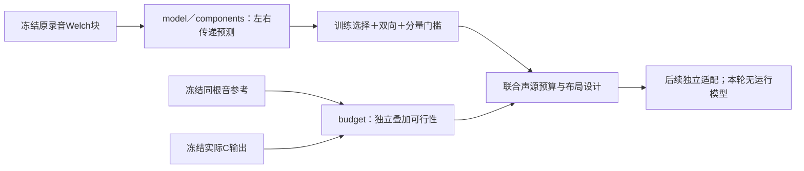

# 左右声纹与叠加预算 V1

2026-11-12。**现有车内素材尚不足以建立一个稳定的通用“声场加宽”模型；已有DNA的左右能量也会限制独立细节层能补什么。** 本轮落实了离线模块与两组候选验证，没有改C、默认模型或试听基准。

## 录音中的左右关系能否复用

复用 `reference_audit_v1` 已冻结、哈希绑定的六段原始双声道Welch观察，分别属于A移动／A驻车、B加速／收油、D台架、E高转车内。2048帧Hann、1024帧hop，每个整秒独立分块；块内谱窗有重叠。未改音频、重采样或重排相位。此前已研究这些录音，**不是未见录音验证**。

每频点的谱矩以 `conj(L) × R` 存复交叉谱；除以trace后保留左右功率比例与复相关方向。拟合时再以每块、每频带总trace归一，使共同响度不会让某一时段支配结果。它拟合的是混合录音传递，不能据此识别缸组、声程或负载。

原八带各用一个常量矩阵作为对照。候选每带分2／4／8个原生FFT频格，父矩阵先验权重4／1／0；矩阵均为半正定。用前半整秒块中的逐块留一误差选择复杂度，再检验后半；反向另做一遍。两方向均需总RMSE至少降低10%、绝对降低0.005，训练内选择至少降低5%。A仅3块，无法得到每半至少2个训练块，明确记为证据不足。

### 总误差会隐藏局部退步

第一组联合矩阵候选有D3带／E2带过总门槛。但误差分解发现，E1.5–1.9kHz的左右功率平衡MSE在两个方向分别上升31.9%／10.4%，复交叉MSE下降约40%，从而掩盖了退步。原结果保留，未回改阈值。

另立方案增加“仅复交叉／仅平衡／联合”三类候选，复杂度和类别仍只按训练内误差选择。单独改变一部分时，对交叉谱作固定对角的PSD圆盘投影；还要求两方向的平衡、复交叉MSE分别不退步。

| 片段 | 原联合族总门槛 | 新分量族全部门槛 |
|---|---:|---:|
| A移动316–319s | 训练不足 | 训练不足 |
| A驻车244–247s | 训练不足 | 训练不足 |
| B加速218–230s | 0／8 | 0／8 |
| B收油475–485s | 0／8 | 0／8 |
| D台架20–32s | 3／8 | 2／8 |
| E车内88–94s | 2／8 | 0／8 |

D留下1.9–2.4kHz（双向RMSE降32.0%／23.8%）、3.8–4.8kHz（11.5%／16.1%），不是完整台架空间或发动机模型。E新族的1.5–1.9kHz仅复交叉候选做到17.7%／6.9%，2.4–3kHz做到11.0%／9.1%，均保留未过双向门槛的状态。不能只选一个方向或改低10%门槛，也不能把台架关系借给车外。

两组各12个已知控制（3seed×mono／独立／稳定滤波延迟／半段反转）均通过：稳定模型每seed8带通过，其余没有双向误判。独立时域三角DFT最大相对误差2.21e−14；独立逐项矩阵和、共同增益／交换声道不变量误差至多4.45e−16。它们验证实现，不等于自然度听评。

## 为什么加一层仍修不好左右关系

独立相加要求目标谱矩 `T = B + R`，其中现有DNA矩阵为B、残差R必须半正定。左右各自有正的功率差额，也可能因交叉项过大或方向相反而使 `T − B` 非半正定。把残差相关幅度裁到1，只保证残差能生成，无法保证最终左右关系等于目标。

针对冻结的**A驻车Upper Mid／E Cabin Lower**参考和实际原C声源8秒输出，分别检查八带及每带4／8个原生频格。这里不是已认可A移动尾排组合，也不是对上述原始动态片段作新的驾驶拟合。

| 对象 | 八带不可独立补齐 | 32格不可补齐 | 64格不可补齐 |
|---|---:|---:|---:|
| A驻车 | 4／8 | 13／32 | 26／64 |
| E车内Lower | 3／8 | 8／32 | 25／64 |

八带结果精确复现旧残差模型的裁剪（归一化矩最大差1.12e−16）。A八带最负特征值仅为该带trace的约−0.00166，E为−0.0522；计数与总功率覆盖率不能直接解释成可闻缺陷大小。

诊断同时求使 `T − αB` 可半正定的最大α，α是DNA**功率**系数。E2.4–3kHz八带边界约0.789；细分8格时，E1.5–1.9／2.4–3kHz最小边界约0.373／0.411。更细的频格会暴露更尖的局部失配，也更受短参考、Welch窗、音高归一和有限seed影响。

**这些边界不能自动编译为增益曲线。** A近mono的弱侧方向失配，也可能得到很小α，直接大幅削DNA会损害主要声线。六组已知矩阵、相位旋转不变性、直接二阶特征值公式与边界主子式检查通过；最大已知α误差4.01e−9（PSD数值容差1e−9），特征值公式差2.50e−16。独立叠加假设是总体统计条件；固定OSC在有限窗里还会有交叉项。

## 模块和当前空间边界

`tools/stereo_field_v1`中，`model`负责谱矩与选择，`controls`造已知信号，`oracle`独立核对，`components`拆开误差轴，`budget`处理相加条件。分析／预算／误差分解／新族运行、汇总、冻结各有入口，见[模块README](../tools/stereo_field_v1/README.md)。

核对当前C实现：`dna_scene/routing.c`先明确选左／右／mid，再投影到排气代理；成对路由是同一mono的一半送两端。`atlas_drive/render.c`分别保留DNA／细节的原L/R分轨与直送，但空间支路使用上述投影，再统一调用一次空间渲染。因此**目前12声道空间支路并不完整保留车内录音的立体声关系**，不能把它称为已完成的左右细节空间化。

下一项生成工程应把两条边界明确落实：源编译联合约束DNA／细节的PSD预算；空间适配明确区分观测stereo声床与已分离的单声源代理。先确定源分轨、能量与布局不变量，再考虑可选stereo声床进入12通道；L/R不能直接命名为物理左右缸组。保持一个驾驶控制器、一次空间渲染和可回退行程播放器。

本专项没有导出新声音或正式模型、没有改442份C/H（逐件SHA核对），认可DNA／LF哈希保持；没有重编设备、重跑未涉及的C测试或新增试听问题。随后幅度候选收到“原版更好”的反馈，见[听评记录](temporal_texture_v1_listening.json)；密度试听分别待回复。按用户状态覆盖问题补做的[设备复测与素材索引](系统运行与状态素材V1.md)另存`system_status_v1`。A驾驶5ms超时及完整工况音色、其他发动机、实际7.1.4仍待完成。

摘要：[stereo_field_v1_summary.json](stereo_field_v1_summary.json)。四组执行目录 `analysis1 / budget1 / detail1 / components1`及核验保存在 `E:/VehicleSoundLab/references/analysis/stereo_field_v1`，冻结至 `E:/VehicleSoundLab/baselines/stereo_field_v1`，包括各次实际源文件、方案、报告、哈希和完整交接源码。
