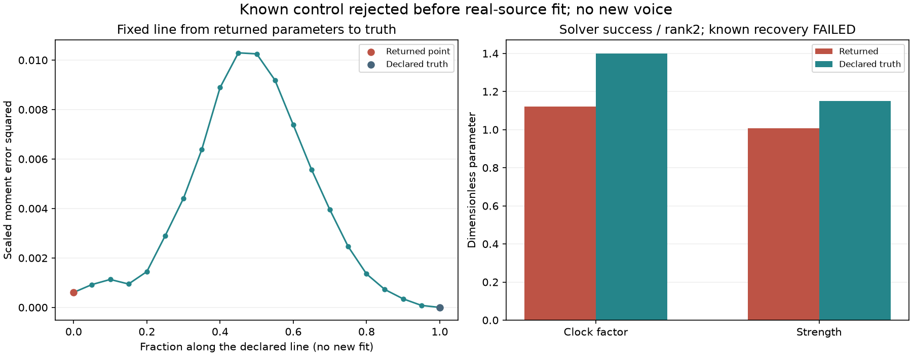

# 怠速75Hz速度拟合核查 V1

**本轮方案没有通过已知参数恢复，未进入实车拟合，也没有生成新试听。** 前向算法和导数经独立核对一致；把三段短随机信号的统计当拟合目标，会出现把速度找偏的结果。下一步应拟合发生器的期望统计，将随机音轨用于验证。

## 试了什么

针对上轮75Hz主声线起伏偏少、偏慢的证据，只设计两个参数：变化速度与力度强度。约112／187Hz、细节共振、相位、左右声道及空间处理保持原配方。

随机滤波形状来自原F2幅度模型的第一行，64抽头、三个创新输入、50Hz节点。新75Hz采用独立随机流和完整63节点预历史，避免把共享随机流按不同速度播放而产生随时间漂移的跨声线关系。原跨声线关联在这个假设中缺失，原计划因此包括独立75Hz的1×／1×对照，不能把差异都归因于速度。

通用`row.py`只处理有限随机滤波器、任意节点时钟和三次插值，不含发动机频率；75Hz选择留在适配器。每个插值位置按完整四节点协方差校正方差，再形成正力度：

```text
x = 三次插值 / 对应标准差 × 原节点标准差
g = exp(强度 × x − 强度² × 原节点方差)
```

理论`E(g²)=1`，不等于每条短音轨具有相同RMS。这里仍是F2观察统计的生成假设，不是已恢复真实燃烧激励。

原计划用三个固定随机种子的前三秒，替换冻结混音里的75Hz力度，经准确的13OSC分析响应提取实部协方差。拟合0／40／100／200ms四个矩，只改变两个参数。三个种子、初值1／1、速度界0.5–4、强度界0.25–3、40次求值上限及误差条件均预先固定。

## 为什么停止

先生成一个明确已知的控制目标：速度1.4、强度1.15。求解结果为：

| 项目 | 结果 |
|---|---:|
| 返回速度／强度 | 1.12085／1.00822 |
| 最大参数误差 | 0.27915，未通过原1e−5门槛 |
| 求解器状态 | 成功，13次求值、无触边 |
| Jacobian | 满秩2，条件数约4.45 |
| 返回点的归一化误差平方和 | 0.00060625 |
| 原声明真值处的误差平方和 | 独立核对约7.5e−29 |

内部优化器的`available`仅反映求解成功／边界／秩条件；宿主的已知恢复检查正确拒绝了整条方法。真实源和三个同谱对照的四套拟合均未执行，原计划的24秒候选也未生成。没有改初值到真值、增加种子／迭代或放宽边界来让控制过关。

失败后明确追加固定诊断：沿返回参数到原真值的直线取21点，不做任何新优化。其目标值有上坡区段，随后又降到真值零点。这个结果表明数值收敛、良好局部条件数和接近的短段统计，不能证明速度参数恢复正确；它不是对全空间局部／全局极值的形式证明。



变速不仅改变随机过程的理论时间结构，也改变三个有限片段实际走过的随机内容。当前目标混入了后者。不能把找到的某组数值直接写成音色参数，或者在实车目标上继续依赖同一资格尚未通过的拟合。

## 两项核查都保留

第一次执行先在导数数值检查停止：四节点三次插值只有一阶连续；在整数节点两侧做中心差分，穿过二阶曲率不同的区间。原步长1e−6下速度导数最大差约3.06e−4，最坏点恰在节点上。

另立诊断后，使用留在同一侧的二阶差分；步长和原1e−6门槛保持。最大差约1.24e−7，强度导数约1.2e−10。只修正数值核查方式，发生器、解析导数和拟合条件不改；第二次执行随后暴露上述已知逆问题失败。两次执行、源码和诊断数组都冻结，没有覆盖失败。

独立审计重建全部新白噪声／FIR节点、原75Hz增益绑定、三套窗口响应及全部13次拟合轨迹。348次加权QR的响应常量差约6.9e−16FS，所有矩差约3.5e−17；独立解析导数与原实现差约2.7e−14。因此现有证据支持“实现一致、逆问题资格失败”，不能称优化成功。

## 后续工程路线

将理论联合统计经实际观察器变成期望窗口矩，先验证已知参数恢复，再拟合F2训练段；随机种子和长音轨只负责检查生成结果的分布与听感。对真实素材比较时仍包含混音相位估计器，不能将窗口指标直接当原生带宽或相位激励。187Hz细节的过量起伏继续作为另一模块处理，不统一加AM。

| 模块 | 职责 |
|---|---|
| `idle75_clock_v1/row.py` | 通用有限随机FIR、任意时钟、方差校正和正力度 |
| `idle75_clock_v1/forward.py` | 原生力度到窗口系数、有限矩及解析Jacobian |
| `fit_idle75_clock_v1.py` | 固定条件宿主；已知恢复失败时停止实源拟合 |
| `diagnose_`／`audit_`／`assess_`／`package_` | 数值诊断、独立核对及完整留痕 |

资料冻结于`E:/VehicleSoundLab/baselines/idle75_clock_v1`。619个C/H、67个旧voice、行驶35%、原怠速／驾驶默认、待听配比及立体声／7.1.4边界保持。新模块仍是研究Python实现，尚未接入实时C；真实怠速改善、完整驾驶工况、跨发动机与空间化目标继续。
