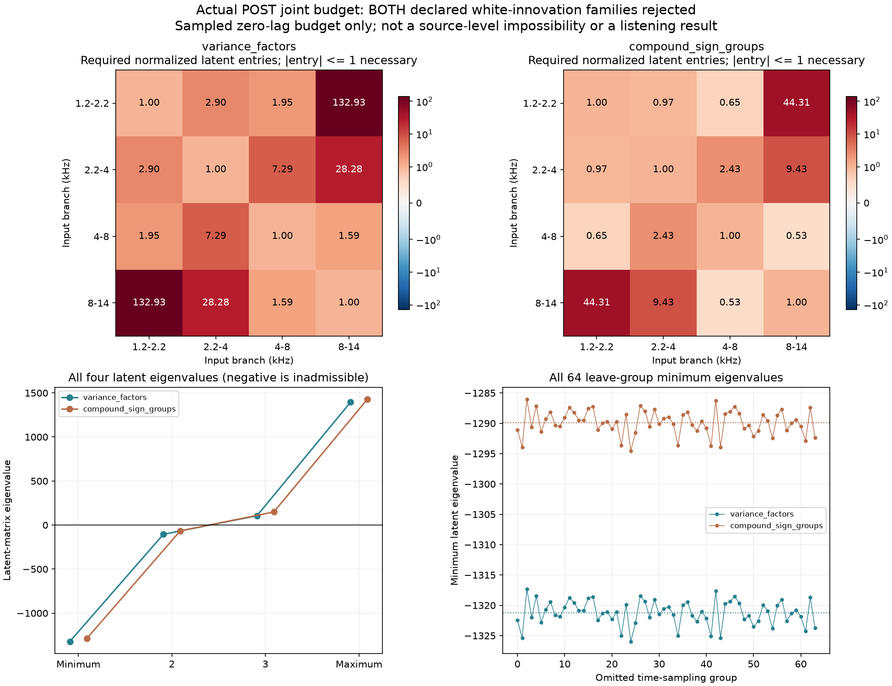

# 怠速共振后共同激励 V1

**改变调幅位置后，原先两种共同白激励仍无法在保住单带预算的同时补齐跨带预算。**本轮没有生成新声音，也没有把非法参数改成能运行的参数。下一步应让已经合法可生成的近似配方进入听音比较，同时继续记录剩余的时间联动；不把所有统计指标精确相等当作试听的前提。

## 两种假设与真实接法

沿用F2尾排的13条OSC、六个FIR与共振后√q调幅，再经过原观察滤波器。q、相位、增益、观察器支持与上一轮2048个时间原点全部冻结。低两支路保留Gaussian；高四支路分别检查：

- **共同方差因子**：各输入瞬时方差由非负共同因子驱动，Gaussian载波独立；同一帧可以相关，不同帧独立。要求方差协方差矩阵`D=W Wᵀ`，且`W≥0`。
- **共同复合标记**：共同Poisson组、每支路独立正负号，另有Gaussian余量保持二阶能量；不同帧独立。要求平方幅度矩阵`C=W Wᵀ`，且`W≥0`。

这些都是有限的统计模型类别，不是已经识别的发动机事件。共同方差的非负因子类别也不包含所有可能的非负随机方差过程。

这次重新计算每个时刻的实际POST响应K，没有复用以前的固定滤波前算子。四个边缘、六个跨带共同构成10×10线性系统。跨输入系数包括带符号项：

```text
Σ_k [K_bi²K_cj² + K_bj²K_ci² + 4K_biK_bjK_ciK_cj]
```

删去最后的相位交叉项会改变问题。本轮保留它，并把上一轮的响应尾界传播到全部系数。

## 结果不是求解器不稳定

两系统满秩，归一化条件数约3.407，线性拟合残差约1.1e−16。但求出的共同矩阵均不满足半正定条件，不能作为声明模型中的协方差或正因子矩阵：

| 类别 | 最小特征值 | 最大特征值 | 64次逐组剔除 |
|---|---:|---:|---|
| 共同方差因子 | −1321.228 | 1394.739 | 64次均不定 |
| 共同复合标记 | −1289.864 | 1428.129 | 64次均不定 |

一个直观检查是第1／4支路：协方差必须满足`|D14|≤√(D11×D44)`；这里前一类需要值是这个上限的约132.93倍，后一类约44.31倍。不是靠很小的数值容差能解决的差异。



最小特征值的近似逐项95%时间抽样区间分别为[−1353.48,−1288.98]和[−1321.64,−1258.09]。区间只描述冻结模型下的时间原点Monte Carlo误差；不含原录音估计误差，也不是完整时间网格或源模型不可能性的证明。

## 可以拟合公式，不等于可以发声

两套无约束代数解都能匹配训练目标，但这两个解不能按声明模型生成随机输入。它们及检查预测完整保留，明确标为不可直接生成；没有裁特征值、投影到最近正矩阵或继续搜索触发速率。

上一轮“共振后q＋重新分配的独立κ”仍是合法的近似配方。它保住单带训练集中度，却只恢复部分跨带共同集中。**不能用本轮非法解的拟合改善来宣称声音更好了。**

目前可排除的是这两类在固定预算下、跨帧独立的共同模型。剩余可能涉及带时间记忆的共同幅度变化、不同的混合矩、共振器近似以及录音因素，尚未区分。不能据此断言发动机只有某一种物理发声机制。

## 接下来直接推进声音对照

停止继续排列这两类白激励或扫描速率。用上一轮已经非负、可生成的POST配方，固定原主声线、原共振器与三个既定随机种子，制作与旧静态／独立颗粒的等增益干声对照，并检查全部频段和完整−40～＋40ms输出曲线。目的在于判断这些已提取的周期变化与颗粒分配能否改善听感，保留所有没匹配的指标。

这是一份待验证的近似候选，不需要先把本轮失败模型修成精确匹配。既有听评不重复提问，不替换认可版本或实时C默认；完整预期曲线、声学分离、其他机位／发动机、驾驶状态与空间目标继续保留。

## 验证与代码

先重跑原精确共享Gaussian标记、Poisson／二项矩及六个逆问题控制，再用非平稳四输入／四输出的完整四阶张量检查新算子，并验证两类各自的正、负与秩不足控制。

独立程序以不同卷积方法重算全部2048时刻；对每个时刻的全部10×10系数，用完整偶数四阶张量的各排列复算。最大算子差2.53e−24；尾界系数相对差1.12e−12；独立SVD求解与全部64次分组参数、预测、状态和近似区间复核，相对差9.20e−13。已知集合最大差6.27e−13。

`operator.py`负责时变联合算子与误差传播，`checks.py`负责新旧已知控制；原合格求解／证书模块复用，观察、独立审计、绘图与冻结分别有入口。完整图已目视。

612份C/H、67份旧配置、认可行驶35%、已有怠速候选、二进制及take保持；没有新下载、音频、C晋级、旧61项驾驶测试或重复提问。完整证据冻结`E:/VehicleSoundLab/baselines/idle_post_joint_v1`；原共同相位资格、立体声／7.1.4、多发动机和完整驾驶目标仍未完成。
