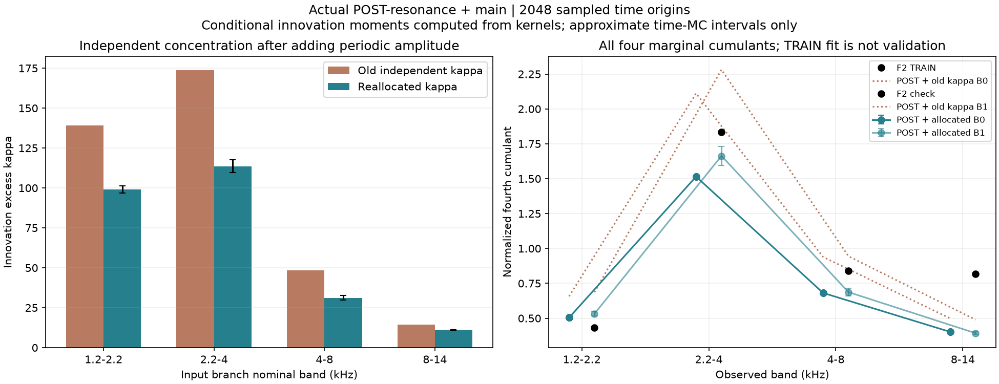
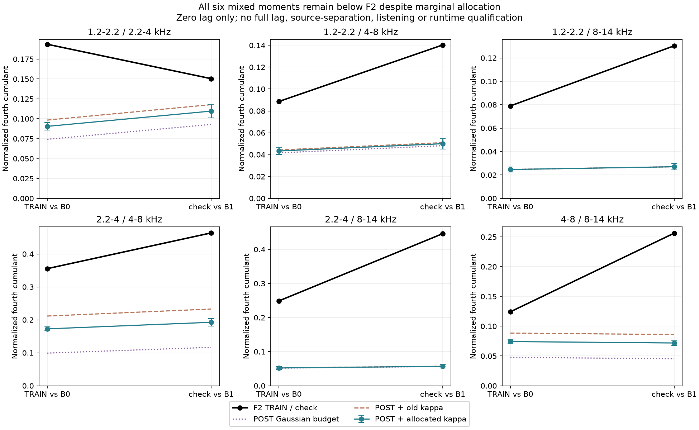

# 怠速共振后颗粒预算 V1

**共振后调幅成立，但不能把旧随机颗粒原样叠上去。**本轮将主OSC、周期细节变化和独立随机颗粒一起核算；独立颗粒强度需比旧配方降低约23%–35%，才能保持F2提取段各频带的集中程度。降低后，跨频带共同集中仍不足，尚不能替换现有怠速音色。

## 实际计算了哪条链

冻结13条OSC、六组FIR、增益与相位，继续使用已批准F2尾排6–9秒提取的正功率q。低两支路不调幅，高四支路在共振之后乘√q，再进入原观察滤波器。加上原主OSC之后，核算四个高频观察带。

```text
主OSC ────────────────────────────────────→ 混音 → 原观察滤波 → 共同预算
独立输入 → 六组原共振FIR → 上四组细节调幅 ──↑
原OSC相位及相位差 → 正功率规律q ──→ 控制细节调幅
```

q仍是录音总带功率的统计关系，尚未物理分离成某个发动机部件。没有重放原包络，没有新房间、高频云、延迟修补或相位重置。

## 为什么这次能算清楚

对每个输出时刻n、输入i，直接计算时变响应：

```text
K_bi[n,k] = Σ_u 观察器_b[u] × g_i[n−u] × FIR_i[k−u]
C_bc[n]  = Σ_i,k K_bi[n,k] × K_ci[n,k]
A_bci[n] = Σ_k K_bi[n,k]² × K_ci[n,k]²
```

C给出条件方差／协方差，A乘输入超额峰度κ给出独立创新的四阶贡献。Gaussian基底则完整包含主声线、方差共同起伏、协方差变化以及主声线与随机部分的混合项，共七项；不能只加一个“噪声量”。

本轮明确采用**时间原点抽样**：固定PCG64种子20261114，每个3秒生成窗抽64组×16个整数时刻，两窗共2048个，允许且保留重复（分别8／5个）。每个时刻的创新集合矩由响应直接计算，没有随机音频抽样。它估计完整窗的时间混合统计，仍有有限时间抽样误差和代入估计偏差；不是完整原生时间网格的精确值。

完整8192抽头FIR保留。观察IIR分别保留3986／2182／1003／543抽头，以逐节加权L1几何上界使各观察器遗漏尾部小于1e−13；再用q的全相位幅度上界传播到K、C与A。该解析界用浮点求值并独立核对，未宣称严格舍入区间证明。没有靠裁短有效声纹来降低模型误差。

## 四个颗粒预算可以重新分配

仅使用F2提取段四个边缘集中度作为目标，扣除Gaussian周期预算后，一次满秩4×4求解得到非负κ；没有裁负、投影或检查段拟合。归一化矩阵奇异值约0.990–1.010。64次逐组剔除求解也全部非负。

| 细节支路名义频带 kHz | 新κ | 新／旧κ | 降低幅度 |
|---|---:|---:|---:|
| 1.2–2.2 | 99.207 | 0.713 | 28.7% |
| 2.2–4 | 113.640 | 0.654 | 34.6% |
| 4–8 | 31.254 | 0.646 | 35.4% |
| 8–14 | 11.070 | 0.769 | 23.1% |

κ是创新分布参数，不是音量、还原比例或机械点火次数。存在独立门控Gaussian实现`p=3/(κ+3)`，这里只说明数学可生成性，未认定实际发动机事件。

提取段四个边缘目标被求解精确匹配，是拟合可行性；**这不是验证成功**。此前已看过的同录音9–12秒只做检查：生成窗1四个边缘值约0.533／1.663／0.687／0.394，原检查录音约0.432／1.836／0.838／0.819，尤其最高带仍明显不足，未用补偿增益掩盖。



## 六对共同集中仍缺什么

以下全部是零间隔的归一化四阶累计量，包含主OSC。跨频带指标没有参加本轮求解：

| 配对 kHz | F2提取段 | 生成窗0新分配 |
|---|---:|---:|
| 1.2–2.2／2.2–4 | 0.194 | 0.090 |
| 1.2–2.2／4–8 | 0.089 | 0.043 |
| 1.2–2.2／8–14 | 0.079 | 0.025 |
| 2.2–4／4–8 | 0.355 | 0.173 |
| 2.2–4／8–14 | 0.249 | 0.052 |
| 4–8／8–14 | 0.124 | 0.074 |

两窗共12项均低于对应原声。单独放大随机颗粒会再次破坏已分配的边缘集中度；现在缺的是共同结构，不能只继续加量。这仍是有限录音里的统计关联，尚未识别为具体机械事件。



下一步应在实际POST时变响应下，联合检查四个边缘与六个跨带预算能否由共同激励实现，并检查完整时间间隔结构；不应直接照搬以前在固定滤波前失败的模型，也不能靠一个共用触发器替代声纹。完整−40～＋40ms曲线尚未完成，本轮没有新的听觉结论或试听晋级。

## 验证与模块

局部二值、Gaussian矩匹配三点、稀疏三点独立集合，非零主声线、双输入／双抽头／下游观察器先完整穷举；另有正／负解、秩不足和尾界控制。独立程序以不同卷积方法重算全部2048个时刻与六输入：最大C差5.29e−19、A差2.14e−25；再以原始矩的15种集合分拆核对完整四阶预算，最大归一差1.94e−15。源录音矩、参数求解及全部64次分组jackknife均独立复核，κ相对差4.99e−14。

κ的近似逐项95%时间抽样区间分别约[96.94,101.47]／[109.76,117.52]／[29.94,32.56]／[10.84,11.30]；区间不包含录音估计、模型偏差或听觉不确定性。代入偏差估计原样保留，没有选择时刻或丢弃重复。

`response.py`只管时变响应／尾界，`budget.py`只管矩和分配，`checks.py`是已知控制；观察、独立审计、绘图与冻结分别有入口。两张完整图已目视。

未改612份C/H、67份旧配置、认可行驶35%、现有怠速候选、二进制或take；无新音轨、下载、旧61项驾驶测试或重复听评问题。完整证据冻结`E:/VehicleSoundLab/baselines/idle_post_budget_v1`。F2近单声道情境、原共同相位资格、立体声／7.1.4、其他发动机及驾驶状态等完整目标继续。
