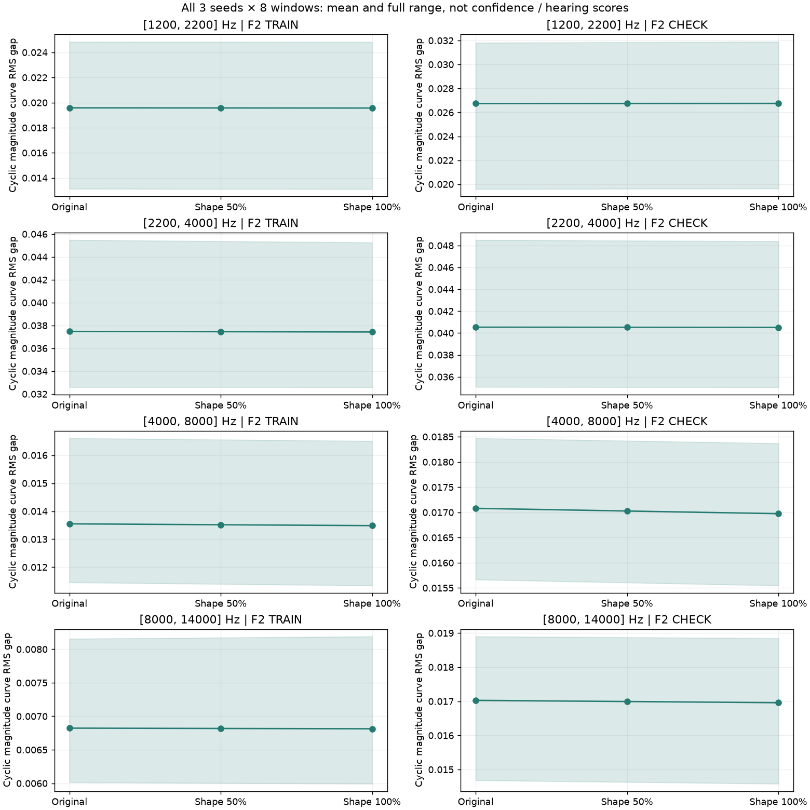

# 怠速共振形状试听 V1

本轮已生成[原版／共振变化50%／100%的24秒试听](http://127.0.0.1:8789/references/analysis/idle_shape_v1/review1/index.html)，含三组随机结果、完整声音、细节独奏与两段F2原声。**它是收益很小的研究候选，尚不能称怠速音色改好了，也未替换实时C。**

## 从素材到新候选

仍只用F2尾排6–9秒训练、9–12秒检查，原生48kHz、左右保留，拟合观察用近单声道的左声道，两端各裁250ms。原13条OSC、两坐标统计相位、六组原共振FIR、四带总功率规律q、稀疏激励概率、固定增益／左右比例均保持。

新增的是每条高频共振声内部的比例控制：四带各拆成互补的低侧／高侧，两侧来自**同一个原激励与连续滤波状态**。用素材的两侧功率拟合八条正指数规律，再取每带两规律的对数差，移除训练均值，得到13×4个统计系数。没有录音PCM、包络时间轨迹或新增独立高频云。

```text
F2训练原声 → 四带互补观察 → 正功率拟合 → 相对共振比例系数
                                                    ↓
原统计相位 → 原主OSC                     新的连续比例控制
          └→ 原总功率q                              ↓
原随机激励 → 原FIR → 互补低侧／高侧 → 正因子组合／功率归一 → √q → 混音
```

互补分频点为1700／3100／6000／11000Hz，采用一阶因果滤波。正因子为`exp(±s·δ/4)`；以两分支的完整2×2响应Gram矩阵归一，包含交叉项。它约束在独立、平稳创新假设下的**条件方差**，不强迫每个实现样本、频谱或短时声纹不变。0量直接返回原流，仍计算分频状态。

此次复用前轮保存的**合成相位节点**，使原版与新候选可直接比较；节点不是录音相位。实际持续系统可由既有统计随机源重新生成节点，本轮没有新增C移植。

## 结果与不足

八分支模型相对常量，在检查段有约7%–18%的功率预测改善；三组同频谱随机相位对照大多没有。这证实录音中有相位关联，但**不能把这些收益全部算成新增共振形状的收益**：旧四带q已经解释了大部分共同起伏。

相对旧q，新增八分支的检查误差变化只有−1.12%至+1.30%，方向混合。全部三种子×八窗的短时声纹距离中位数如下；低值只表示该观察较接近，不是音质评分。

| 变化量 | 训练录音距离 | 检查录音距离 |
|---|---:|---:|
| 0 | 0.0225064 | 0.0265743 |
| 50% | 0.0224932 | 0.0265547 |
| 100% | 0.0224796 | 0.0265350 |

100%相对0只缩小约0.12%／0.15%，远小于生成窗之间的差异。新旧差值的RMS约比整个细节总线低51dB（该总线也包含原低频细节）。本版变化可能很轻，不能据此承诺可听改善。



这说明“两条宽互补分支的相对音量”只补到了少量结构。**不通过把变化量继续放大、扫分频点或堆更多宽带AM来宣称解决。**后续若继续这一方向，应针对前轮完整复相关曲线拟合正因子的条件共振核，检验能否补到相位／波形结构；不能把当前观测曲线的复比例直接当作可合成参数。既有相位候选仍独立保留，听感未知不晋级默认。

## 模块和验证

| 模块 | 职责 |
|---|---|
| `tools/idle_shape_v1/analysis.py` | 原生观察、只用训练段拟合、参数编译 |
| `split.py` | 互补滤波、响应Gram与正因子组合 |
| `render.py` | 原声源／相位适配、独立新变化量，无驾驶状态机 |
| `run_idle_shape_v1.py` | 四组素材／对照拟合，三种子三档24秒完整导出 |
| `audit_idle_shape_v1.py` | 独立完整波形、滤波响应、源观察与条件方差核对 |
| `assess_idle_shape_v1.py` | 全72窗统计，不回调声音参数 |
| `review_idle_shape_v1.py`／`check_idle_shape_v1.cjs` | 同增益试听与静音页面验证 |

独立审计用完整FFT卷积、另一插值／相位约束解、逐项三角声源和指数规律，重算全部三种子三档原生波形。混音最大FLOAT差约1.49e−8FS；分支约4.86e−17FS，条件方差误差约7.77e−16。两分支相关的已知离散集合先行验证，保留交叉项；有效响应尾部也独立检查。

三条0量混音与前轮冻结FLOAT逐样本相同；旧12条短时曲线也逐位相同。最大峰约0.384902FS，无削波。20份PCM24试听统一增益1.0／相同淡入淡出，没有逐条响度补偿；全部HTTP字节、20种页面组合、静音播放／切换／seek、手机布局通过，截图及统计图已目视。静音自动化不代表人听过。

全部执行源码、参数、原音轨与对照、审计和页面证据冻结于`E:/VehicleSoundLab/baselines/idle_shape_v1`。619份现有C/H、67份旧声音配置、行驶35%、旧怠速／待听页面、二进制和take保持；没有新下载、房间、加宽或物理RPM／全状态完成声明。
