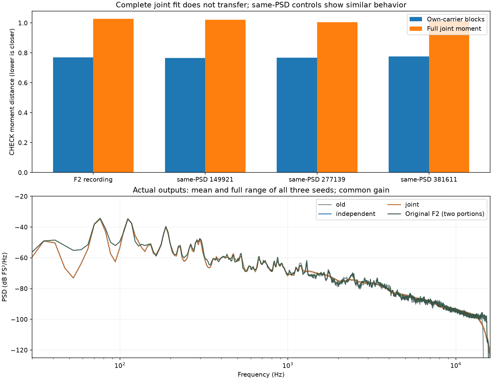

# 怠速关联细节对照 V1

本轮重新提取了已批准F2尾排怠速的跨频率复系数统计，并生成[独立／关联／此前候选的24秒对照](http://127.0.0.1:8789/references/analysis/idle_joint_osc_v1/review1/index.html)。**完整关联模型的跨片段检查失败，本轮不能称怠速音色优化成功，没有替换C Demo。**试听是保留的诊断结果，不能把程序检查通过当成人耳认可。

## 从素材提取了什么

仍使用F2原6–9秒拟合、9–12秒检查，各自两端裁250ms，原生48kHz；检查段此前已被观察，不是全新盲测。素材来自已冻结、带哈希的原声与声学相位观察，没有重新下载，也没有混入车内、其它车型或F3讲话覆盖片段。

在原四个细节观察带1.2–2.2／2.2–4／4–8／8–14kHz中，提取342个窄带复系数。观察前除去既有正功率规律√q，避免把已建模的共同音量变化再计算一次；这仍是混合录音的归一化观察，并非物理声源分离。

观察坐标是两条低阶声学相位之差，名义载频约37.505Hz，不等同曲轴RPM。高阶乘数会放大坐标误差，这是本方法的局限。使用16385抽头原生分析滤波器、500Hz系数节点；系数只在固定训练支持内观察。

保存实／虚部的完整684×684未中心化二阶矩，包含普通复协方差和伪协方差。它是显式外积和，平方根只允许清除浮点舍入量级的负特征值，较大负值会中止。没有把源系数时间轨迹导出为运行音色。

## 两版怎样生成

```text
F2原声 → q归一化 → 窄带复系数 → 训练二阶矩
                                      ├→ 完整正因子：关联版
                                      └→ 仅保留每条OSC的2×2块：独立版

新高斯随机数 → 有限低通 → 正因子 → 连续复幅度 → OSC叠加 → 原√q
                                                        ↓
                          同一原主声线＋低两组细节 → 完整声音
```

两版共用新的随机坐标、171抽头系数低通、四点插值、主声线、低两组共振细节和左右比例。独立版保留每条OSC的实虚关系，只移除不同OSC之间的关联。插值按全部96个原生分数相位校正平稳方差。

两版每条OSC的期望方差预算相同，**实际输出PSD、短时功率和RMS不保证相同**；相位相关交叉项及有限随机实现都会影响它们。试听统一增益1.0，没有逐条响度匹配。第三项“此前离线候选”使用旧稀疏共振细节，与两版新Gaussian系数源不同，不是仅开关关联的对照。

保留原13条主OSC及六组旧共振参数，新候选只替换上四组细节的生成表示。没有PCM循环、录音相位轨迹、房间、加宽、额外低频PAD或点火事件替代器。

## 结果及工程决定

| 训练对象 | 独立块到检查段的距离 | 完整关联到检查段的距离 |
|---|---:|---:|
| 原F2 | 0.77020 | 1.02787 |
| 同谱相位对照149921 | 0.76542 | 1.02144 |
| 同谱相位对照277139 | 0.76759 | 1.00521 |
| 同谱相位对照381611 | 0.77690 | 1.01264 |

距离为矩阵Frobenius相对距离，低值表示该统计观察较接近，**不是音质分或还原百分比**。完整关联在原F2和全部三组同谱对照上均更差。这不否定发动机的频率关联，但说明当前高维、短记录、声学坐标表示没有提炼出可靠的跨段完整关联；直接全部搬入持续生成缺乏依据。



平均频谱接近仍不足以解释机械质感。实际谱中低阶间的宽结构也有缺口，不能把问题一概归为缺高频；混合录音中的风、环境与发动机成分尚不能物理分离，不能据此自动补一层低频噪声。

决定：不移植该完整关联模型到C，不按检查段挑混合比例或放大关联，不将短段矩拟合称作新发动机DNA。下一轮若继续这一方法，先检验少量局部关联在不同片段中能否重复，再用正因子共振核持续生成；主声线低阶波动与细节共振形状分别验证。当前仅固定F2怠速，不推成宽RPM、负载、多车型或全状态完成。

## 模块及验证

| 模块 | 职责 |
|---|---|
| `idle_joint_osc_v1/analysis.py` | 原生滤波、解调、q归一化、系数观察 |
| `kernel.py` | 分析／生成低通与插值方差 |
| `moment.py` | 正二阶矩因子、每条OSC独立块对照 |
| `synthesis.py` | 新随机系数及持续OSC合成 |
| `fit_…`／`render_…` | 固定训练／检查及三种子24秒导出 |
| `audit_…` | 独立矩、因子、节点卷积、原生采样点和全部混音关系 |
| `review_…`／`check_…` | 同增益音频、单播放器、静音切换与布局验证 |

四带已知四音观察误差约7.38e−7FS。独立重算全部四对象的训练／检查矩与因子；全部三种子系数节点通过，节点滤波在跨时段节点上独立直接卷积，原生声音每组核对约4900点，包含全部插值相位、端点、块边界和24秒全程，不宣称原生波形逐样本独立重算。采样点最大误差约1.86e−9FS；全部混音关系核对通过，最大保存峰值0.395002FS，无削波。此前混音由FLOAT细节重组，最大差2.98e−8FS，并非逐位身份声明。

20份PCM24／HTTP字节、全部20种页面组合、静音播放切换／seek、手机布局通过；图与桌面／手机截图已目视。静音验证不代表听感认可。`audit1`与补充四带已知观察后的`audit2`都保留。

619份既有C/H、67份旧音色配置、驾驶Demo、已认可行驶版本、旧音轨与take不变，未重复运行与本次Python研究无关的整套C测试。源码、参数、声音、执行快照及验证记录冻结于`E:/VehicleSoundLab/baselines/idle_joint_osc_v1`。
