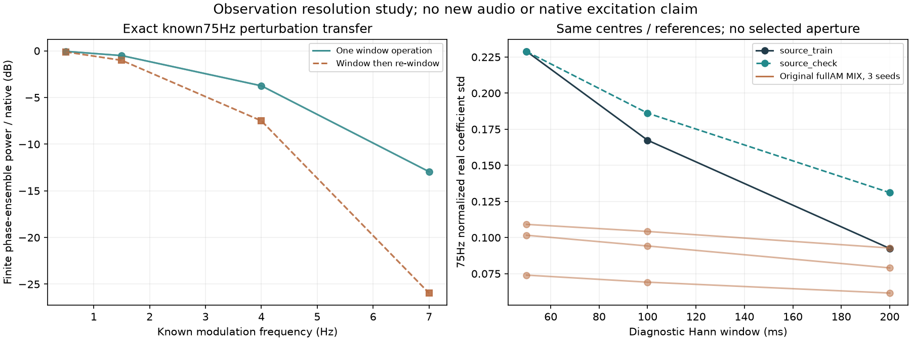

# 怠速分析窗传递 V1

本轮确认了一项需要处理的提取偏差：**分析窗会压低快变化，窗口结果再次进入声源并被观察时还会继续平滑。** F2在较短窗口下显示的75Hz附近变化明显多于现有合成声。尚未分清其中的主声线调幅、邻线与宽带残差，因此不直接补AM或更换实时音色。

## 已知信号：窗口会损失多少

使用前三秒的三个冻结程序相位／细节环境及准确的75Hz原生响应。四个预声明调制频率为0.5／1.5／4／7Hz，用cos／sin两条相位正交信号计算随机初相位的有限段期望；可以对应正增益`1+0.1*cos`的精确线性变化。

第一步经过原200ms窗；第二步把第一步的116个系数中心值三次插值回原生时间，再观察一次。只保留插值支持完整的96个窗口，所有比值使用同一组96个中心、各自有限段去均值。

| 已知变化频率 | 一次观察剩余功率 | 再次观察剩余功率 |
|---|---:|---:|
| 0.5Hz | 98.72% | 97.45% |
| 1.5Hz | 88.98% | 79.17% |
| 4Hz | 42.20% | 17.78% |
| 7Hz | 5.07% | 0.254% |

这里是调制**功率比**，不是整段声音功率／幅度或音质百分比。三个环境结果接近。该实验量化重复观察的平滑作用，**不是原log幅度→联合FIR→正增益编译器的精确复现**，不能据此把全部真实差异归因于重复平滑。7Hz是已知包络变化频率，与发动机RPM无直接对应关系。

## 原声与生成声：同中心比较

独立诊断观察器比较50／100／200ms Hann窗，20ms步长、原116中心、13条声线＋DC和固定原TRAIN复参考。完整覆盖F2拟合／检查、三个同幅谱相位对照各两段，以及三个原完整AM混音的程序实际相位／混音估计相位，共14份数据×3窗＝42组。没有挑选最佳窗口，也没有用CHECK调参数。

下面只列75Hz归一化实部系数的标准差。生成声范围为三个种子的**首个三秒段**，采用与实录相同的混音相位估计：

| 观察窗 | F2拟合段 | F2检查段 | 原完整AM合成声 |
|---|---:|---:|---:|
| 50ms | 0.22891 | 0.22881 | 0.07401–0.10914 |
| 100ms | 0.16740 | 0.18615 | 0.06913–0.10424 |
| 200ms | 0.09248 | 0.13111 | 0.06160–0.09279 |

50ms窗下两个实录段接近，200ms窗下则相差较大；不同时间尺度的统计不能用一个“力度强度”概括。全部窗口最大条件数不超过约3.12，未发现这组声线设计的数值病态。但良好条件数并不排除遗漏邻线、宽带噪声及相位估计影响。

源／生成虚部也明显随窗口和相位基底变化，不能把这些坐标的全部变化直接当物理机械声、点火或原生AM。特别是缩窗后112／187Hz的虚部仍存在已知相位与估计相位差异；完整数据均保留。

## 工程决策

下一步先在相同三窗下复核生成器主声线／细节预算，并检查原声75Hz附近未表达的旁带与宽带残差，区分该由主声线调制还是细节模块承担。随后再用原生生成→相同观察器验证时间形状；真实源比较继续包含混音相位提取器。

不将短窗幅度直接写入FIR，不反演接近零点的窗口响应，不统一增强三条AM，也不改变187Hz的独立细节预算。当前证据支持修正提取／观察关系，尚不证明某种新声源已更自然。

| 模块 | 责任 |
|---|---|
| `tools/idle_window_transfer_v1/observe.py` | 固定中心、可配置观察窗及模型内已知控制 |
| `tools/idle_window_transfer_v1/transfer.py` | 精确一／二次窗口响应及有限初相位期望 |
| `tools/observe_idle_window_transfer_v1.py` | 完整源／对照／生成数据适配与保存 |
| `tools/audit_idle_window_transfer_v1.py` | 独立QR、三次插值、协方差与谱核对 |
| `assess_`／`package_idle_window_transfer_v1.py` | 图表、解释与归档 |

先通过13OSC非线性FM、无AM已知控制：三种窗口系数误差低于1e−10、虚假log幅度标准差低于1e−8；四频率×三环境的真实波形变化与缓存响应也通过。随后独立5220次QR核对全部42组＋3已知组，系数差约3.01e−14FS；所有14份200ms结果与冻结旧观察一致，约1.18e−14FS。全部51有符号6×6协方差、时间PSD、12组双窗口数组及指标独立核对通过，图已目视。

本轮没有新拟合、声音文件、下载或C修改。证据冻结在`E:/VehicleSoundLab/baselines/idle_window_transfer_v1`，619个C/H、67个旧voice、行驶35%、旧音轨及默认保持。现有怠速配比听评不重复；完整怠速／负载工况、多发动机、立体声／7.1.4目标继续。
