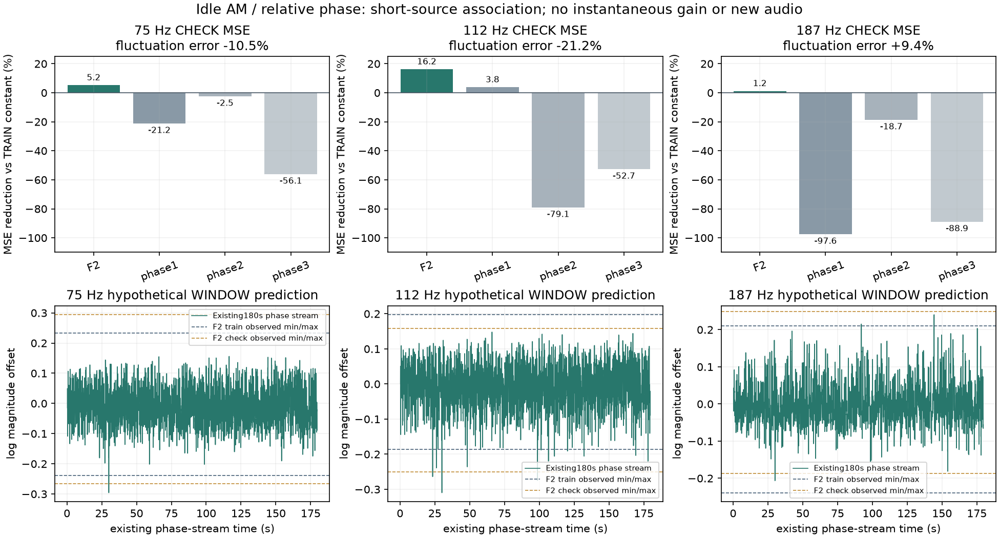

# 怠速力度与相位联动 V1

F2录音支持继续研究75、112Hz主声线的力度／相位联动；**187Hz不能一并套用同一规律**。本轮完成源数据关系、持续相位轨迹和误差分解核查，没有生成新音频或改C默认。上一轮[怠速新配比](http://127.0.0.1:8789/references/analysis/idle_local_partition_v1/review1/index.html)继续保留待听。

## 从素材提取的关系

沿用F2原6–9秒拟合、9–12秒检查，以及全部三个同谱相位对照的两部分；这段检查材料已被研究过，不称新的盲测。复用冻结的13声线联合观察、三条主声线的实测声学相位和局部复系数，没有重做声学时钟或另选片段。

以单位相位`z75/z112/z187`构造两个相对坐标：

```text
w0 = z187 × conj(z112) × conj(z75)
w1 = z75³ × conj(z112)²
```

每个原生200ms Hann窗内，对两个复坐标的实部／虚部分别求平均，得到4项特征；目标是三条局部复系数模长的自然对数。使用一个含截距的5列OLS，全部参数只用拟合段；没有相位展开、额外延迟选择、正则强度扫描或检查段改截距。四套源／对照拟合都满秩，源设计条件数约8.29。

| 约Hz声线 | 检查段总MSE降低 | 检查段波动误差降低 | 含义 |
|---:|---:|---:|---|
| 75 | 5.21% | 10.55% | 有局部联动线索，平均偏差仍增大 |
| 112 | 16.19% | 21.21% | 本实验较明确的局部联动线索 |
| 187 | 1.19% | **−9.42%** | 总误差改善来自平均值，波动反而变差 |

总MSE以“拟合段目标均值”为固定常量基准。后续另做明确的**后验误差核算**：`MSE=误差方差+平均误差²`，没有重新拟合检查段。表中波动误差指这项误差方差，不能当作音色或机械真实度评分。

同谱对照各自拟合后，三个目标的检查结果大多为负；只有一个对照的112Hz总MSE降低3.81%。源三项均较好，但只有一次短录音，每段116个窗口有90%重叠，不能当作116个独立样本或统计显著性。相位、幅度来自同一个音频观察器，邻频拍频等仍是替代解释，不能据此认定物理燃烧耦合。

另外保留了全部8组、7变量、51个正负20ms间隔滞后的完整协方差，而非只挑相关最高的延迟。图和JSON均保留负收益。

## 在持续相位轨迹上检查

源实验结束后才声明第二项检查：不改拟合参数，将同一个窗口关系用于已有的三个持续相位轨迹，分别180／24／24秒，共11298个完整窗口。复用原200Hz节点和自然三次插值，按48kHz求同样的200ms Hann平均，没有简化成节点率观察。

预测窗口值在代数全局界内，未见本批轨迹产生极端发散；但约18.5%／21.4%／26.7%的窗口至少一项相位特征超出拟合段逐项最小／最大值。这只是矩形描述，**不是置信区域或失效概率**；预测也有少量超出短原声力度范围。没有对这些点限幅、补训练或改相位。



图上排是总MSE比较，标题同时标出波动误差；下排只是既有180秒相位轨迹经观察窗映射后的假设力度，**不是新生成音轨或实时增益曲线**。

## 为什么还不能直接接入C

这里拟合的是`log(窗口内观察到的幅度)`。把同一公式当作逐采样点的`log增益`，再经过OSC相加、200ms观察和对数，不会得到同一个结果：指数、平均、复数投影并不交换。已有幅度生成的75Hz观察起伏不足，也说明需要校验整个前向链。

下一步算法应先用已知联动声源检验“生成→原观察器”的窗口一致性，然后拟合受约束的联合统计及主声线／残差功率。75／112Hz可作新假设依据，187Hz保留独立分支和反例；不能简单把本轮回归公式放到所有OSC增益前，也不能盲加AM。这里的相对矩阵只针对F2声学坐标；其他发动机须有各自配置和证据，不把2／3／5关系硬编码成全车型规律。

本轮没有建立真实曲轴RPM／负载、物理AM/PM分离、完整声源功率预算或听感验收；原共同相位36／17／33／逐线14kHz／原E资格继续保留。实时默认、行驶35%、619个C/H、67个旧voice、驾驶器及立体声／7.1.4边界不改。

## 代码与留痕

| 入口 | 职责 |
|---|---|
| `tools/idle_amp_phase_link_v1/observe.py` | 窗口特征、对数幅度、固定回归和完整有符号协方差 |
| `tools/idle_amp_phase_link_v1/known.py` | 已知联动、坐标旋转与短录音高相关反例 |
| `observe_idle_amp_phase_link_v1.py` | 全8源／对照宿主；只分析，不渲染 |
| `probe_idle_amp_phase_stream_v1.py` | 既有全时长相位轨迹的同窗检查 |
| `audit_*`、`assess_*`、`package_*` | 独立核查、绘图和归档 |

独立实三角／逐窗加权、QR、全部8×51×7×7标量协方差、预测及误差通过；最大新统计核对差约7.4e−13。全部11298个持续窗口使用另一插值实现复算，特征差约7.1e−15；完整载波消去的代数核对差约3.5e−11。误差分解另行复核。保留assessment1原图与assessment2补充波动提示的图，均非听感结论。

所有实际执行源码、参数和数组冻结在 `E:/VehicleSoundLab/baselines/idle_amp_phase_link_v1`，摘要为 `idle_amp_phase_link_v1_summary.json`。旧声学观察器及系数复用其已冻结资格，不把这轮统计审计冒称新的物理相位验证；无新下载、听评提问或无关驾驶测试重跑。
