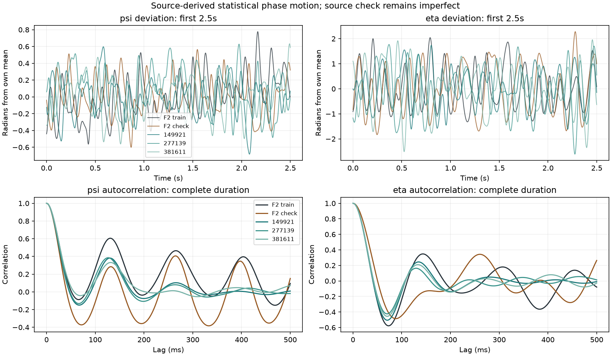
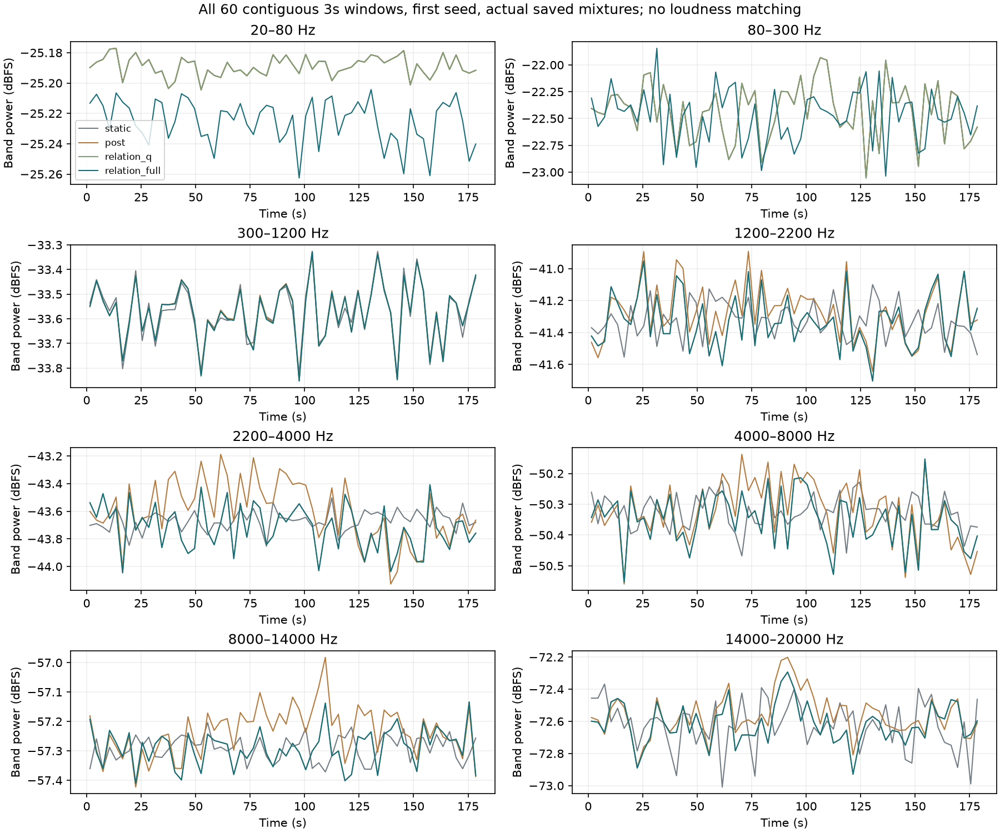

# 怠速声线关联生成 V1

新的[同增益试听](http://127.0.0.1:8789/references/analysis/idle_phase_recipe_v1/review2/index.html)已生成，包含原录音、旧细谱、前轮配方和新候选，支持24秒／3分钟、细节独奏和三组随机变化。**这是离线候选，听感尚待确认，没有替换实时C或驾驶默认音色。**

## 这轮从素材补了什么

主要使用已批准的F2近尾排怠速：原6–9秒训练、9–12秒已观察检查，两端仍各裁250ms。其他素材继续分别建档：A是Performante车外，B／F3是Tecnica车内，F1是多车／移动录音；F3讲话覆盖的驻车段不用于怠速拟合。没有新下载，也没有把不同车辆与录音位置混成一个模型。

前轮只保存独立频率和平均幅度时，三条主要低阶声线之间的关系会在持续生成中漂移。这轮增加两组**相对相位变化的统计参数**，并让同一组三声线相位控制既有四带正功率规律q，协调高频细节的增强和减弱。仍是13个主OSC、六组原8192抽头共振FIR和原左右比例；没有新增高频云、独立摩擦锯齿波、房间或低频增益。

```text
F2原声 → 两组声学相对相位 → 联合频谱／协方差 → 统计参数
                                                  ↓
新随机源 → 2×2有限FIR → 连续相位变化 → 三条主OSC（其余10条保留）
                                    └→ 原正功率规律q
独立随机细节 → 原六组共振FIR → 共振后√q调幅 → 与主声线混合
```

运行时保存和使用的是系数，不保存录音相位、包络轨迹或PCM循环。与主声线关联的细节仍有独立随机颗粒；这不是单一点火触发器。当前只研究固定F2怠速，不能推成完整转速／负载覆盖或其它车型已验证。

## 先做了什么，又为什么修正

首个VAR(2)模型虽数学稳定，实际生成的相位自相关却过于振荡：η约150ms处回归强度约0.8，录音训练约0.35，检查段同一位置接近−0.1。它可能引入多余调制感，但**没有相应听评证据**。保留`fit1/render1/audit1/review1/plot1`，不采用它作为默认，也没有删掉不理想结果。

随后明确追加联合频谱方案：200Hz坐标、全部六个128点Hann窗／64点步进／256点FFT，联合谱平方根生成完整256抽头2×2 FIR。再以完整训练协方差做声明的2×2输出变换；独立白噪声经充分预历史滤波后产生新变化，插值到48kHz。它具有有限记忆，避免用单个高共振二阶模型概括全部变化。没有扫阶数、窗口、种子或用检查段重训。

为保持相位分支一致，合成适配器把η的圆坐标提升一圈，再和同一训练段拟合的公共声学载频组合；未改统计波动。载频约37.50537Hz，三条声线均频从75.03680／112.48553／187.52858Hz变为75.01073／112.51610／187.52683Hz。**这是显式的声学生成假设，不是测得的曲轴RPM或真实长期锁相。**其余10条模态、全部幅度与声道相对相位保持。



新方案降低了首模型过强的周期性，但也损失部分长延迟关联，不能称完全还原。180秒生成两坐标标准差0.245／0.806rad，原训练0.251／0.817、检查0.223／0.953；尤其检查段η变化仍更大。短录音的频谱估计和Gaussian分布也有限，不能由这些数值推出“更好听”。

## 验证与使用范围

三组原种子149921／277139／381611全部保留；首组完整180秒，其余各24秒。所有完整混音／独奏均48kHz，无削波，联合频谱候选最大峰值0.401633FS。独立程序逐节点直接卷积核对相位随机过程，重算全部原生主声线与q、全部保存混音关系，并在早／边界／60／120／179秒等位置直接点积核对原六组音频FIR。最大主声线差约7.46e−9FS，q差2.02e−11，混音存储差2.24e−8FS；音频FIR核对为选定点，不宣称逐样本独立重算所有卷积。

原声两段／全部三组生成的501点坐标曲线和首组全部60个连续3秒实际混音窗均保留。30份PCM24试听使用统一增益1.0、相同首尾淡入淡出，HTTP内容逐字节校验。旧配方也使用本轮相同PCG64随机细节便于比较，**不宣称与旧xorshift音轨逐样本相同**。独立生成的统计相位由另一个种子流提供，不循环录音。



612份C/H、67份旧声音参数与旧试听／take保持；新统计参数只存研究配置，尚无本轮C移植或实时驱动接入。相位生成、主OSC、共振细节、监听导出分别在`tools/idle_phase_recipe_v1/{phase,spectral,render2,review.html}`及独立入口维护。首模型／后续联合谱方案、两次完整音频审计和所有源代码字节分别留痕；浏览器首次自动检查因未展开折叠区域而无法点击，保留失败，只修正检查脚本，不改声音或网页。完整冻结`E:/VehicleSoundLab/baselines/idle_phase_recipe_v1`，摘要`idle_phase_recipe_v1_summary.json`。

下一步以本轮听感决定是否值得移植；不重复待答听评、不直接晋级C。后续仍需区分相位纹理、共同载频变化、幅度／瞬态，补独立怠速证据并与驾驶状态同钟集成。原共同相位36／17／33／逐线14k／原E资格、全状态／多音色和实际7.1.4目标继续，不能用本轮离线数值检查替代。

归档首轮把整个FLOAT WAV哈希当作旧配方身份条件而失败；逐块检查确认15条旧配方总线的每个样本和data块完全相同，差异仅为PEAK块中的生成时间戳。原失败脚本、诊断与音轨保留；新版打包逐样本及所有RIFF块核对，仅单独核对该时间戳字段，不重渲染或放宽声音误差。
