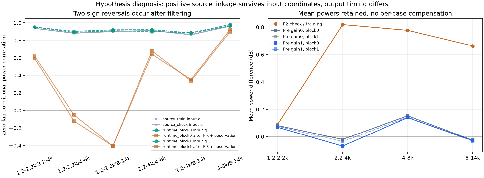
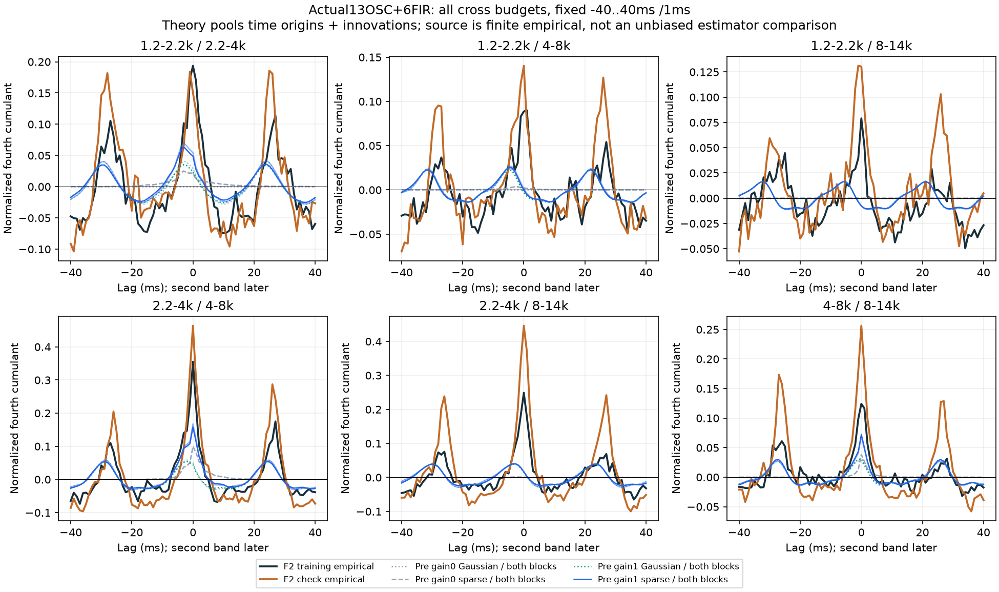
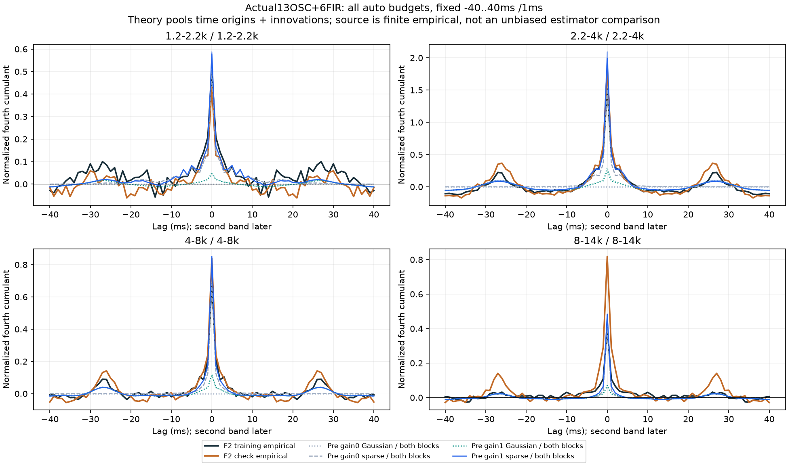
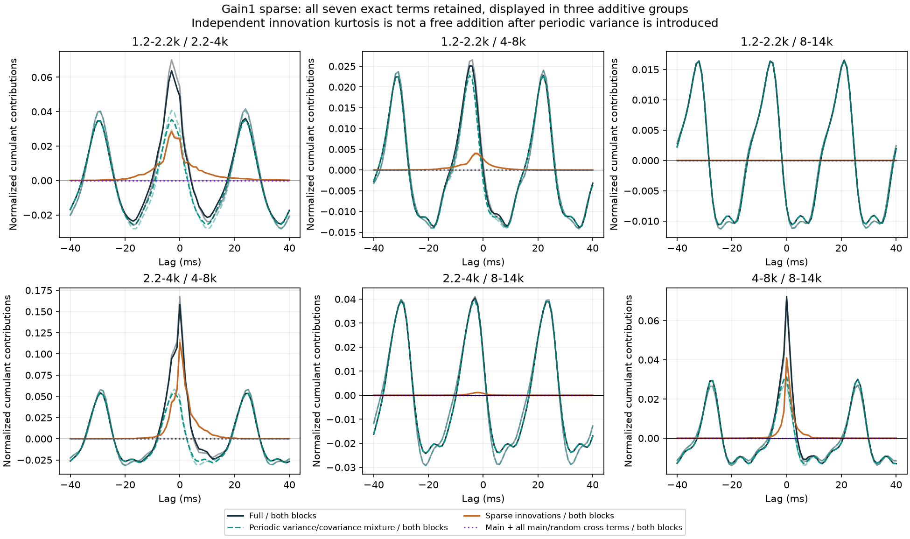

# 怠速实际声源预算 V1

本轮把正功率模型放进真实的13条OSC＋六个FIR支路计算，**发现不能把录音总带功率直接当成滤波前的随机输入强度**。新联动带来了部分正负时间结构，但滤波后两对条件功率关联反向，原稀疏颗粒强度也发生重复计入。没有生成新试听或修改C默认。

## 试验接法

原模型、声线、六个滤波器及增益全部冻结。只测试一个明确的新假设：高四个随机输入的方差为`v=1+amount×(q−1)`，先乘`√v`再进入原FIR；低两个输入仍为单位方差。q由原三个OSC自身相位及全部三对相位差驱动，不读取原录音相位轨迹或包络。

这与既有的滤波后幅度支路不同，不代表认可版本已被替换。固定0／100%两档、Gaussian／原独立稀疏输入两类、六秒内两个完整3秒窗，共8组，没有挑随机种子。沿用四个观察带，裁除各窗两端100ms，−40～＋40ms每1ms全部81点、四自带六跨带全部计算。

首轮已知验证通过后，原48000帧预热被完整响应长度65536的保护条件拒绝；原计划、执行源、报告与数组保留。只将分析预历史扩为65535帧，覆盖原完整数组，不截短响应、不改音色或拟合。输入相位和主声线在负预热时间连续推进。

## 输出矩怎么算

原13OSC经过观察带通得到确定性均值m。独立、对称、单位方差的随机输入经过实际有效响应h，条件输出方差V、带间协方差C和四阶项J分别为：

```text
V_b[n]   = Σ_i,u h_bi[u]² v_i[n−u]
C_bc[n,τ]= Σ_i,u h_bi[u] h_ci[u+τ] v_i[n−u]
J_bc[n,τ]= Σ_i,u κ_i h_bi[u]² h_ci[u+τ]² v_i[n−u]²
```

用真实线性卷积、有效下标范围，不循环绕回。Gaussian输入κ＝0；稀疏输入沿用原四个κ，未重新拟合。所有主声线、随机方差、协方差与混合项都计入。累计量分解为7项：主声线、`Cov(Vb,Vc)`、`2Var(C)`、两项主声线平方与随机方差交叉项、`4Cov(mb×mc,C)`及平均J。

理论量的定义是：在指定有限时间范围均匀选时间原点，再对独立随机输入集合平均，按这个集合的均值中心化。**它不是单条有限随机录音累计量估计器的无偏期望**。与原录音曲线的比较用于描述差异，不作统计显著性或物理源认定。

## 结果一：滤波位置改变了共同起伏

对原录音两段的q、既有OSC驱动的两段q，六对输入零间隔关联全部为正，范围约0.86～0.98。相位闭合坐标也没有显示必须立即重置相位的证据；这里只描述声学坐标，不认定曲轴。

但经过原FIR和观察滤波器后：

| 条件功率配对 | 生成窗0输入q相关 | 输出随机方差相关 | 窗1输入q相关 | 输出随机方差相关 |
|---|---:|---:|---:|---:|
| 1.2–2.2／4–8kHz | ＋0.8901 | −0.1208 | ＋0.9020 | −0.0505 |
| 1.2–2.2／8–14kHz | ＋0.9095 | −0.4063 | ＋0.9192 | −0.4061 |

加入主OSC后的条件总功率结果几乎相同，主OSC不是本次反向的主要项。四个自身主带响应的能量重心分别约9.61／4.57／2.22／1.34ms，响应宽度也不同；**这些重心不是可直接套用的固定补偿延迟**。有色细节的包络通过不同滤波器，实际时间传递必须计算。



后验诊断另有一个非发动机反例：三条数学正弦的相对相位闭合从0换到π，可以让两个正值功率信号的相关从1变为−0.9889，而边缘均值不变。原录音与生成输入本轮均保持正关联，因此不能拿这个反例当作本次应锁定相位的理由。

## 结果二：有部分时间结构，仍缺少原声的共同集中

引入联动后，稀疏版本六对跨带在8–20ms区域有五对平均为负；原录音两段是六对全部为负。1.2–2.2／8–14kHz仍为正，部分零间隔项也不符合原声。完整曲线显示偏移与幅度不足，不能只凭“五对变负”宣布还原。



## 结果三：稀疏颗粒与周期变化需要共同分配

原不调制的稀疏模型已经拟合了单带集中度。加周期方差变化后，既多了方差混合项，原创新四阶项还会随v²放大。2.2–4kHz零间隔自带指标从约1.5149上升到1.9963／2.0939，增加31.78%／38.22%。继续保留全部旧κ再加新层，会重复计入原先已分配的集中度。





平均功率变化很小，原不调制配方的全部810个旧理论点也复现，最大差5.64e−12。**均值接近不等于时间质感接近**。这些是预算发现，没有新的主观听感结论。

## 下一步和模块

先检查实际能量响应对已测幅度调制的传递，再比较在频谱塑形之后调幅的接法，或把真实前向响应纳入输入强度求解。两路都要验证最终输出；不靠手调固定延迟、加强高频、改相位锁定来掩盖本次差异。确定调制位置后，再重新分配周期变化与独立颗粒的四阶预算，不能直接叠加旧κ。

离线模块`response.py`只管随机输入经过实际响应后的条件矩，`moments.py`只管时间集合矩与7项分解，`checks.py`是已知穷举；观察、独立审计、后验诊断及其审计、绘图、打包各有入口。它们是算法研究工具，未增加运行时C模块。

两输出／两输入／双抽头、非零均值与时变方差的Rademacher、Gaussian矩匹配三点、稀疏三点集合先精确穷举，全部3对×5间隔及条件矩通过。真实全部8组80曲线6480点由独立SciPy线性卷积、原始矩和四阶累计量15种集合分拆复算；最大归一原始矩差2.45e−15、四阶差2.23e−15、响应差3.65e−18FS。输入／响应诊断另外独立验证，最大相关差1.23e−15，并以Bessel积分核对反例。四张完整图已目视。

612份C/H、67旧配置、认可行驶35%、已有怠速候选与旧二进制／take保持。无新音轨、下载、运行配置或旧61项驾驶测试；现有听评不重复提问。仍只分析近单声道F2左观察，未恢复立体声对象、实际RPM／机械事件或多发动机。原共同相位36／17／33／逐线14k／原E与7.1.4等完整目标继续。完整证据冻结`E:/VehicleSoundLab/baselines/idle_wave_budget_v1`。
