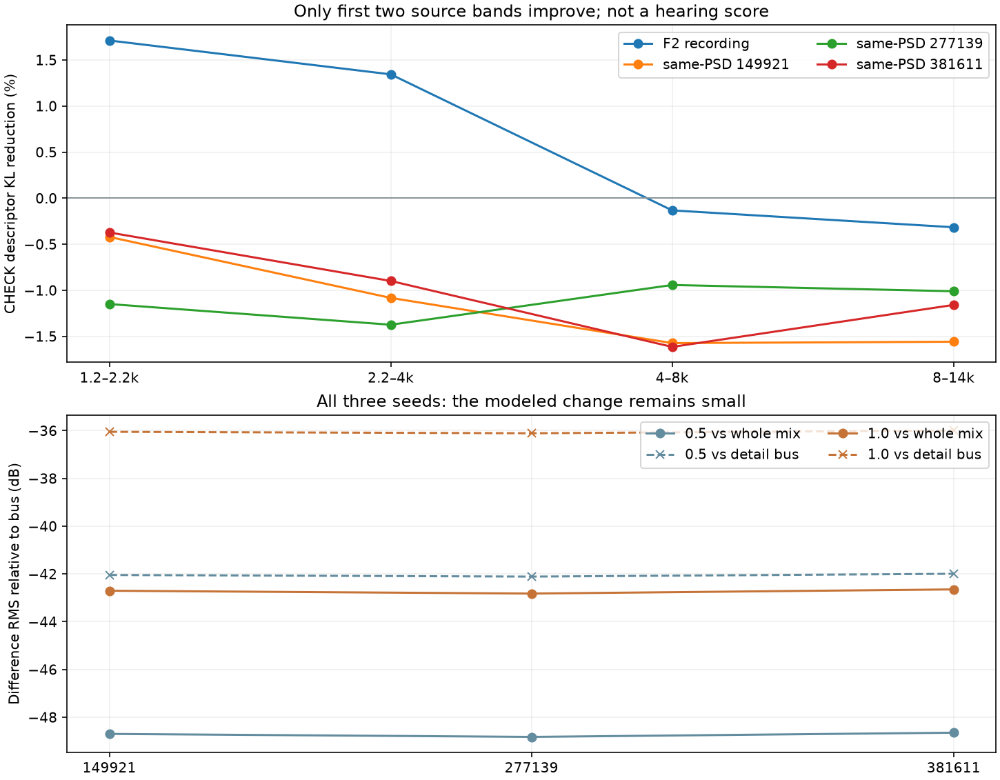

# 怠速局部共振 V1

本轮从原F2素材提取了**随低阶声学相位变化的局部频谱形状**，完成[原版／50%／100%的24秒对照](http://127.0.0.1:8789/references/analysis/idle_local_shape_v1/review1/index.html)。仅1.2–4kHz两层有少量跨段预测收益；实际完整混音变化仍很轻，**不能称怠速已经明显改善，也未晋级C**。

## 提取与选择

原F2尾排6–9秒训练、9–12秒检查，各裁两端250ms；48kHz原声及此前声学相位来自带哈希冻结。检查段早已观察，本轮又用于选择频带，不能宣称独立盲测。其余车辆／车内素材不混合，没有新下载。

对四个原Butterworth频带分别除去旧正功率规律√q，再以256点Hann窗、96帧步进观察原生FFT。每帧的频带内谱能量归一为总和1的概率，刻意去掉整带音量，只研究内部形状。256点窗有5.33ms时间支持、187.5Hz格距；这不是无偏瞬时PSD或物理声源分离。

预测器是正的多项logit：`p = softmax(log(训练平均谱) + [1, x]β)`。x为三条原低阶相位及其三个相位差的实／虚部，共12维；每带13个回归项。没有把带噪低阶相位乘到数百阶。所有参数只拟合训练段，16个源／对照模型均在原400次迭代上限内收敛。

| 频带 | 原F2检查KL下降 | 三个同谱相位对照的范围 |
|---|---:|---:|
| 1.2–2.2kHz | +1.712% | −1.149%至−0.372% |
| 2.2–4kHz | +1.344% | −1.374%至−0.899% |
| 4–8kHz | −0.133% | −1.615%至−0.943% |
| 8–14kHz | −0.316% | −1.558%至−1.010% |

这是局部谱描述的平均KL改善，**不是听感／还原百分比或置信区间**。源前两带和全部同谱对照表现不同，支持继续做有限候选；收益仍小。先保存全部拟合，再明确追加音频方案，仅选择前两带，不重拟合检查段、不扫强度选最好结果。

## 持续合成

保留原13条OSC、原六组细谱FIR、相位、q、左右比例和稀疏激励概率。把选中两条旧FIR的响应分成5／10个互补余弦局部分支，**所有分支使用该带原来的同一条随机激励**。不是另加独立高频云。

```text
原随机激励 → 原FIR的互补局部分支 ─────→ 分支加权 → 原√q → 原混音
                                             ↑
原统计相位 → 12维声学特征 → 训练谱概率p → 正增益／完整Gram归一
```

原生采样点上计算`g=(p/训练平均谱)^(强度/2)`。分支彼此相关，归一使用完整响应Gram的`gᵀGg`，包含交叉项；使独立平稳创新假设下的条件方差保持原值。不能把这一约束扩成实际短时功率、PSD或全部四阶矩不变。0量直接返回旧流，同时保留分支计算；没有复制录音或其系数轨迹。

编译保留完整32768抽头分支及16384帧对齐。当前离线源生成明确预取内部随机创新，未把它当作外部输入零延迟处理，也未完成这些分支的C实时成本验证。其余四条共振层和13条主声线不改。

## 实际结果和边界

三种子149921／277139／381611，各0／50%／100%、24秒全部保留。100%差值RMS比完整混音低约42.65–42.82dB，比整个细节总线低约35.99–36.11dB。局部结构确有改变，但远不足以凭统计收益承诺明显变好听；不通过继续放大强度掩盖这一点。



本轮说明：整带功率以外确有一点可重复局部谱形状，但它不是当前怠速问题的充分解法。下一步应同时回到主声线幅度／相位的自然变化，先分清真正幅度起伏与固定频率投影把FM误读成AM的部分。

额外只读回查旧200ms窗的三条强主声线：原始未限幅对数幅度标准差约0.0950／0.1003／0.1233，200ms迹加权相关约−0.2012。它只是旧固定频率投影的训练观察，FM和窗口误差仍混杂；**不能直接当新的真实发动机幅度模型，也不能把负相关裁为0就移植到新相位声源**。该后验线索及输入哈希独立保存。后续观察应使用原低阶声学相位作回归基，并先过已知无AM非线性FM／已知AM控制，再跨片段检查。

## 代码与验证

| 模块 | 职责 |
|---|---|
| `idle_local_shape_v1/observe.py` | q归一化、局部谱形状观察 |
| `model.py` | 正条件谱及固定参考频格的拟合／预测 |
| `filterbank.py` | 原FIR互补分支、完整Gram、正增益 |
| `fit_…`／`render_…` | 训练与对照、24秒同源合成 |
| `audit_…` | 直接DFT／另一IIR实现、梯度、全部分支与原生音轨重算 |
| `assess_…`／`review_…` | 全部差值、同增益试听；复用原页面检查程序 |
| `inspect_idle_core_amplitude_v1.py` | 旧强主声线幅度统计的后验只读线索 |

已知正谱律／常量、相关分支集合和对角归一失败反例先行。独立重算8组源观察、16个模型预测／梯度；检查每条编译分支的全部FFT响应，独立完整FFT卷积重算全部三种子／三强度的原生波形。最大音轨差约2.23e−8FS、分支差2.61e−17FS，全部原生条件方差误差小于8.9e−16；0量与旧冻结混音有两组逐样本相同，另一组最大1.86e−9FS。旧音轨不被覆盖。

20份统一增益1.0 PCM24、HTTP字节、全部页面组合／静音切换／seek／手机布局通过，图与UI截图目视。`audit1`与补充逐分支响应核验的`audit2`均保留。数值验证不代表人耳认可。619份既有C/H、67份旧音色及已认可行驶Demo、旧take保持；本轮无关的整套C测试未重跑。

源码、参数、执行快照、全部音轨与验证冻结于`E:/VehicleSoundLab/baselines/idle_local_shape_v1`。局部研究不替代原共同相位资格、完整驾驶状态／多音色或实际7.1.4目标。
