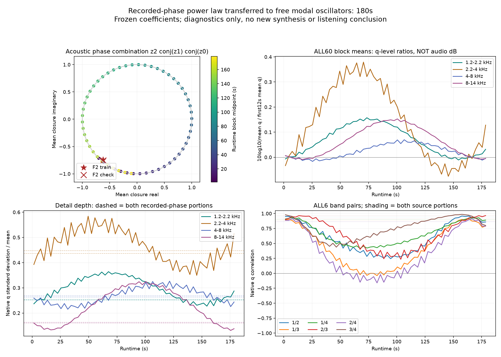
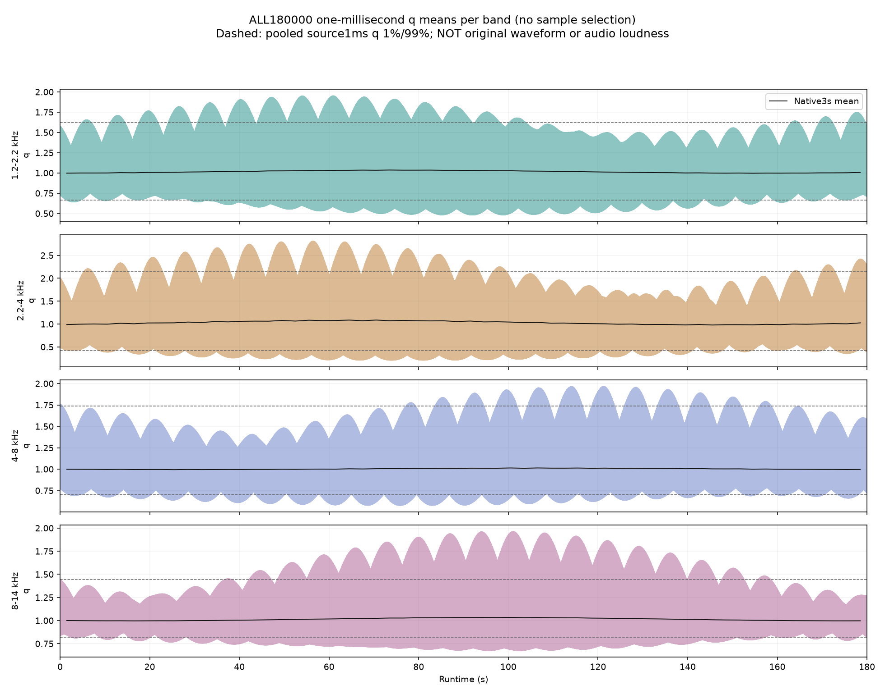

# 怠速持续相位迁移 V1

三分钟检查发现：**从录音相位学到的细节规律，直接交给自由运行的固定频率OSC后，细节统计会慢慢漂移。**这不否定前轮12秒试听，但说明“正功率、短段可听”还不能证明持续怠速稳定。本轮未生成或更换音频；[前轮试听](http://127.0.0.1:8789/references/analysis/idle_post_audio_v1/review1/index.html)保持原样。

## 两种相位来自哪里

训练时，F2原录音75／112／187Hz附近各经独立带通与Hilbert观察，得到随录音变化的三条单位复数声线。正功率规律使用这些相位及其全部三组相位差。生成时，使用原主OSC的三个固定频率及初相重新计算同一规律，不循环录音相位轨迹。

三个OSC原频率为75.03679765988039／112.48553445984204／187.52858173958495Hz。观察其中一个声学组合：

```text
ψ = θ187 − θ112 − θ75
dψ/dt / 2π = 0.0062496198625154875 Hz
因此自由运行的ψ约每160.0097秒转一圈。
```

这是已保存频率之间的差，不是新发现的发动机周期、曲轴RPM或应加入的LFO参数。原录音只支持短时间声学观察，不能据此直接把这些OSC锁成2／3／5阶。

## 全部180秒结果

固定参数、不重训、不挑时间段，连续检查60个3秒窗；每窗原生48kHz计算，再保存全部180000个1ms功率均值。原声仍用6–9秒训练、9–12秒已观察检查，各裁首尾250ms。

| 指标 | 录音相位代入同一功率规律 | 自由OSC代入同一规律 |
|---|---:|---:|
| ψ的圆集中度 | 训练0.969／检查0.975 | 完整180秒0.108 |
| 2.2–4／8–14kHz的q相关 | 0.862／0.867 | 3秒窗最低−0.160，最高0.916 |
| 8–14kHz的q标准差／均值 | 0.163／0.160 | 3秒窗0.131–0.325 |
| 四带平均q相对前12秒 | 训练均值约1，检查约0.997–0.999 | 最大变化约−0.076～＋0.379dB |

圆集中度为单位复数均值的模，0表示覆盖较分散，1表示高度集中；不代表还原率或声学质量评分。相关和起伏均是**同一模型预测的细节功率q**，不是原始声音的全部统计，也不是已经经过FIR／主OSC混音的声压。q均值的dB比也不能当SPL或实际输出响度。

平均功率相对稳定，不能掩盖细节深度和频段间关联的变化。180秒时ψ转过约1.125圈，表中完整集中度依赖这个固定观察时长，并非无限时间的精确值。原声两段总共只留下5秒有效相位，本轮既不能证明实车三分钟保持不变，也不能证明所有合成器感都由此造成。





## 工程意义和后续

问题位于**细节功率规律与持续相位坐标的接口**，不是音频文件压缩、播放变调或新增房间模型。前轮首12秒q与原冻结数组复现，原正功率全相位边界仍成立；此次没有发现非法值或播放实现错误。

下一步先研究录音中ψ的分布、时间变化以及它与细节功率的关系，判断应保留哪些声线关联、哪些可作为独立随机纹理。修正方案必须有新的已知控制和跨段验证，再做完整混音与长短试听。暂不硬锁相、改OSC频率、复制相位轨迹或用增益补偿掩盖漂移。固定行驶配方继续独立保留。

## 验证和留痕

`tools/idle_phase_transfer_v1/measure.py`只管坐标和统计，观察／独立审计／绘图／打包分别维护。常量规律、解析闭合与失谐三声线、独立相位原点旋转／系数变换、分块一致性先过，之后才读源数据。

独立审计不用生产特征函数，以实三角函数或显式实虚乘积重算全部60个原生窗、两段源相位、1ms均值、原生二阶矩／协方差／排序分位数和圆统计。最大1ms功率差2.02e−11、分位数差2.35e−11；首12秒与上轮原生q核对，最大差3.19e−12。两个完整图已目视。所有父输入与执行源均按哈希绑定。

数据冻结`E:/VehicleSoundLab/baselines/idle_phase_transfer_v1`；计划`idle_phase_transfer_v1_plan.json`，摘要`idle_phase_transfer_v1_summary.json`。612份C/H、67份旧配置、已有怠速与认可行驶35%、二进制／take保持原样，无新下载、音轨、运行参数或无关61项驾驶回归。未重复待回复的听评问题，未声称新听评或实际RPM／物理源识别。原共同相位36／17／33／逐线14k／原E资格，以及完整驾驶、多音色、实际7.1.4目标继续。
