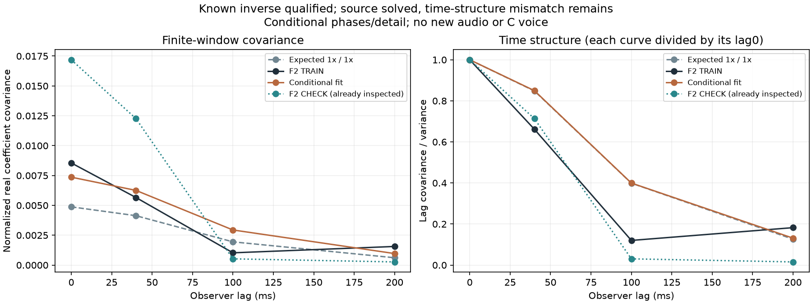

# 怠速期望统计拟合 V1

本轮修好了“起伏参数如何估计”的验证链，但**还没有获得值得替换的怠速音色**。F2原录音的变化节奏仍与当前两参数模型有差距，因此没有生成新试听、修改实时C或替换已认可声音。

## 从素材研究了什么

沿用已批准F2尾排怠速的6–9秒拟合段、9–12秒检查段，以及原三个同幅谱相位对照；没有下载新素材。约75Hz主声线的力度起伏是本轮对象；112／187Hz、其他OSC、细节共振及空间处理不改。75Hz是这段录音的声学声线，不据此推定真实RPM或点火阶次。

上一轮用三个短随机片段反求变化速度，连预设的已知参数都找偏。本轮计算随机发生器的**理论期望**，再让它通过实际200ms分析窗、20ms步长与有限段去均值，预测0／40／100／200ms四个窗口统计。只对新的独立75Hz力度取期望，其余三套冻结相位／细节是固定条件；尚不是完整声源及混音相位提取器的期望。

随机FIR仍来自原素材幅度模型：64抽头、三个输入、50Hz节点，四节点三次插值按完整协方差校正方差。力度为`g=exp(s*x−s²*V)`，有：

```text
E(g) = exp(−s²*V/2)
Cov(g_i,g_j) = exp(−s²*V) × expm1(s²*Cov(x_i,x_j))
```

`E(g²)=1`只约束理论功率，不能保证每条短音轨RMS相同。独立75Hz仍缺少旧跨声线AM关系；未来若渲染，须保留独立75Hz的1×／1×对照。

## 数值链通过，素材节奏仍未匹配

先执行预声明控制，再进行全部四个TRAIN拟合，最后报告已看过的CHECK。初值1／1、边界速度0.5–4／力度0.25–3、40次求值与原误差门槛未改。

| 检查 | 结果 |
|---|---:|
| 已知速度／力度1.4／1.15，同网格恢复误差 | 2.2e−16 |
| 独立2000Hz参考目标，1000Hz拟合恢复误差 | 2.3e−9 |
| 全部12组压缩观察与原生48kHz系数最大差 | 4.23e−6，低于原1e−5门槛 |
| 四组1000／2000Hz期望矩最大相对差 | 3.68e−6，低于原1e−4门槛 |
| 独立期望矩／Jacobian核对最大差 | 2.78e−17／8.43e−11 |

1000Hz网格只压缩**慢力度函数的积分**，原录音、OSC与观察响应均未降采样。

F2求得速度0.9581、力度1.2177，17次求值、无触边，Jacobian满秩2、条件数21.75。它通过原求解成功／边界／秩检查，`available=true`仅是数值状态。不能据此称音色模型合格：

| 窗口观察量 | F2拟合段 | 当前拟合预测 | F2检查段 |
|---|---:|---:|---:|
| 归一化实系数标准差 | 0.09248 | 0.08579 | 0.13111 |
| 40ms相关性 | 0.66168 | 0.84972 | 0.71346 |
| 100ms相关性 | 0.12012 | 0.39945 | 0.03038 |
| 200ms相关性 | 0.18234 | 0.13122 | 0.01545 |

四个矩的归一化平方误差，TRAIN从原1×／1×的0.24024降至0.07911；CHECK从3.00627降至1.90160。存在有限改善，但变化节奏和跨段力度仍未对齐。这不是听感分数，检查段也不是新盲测。三个同谱对照都推到0.5／3边界，按原规则保持不可用，不据此宣称识别出发动机。



本轮**不采用**这些参数，是对剩余差距的工程判断，没有追加或放宽数值门槛，也没有证明所有速度／力度组合都不可能匹配。没有做新的初值、强度、时钟、边界或网格扫描。

## 模块与下一步

| 文件 | 责任 |
|---|---|
| `tools/idle75_expected_v1/kernel.py` | 通用FIR任意时刻协方差、正力度期望与解析导数 |
| `tools/idle75_expected_v1/observer.py` | 原生响应的稀疏积分、完整窗口协方差、有限段去均值 |
| `tools/idle75_expected_v1/inverse.py` | 固定规则的两参数求解与轨迹保存 |
| `tools/idle75_expected_v1/controls.py` | 有限白噪声算子及高斯求积控制 |
| `tools/fit_idle75_expected_v1.py` | F2适配、已知资格检查、TRAIN先于CHECK |
| `audit_`／`assess_`／`package_idle75_expected_v1.py` | 独立核对、解释及冻结 |

独立审计重建六个稀疏观察算子的全部116行、12组原生预测、11组完整期望终点及全部48条已存轨迹成本。中间每条轨迹的核矩阵没有全部独立重算，此范围明确保留；没有重跑优化器。图已目视检查。

下一步继续提取素材的**时间结构及力度／相位关系**，经同一观察器检验，避免将窗口包络再次当原生激励而重复平滑；这只是待检验方向，不是本轮已证实原因。真实源的前向比较仍需加入混音相位提取器。187Hz细节过量属于另一项预算，不能通过统一放大AM解决。

原怠速配比试听仍独立待评；不重复提问或默认晋级。资料冻结于`E:/VehicleSoundLab/baselines/idle75_expected_v1`，619个C/H、67个旧voice、行驶35%、原默认／旧音轨及立体声／7.1.4接口保持。完整驾驶工况、跨发动机和最终怠速听感仍未完成。
