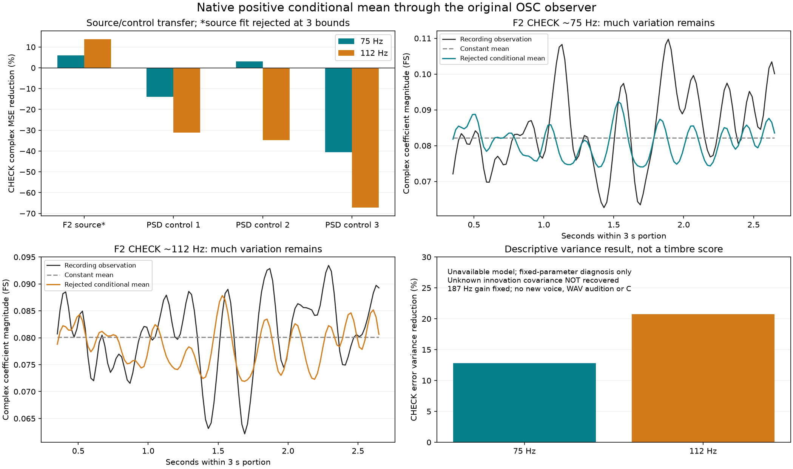

# 怠速条件力度前向拟合 V1

这轮把真实F2怠速的相位关联，拟合成了**先生成正力度、再经过OSC与原分析窗口**的模型；不再直接把窗口回归当实时增益。结果有局部线索，但**源模型有三个参数触边，保持不采用**。没有新增试听或替换C默认。

## 方法

复用已批准F2的6–9秒拟合、9–12秒检查，以及全部三个同谱相位对照。检查段早已研究过，不是新盲测。每段仍是13条声线、三条实测声学相位、200ms Hann／20ms步长／250ms裁剪，共116个高度重叠窗口。

只给约75、112Hz声线拟合正增益；187Hz及其他十条保持原拟合段的固定复系数。两项相对坐标仍是：

```text
w0 = z187 × conj(z112) × conj(z75)
w1 = z75³ × conj(z112)²
x = [Re(w0), Re(w1), Im(w0), Im(w1)] − 拟合段原生均值
d(t) = exp(截距 + β·x(t))
```

这里的坐标仅是F2声学模型，不是已确认曲轴阶次，更不能硬编码给所有发动机。四个特征按48kHz逐点计算，先形成实际OSC波形，再用准确的线性投影响应预测窗口复系数。没有先平均特征再做指数。

先拟合两个常量截距作基准，再拟合两条声线各五个参数。四个源／对照模型全部只用各自拟合段，完成后才计算检查结果。截距界为±log(2)、斜率界为±0.5；最多40次求值，没有检查段调参或边界扫描。

## 得到什么

| F2声线 | 检查段复系数MSE降低 | 检查段误差方差降低 |
|---|---:|---:|
| 约75Hz | 5.97% | 12.83% |
| 约112Hz | 13.75% | 20.73% |

这些源结果来自**后续明确声明的固定参数诊断**。最初执行已将源模型判为不可用，并跳过其检查评价：数值求解成功、设计条件数约57.6，但三个斜率达到−0.5边界。随后仅评价这组固定参数，没有重新拟合或放宽限制。表格不是对模型的重新验收，更不是音质改善比例。

三个同谱对照各自拟合成功；检查段75Hz变化为−13.97%／+3.17%／−40.57%，112Hz均变差，分别−31.06%／−34.79%／−67.20%。真实源关系比这些对照更有延续性，但仍是单次短录音、同一观察器提取的相位和目标，不能排除邻频／窗口混合，也不能据此证明物理燃烧耦合。

F2拟合段有效内部的两条增益约0.82–1.19与0.81–1.18；检查段约0.82–1.22与0.82–1.17。含滤波边缘的完整三秒范围更大，最低约0.22–0.29。保留这项差异；它不是触边原因的证明，也提醒不能把原声边缘的相位特征不加判断地作为运行输入。



## 为什么还不是完整音色

此处拟合的是**给定相位后的复系数均值**。若未知正力度创新`U`满足`E(U|相位)=1`，则线性投影保证`E(窗口复系数|相位)`等于本模型预测。九点高斯求积检查了一个均值为1的对数正态控制；没有把其方差当成真实录音参数。

均值拟合本身无法识别未知创新的方差、时间关联、跨声线关联或完整分布。源检查图中，很多幅度起伏仍未解释；直接用均值曲线生成整段声音会遗漏这些变化。保存的全部51个有符号滞后、4×4实／虚误差协方差只是**观察层描述**，不是已校准的潜在激励、置信区间或独立样本估计。

因此本轮不能把模型接进C，也不生成一个只含均值的试听来宣称改善。下一步应在同一前向观察器下约束剩余创新的方差和时间结构，保持主声线／残差功率划分；若条件关系继续触边，应更换有源证据的假设，而不是扩大系数或叠加任意噪声。187Hz仍保留独立反例。最新[怠速配比试听](http://127.0.0.1:8789/references/analysis/idle_local_partition_v1/review1/index.html)继续保留，待原听评，不重复提问。

## 实现与验证

| 模块 | 职责 |
|---|---|
| `idle_conditional_gain_v1/forward.py` | 原生圆周特征、正均值、完整OSC窗口响应 |
| `idle_conditional_gain_v1/model.py` | 固定有界拟合、误差分解和观察层协方差 |
| `run_idle_conditional_gain_v1.py` | 已知控制及全部四个TRAIN模型／对照预测 |
| `diagnose_idle_conditional_gain_v1.py` | 不可用源模型的固定参数诊断，不再拟合 |
| `audit_`／`assess_`／`package_` | 独立QR、绘图和冻结留痕 |

已知程序相位控制中，10个条件均值参数在7次求值后找回，最大误差约3.0e−11，Jacobian条件数约106；后三秒及另外两种子保持固定参数预测。这里不提供幅度创新，但目标本身是准确条件均值，仍不等于从实车恢复未知创新。

独立审计覆盖全部14段、1624次加权QR、完整原生增益／均值波形、所有拟合轨迹成本、Jacobian奇异值、固定参数检查、误差分解及有符号协方差。最大窗口复系数差约3.1e−16FS，最大波形差约4.7e−14FS；数值一致不等于源模型通过。

第一次执行因本机NumPy没有`row_stack`接口而停止，原脚本、控制结果和失败记录保留。第二次仅改为等价`vstack`，没有改数据、模型、容限或边界。全部源文件、诊断数组和失败冻结于`E:/VehicleSoundLab/baselines/idle_conditional_gain_v1`。619个C/H、67个旧voice、行驶35%、原怠速与驾驶／立体声／7.1.4接口保持；完整项目目标继续。
