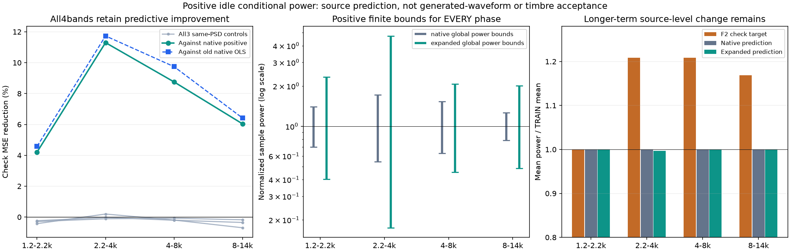
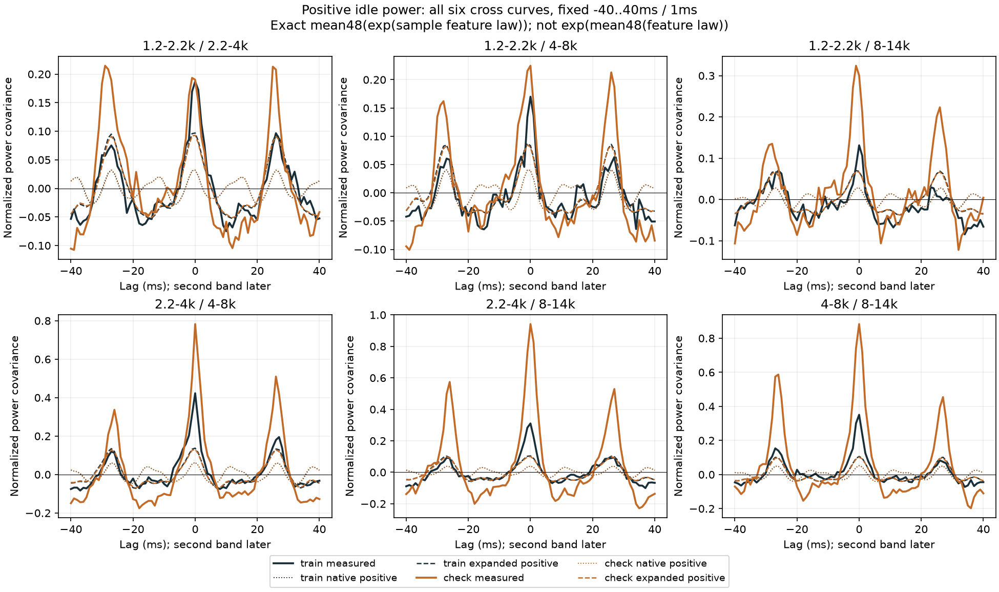
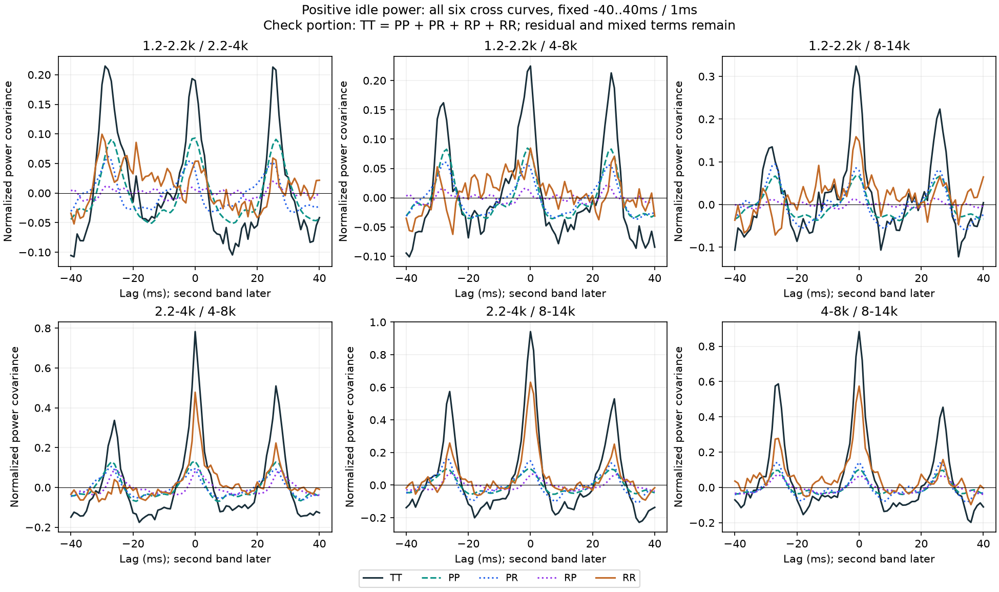

# 怠速正功率模型 V1

上一轮的相位差特征有跨段预测价值，但线性功率公式存在真实负值。本轮改成**始终输出正功率的指数模型，预测改善得到保留**。这是声音生成前的独立模型验证，还没有替换C或新增试听。

## 模型及平均方式

继续用冻结F2尾排6–9秒训练、9–12秒检查和全部三组原同频谱相位对照；原三条低声线、全部三对相位差、四个高频观察带、原生48kHz与两端250ms裁除不变。

逐采样模型为：

```text
η[n] = c + Σ(a cosφ[n] + b sinφ[n])
q[n] = exp(η[n])
1ms预测 = 48个q[n]的平均
```

`φ`是已有独立声学相位及它们的相位差，不是新曲轴时钟。原相位模型7参数，增加全部相位差的模型13参数，分别训练和比较。

每带目标是原带通输出的逐采样平方，除以训练均值。只在训练120000采样上最小化凸准似然`mean(exp(η) − target × η)`；不把能量当真实计数。固定零初值、Newton／Armijo求解、最多60步、梯度无穷范数`≤1e−9`，没有正则、裁剪、重启或门槛搜索。

这是**显式的新链接、新采样分辨率目标**，不是把上轮失败门槛改成通过。指数不能与平均交换：不能先平均相位特征再指数。已知用例显示这两种计算可差0.003994；本轮全部按逐采样指数后平均执行。

## 保住了什么

每组在训练结束后冻结参数，检查段只预测。四带都优于正值原相位模型和旧原相位OLS，且增量改善超过各自全部三个同谱对照。

| 观察带 | 检查MSE较正值原相位下降 | 较旧原相位OLS下降 | 新模型全相位功率下界／上界 |
|---|---:|---:|---:|
| 1.2–2.2kHz | 4.21% | 4.57% | 0.40250／2.33885 |
| 2.2–4kHz | 11.30% | 11.73% | 0.17462／4.73105 |
| 4–8kHz | 8.75% | 9.74% | 0.45305／2.07466 |
| 8–14kHz | 6.04% | 6.41% | 0.48601／2.00788 |

单位相位给出`η ∈ c ± Σhypot(a,b)`，对上下界取指数即可得到表中保守、有限且严格正的功率界；相位差相互依赖也不会破坏此界。没有裁掉负值或缩小系数来放行。全部8模型、32单带拟合通过既定收敛与满秩条件，新的预测前置条件通过，旧线性公式仍保持失败记录。



## 还没有解决什么

两段十对完整功率时间曲线的误差，相对正值原相位模型全部下降；但高峰和剩余关联仍明显。检查段后三带平均功率比训练高约20.85%／20.85%／16.88%，模型预测均值仍接近1。这里没有用检查段自动补增益，也没有把变化命名为负载、真实转速或某个机械事件。



每组、每模型、两段仍保留`T=P+R`的全部均值及`TT=PP+PR+RP+RR`时间账目，固定−40～＋40ms／1ms、固定训练标准差乘积归一，800条曲线全存。剩余项和两个混合项不能直接全部变成独立噪声。



**q学习的是原录音各频带总功率，不是已经分离的随机激励增益。**当前仍未证明把`√q`乘到既有细节支路，就能得到同样的最终能量或四阶结构。原OSC声线、六个固定共振滤波器、不同调制位置和滤波时间支持都必须计入；本轮功率账目不能替代真实生成波形预算。

下一步以冻结的13条OSC／六滤波支路为底，验证正值幅度模型经过实际滤波后的能量、带间时间关系及与主声线的总预算，先做已知控制再计算原配方。只有这一步成立才值得做新声音对照。保留周期性幅度、随机细颗粒和固定谱的独立模块；不复制原录音时间包络，不添加任意PM／FM或房间效果。

## 模块和核查

`tools/idle_positive_power_v1/model.py`提供正功率拟合、边界、逐采样预测与观察平均；`checks.py`是已知正值／移位预测／坐标与尺度不变性／Jensen／梯度和Hessian有限差分／非法输入控制。相位特征与功率时间账目复用既有模块，观察、独立审计、绘图、打包各自独立。

独立实虚乘积、标量指数／分块求和、32个全分辨率梯度与Hessian、每步Armijo记录、全部800曲线×81点直接扩展精度矩复算通过。最大梯度差1.68e−14、Hessian差2.67e−15、预测差1.12e−15、曲线差5.33e−14；实际最大梯度5.17e−10，小于预定1e−9；最小Hessian特征值0.010615。凸目标加满秩提供唯一极小点的理论结构，这些是数值驻点核查，不是声学真实性证明。

独立直接型IIR与原SOS观察最大差4.31e−10FS、相对RMS差7.82e−9；原1ms目标与旧冻结观察复现。首审计在训练均值比对因120000项浮点累加顺序差异失败（绝对差1.30e−18、相对1.67e−14），执行源和报告保留。只把这项审计改成非负求和的标准`γ_n`舍入误差界；拟合、数据、模型门槛没有重跑或修改。audit2完整通过，三图已目视。

仍是相邻、以前观察过的近单声道混合尾排录音，不能当未见录音或真实机械源验证。612份C/H、67旧配置、认可行驶35%、已有怠速候选、旧二进制与take保持；没有新下载、音轨、运行配置或旧61项驾驶测试。原共同相位36／17／33／逐线14k／原E资格、完整驾驶状态、多发动机与实际7.1.4仍需完成。完整证据冻结`E:/VehicleSoundLab/baselines/idle_positive_power_v1`。
