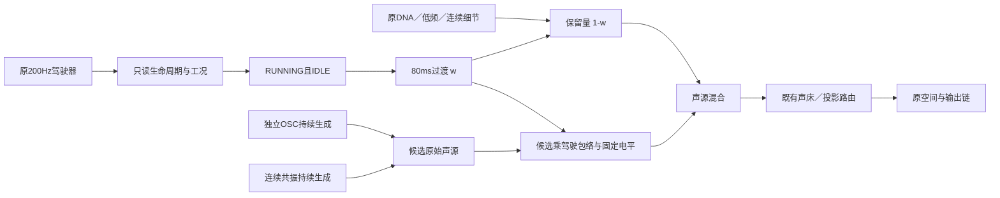

# 怠速状态衔接 V1

新的固定 F2 怠速声源已接到**同一个驾驶器的空间处理之前**，作为可单独启用的工程分支。当前默认 demo 和固定怠速听评保持原状；本轮没有重新拟合音色，也没有获得新的主观音色认可。

## 结构与触发

F2 候选只在 `RUNNING && IDLE` 时进入；离开该状态则淡出，旧声源恢复。启动／接火、事件和辅助层沿用原职责。两个声源全程推进，回到怠速不重置振子、随机序列或滤波器。

候选的独立频率比例始终为 **1**。F2 尚无已确认的实际 RPM，不能把此分支称作随转速标定的怠速模型。80 ms 是工程过渡参数；画面／素材没有标定该时长。

## C 模块分工

| 文件 | 职责 |
|---|---|
| `modules/modal_layer/profile.*` | 通用声源组合与非实时参数校验 |
| `modules/modal_layer/voice.*` | 复用独立 OSC／共振核，持续生成、固定电平和有限过渡 |
| `modules/atlas_drive/source.*` | 空间处理前的逐样本声源接口；提供只读驾驶状态和分层音频，检查输出有限性 |
| `experiments/idle_state_v1/source.*` | 本次 F2 的工况适配；无第二驾驶器、不改 RPM |
| `experiments/idle_state_v1/study.h` | 80 ms 与一次固定电平校准值；不写进通用 DSP |
| `experiments/idle_state_v1/{kernel_checks,checks,probe}.c` | 已知信号、状态／路由检查、C 分轨与状态导出 |

`AdConfig.source_processor` 默认为空。适配器处理已经乘驾驶包络的录音声源分轨，并通过 `AdCapture.source_added` 暴露新分轨；空间处理仍由原链调用一次。观察 L/R 在声床中保留，单声道投影模式沿用显式投影，不能解释为左右汽缸或独立排气声源。

## 固定电平校准

初版 `render1` 的候选在完整怠速段约低 **9.52 dB**。保留初版后，另立电平计划：取其**第一段完整 `w=1` 区间**的全部样本，计算一次常量增益 **2.9914135669326032**。未参与计算的第二段完整怠速，校准后相对旧路径约 **+0.63 dB**。

该值只匹配这次监听的电平。两端是 F2 LP-610 尾排与 A Performante，不是同一车型同机位；没有实际 SPL／RPM 标定。原始声线、共振参数、随机种子和主音量均保持，原始 `modal/detail/raw` 不受该电平控制影响。

## 当前可复查的行为

8 秒台架输入在 0 秒启动、2 秒将目标设为 2200 RPM／负载 0.6、4 秒回到 850 RPM／负载 0、6 秒熄火。这些都是既有控制程序的工程设置。逐样本实际状态为：

| 时刻 | 实际控制状态 |
|---:|---|
| 0 | CRANK，开始转动 |
| 0.28 s | CATCH，接火 |
| 0.93 s | RUNNING／IDLE，约 850 RPM |
| 2.01 s | FREE REV，约 1038 RPM，随后趋近 2200 |
| 4.34 s | 返回 IDLE，约 1027 RPM，随后趋近 850 |
| 6.00 s | STOPPING |
| 6.55 s | OFF |

这条轨迹用于核查进入／退出声源，不是 F2 原录音的转速还原。完整混音、候选独奏与原路径可在[衔接试听页](http://127.0.0.1:8789/references/analysis/idle_state_v1/review2/index.html)切换；其音频由 C 连续生成后导出，页面不是实时驾驶窗口。

## 验证与限制

两种互不相同的已知声线／共振参数通过直接余弦和原 Rdt 逐样本对照；零 gate／零驾驶包络继续推进、重复 gate、有限端点、反向、无效输入事务检查通过。原 55 项与新增 2 项 CTest 共 **57 项通过**；全部 **84 条冻结旧 WAV 与三份驾驶轨迹逐字节一致**。

实际状态行程在不同音频块长度下输出完全一致；启用／关闭候选的完整驾驶状态与包络轨迹一致。2／12 通道检查验证同一声源与前置声床，不能当作实际 7.1.4、房间还原、设备长时或主观连续性验收。新候选可能存在拍频、机位差异和过渡声线变化，仍待听评。

**本实验暂不支持 schema8 行程保存。** 该格式没有表示通用声源适配器的状态；`at_assets_copy/valid` 明确拒绝，防止保存后重放成另一个声音。原 schema8 路径继续通过测试。新构建的 renderer 指纹随源码改变，旧行程应使用其冻结播放器；原播放器、原 UI 可执行文件与旧数据均保留。本次新构建在 `build-idle-state-v1`，没有覆盖当前监听窗口。

首次检查脚本因路径列表顺序断言失败、首次 probe 因缺少显式渲染头文件编译失败，均保留了执行源和日志。`kernel3/full1/render1` 是未校准电平的通过记录；`level1/full2/render2/review1` 是固定电平后的结果。声源参数文件与67份运行配置未改。

网页首次交互检查发现服务器返回的WAV不能正常跳转，`seekable`区间为零；失败与诊断保留在`preview_check1`。`review2`先完整读取三条短音频并缓存Blob URL，随后由同一播放器切换，不修改音频样本；独奏仅在怠速分支进入时发声。`preview_check2`通过进度保持、静音连续播放／切换、状态显示、跳转按钮和390px宽度检查，桌面／手机版面已目视。该检查不构成设备或听感验收。

冻结入口`tools/package_idle_state_v1.py`保存全部执行源、失败、初版及最终分轨和页面；目录`baselines/idle_state_v1`的manifest绑定身份。C索引562份＝547份原文件字节保持＋3份修改＋12份新增；67份运行声音文件保持。

复现入口：`Build-Idle-State-Study.ps1`。分析／分轨入口为 `tools/{verify,render,review}_idle_state_v1.py`，电平来源为 `tools/calibrate_idle_state_level_v1.py`。证据位于 `E:/VehicleSoundLab/references/analysis/idle_state_v1/`。

下一步优先完成 F2 音色听评及源级改善，再扩展有素材依据的怠速 RPM 范围、同车型加速锚点、原生控制与拥有全部参数的行程格式。本实验不豁免共同相位提取器的原资格要求，完整目标仍未完成。

首次打包将重新导出的独奏WAV容器当作音频身份，SHA断言失败，`package1`保留执行源与诊断。两个字节差异仅位于FLOAT文件的PEAK时间戳；混音／状态文件逐字节相等，独奏的fmt／data和其余块相等，PEAK的版本／峰值／位置相等。最终冻结分别核查容器身份与音频样本，不把时间戳差异解释为声源变化。
