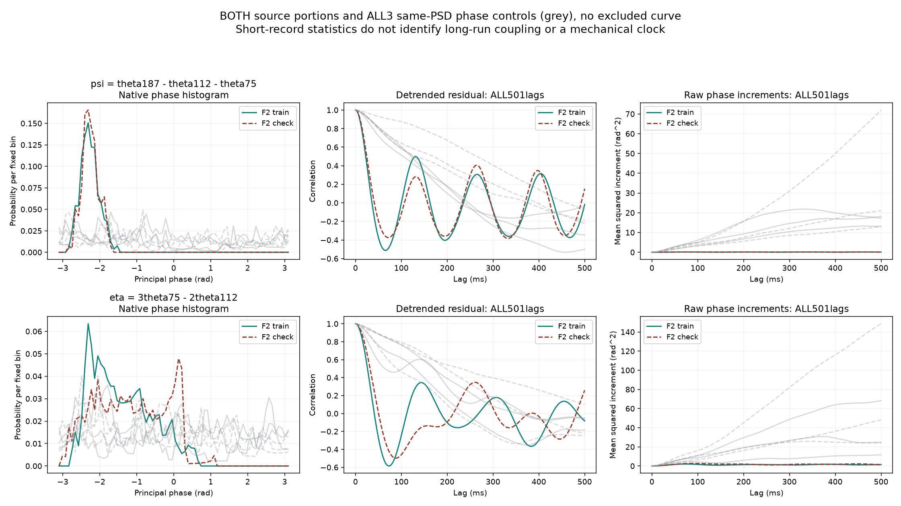
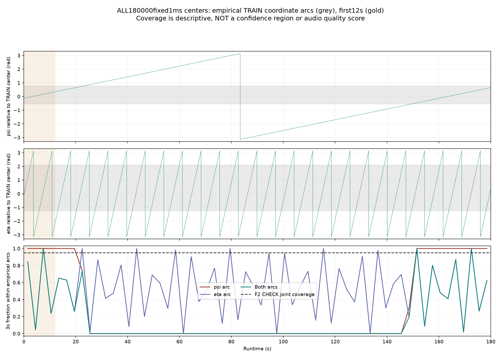

# 怠速相位关联证据 V1

从原F2录音提取到可重复的相对相位结构，但**尚不能认定实车长期锁相，不能直接把OSC锁死**。本轮没有更换音频或实时C。前轮[试听](http://127.0.0.1:8789/references/analysis/idle_post_audio_v1/review1/index.html)保持。

三个声学相位有两个独立的相对关系；只检查其中一个，会漏掉另一种漂移：

```text
ψ = θ187 − θ112 − θ75       自由OSC约160.01秒转一圈
η = 3θ75 − 2θ112           自由OSC约7.18秒转一圈
```

2／3／5是之前选择的声学关系，尚不是已认证的机械阶次或曲轴RPM。第二个坐标是在首轮ψ观察／审计完成后明确追加的诊断；追加方案、独立源和结果均单独保存，没有把它说成最初预注册或未见数据检验。

## 素材里实际有什么

沿用F2 6–9秒训练、9–12秒已观察检查，两端各裁250ms，保留全部原生相位。三个同频谱随机相位对照、两段均全保留。圆集中度为单位复数均值的模：

| 坐标 | 原声训练／检查 | 三组同谱相位对照的全部六段 |
|---|---:|---|
| ψ | 0.969／0.975 | 0.054–0.396 |
| η | 0.707／0.607 | 完整结果见冻结报告和图，未据此设接受门槛 |

ψ的原声两段分布相近，明显比本次全部同谱对照集中。线性去趋势后，ψ标准差约0.212／0.223rad，η约0.816／0.948rad。原生步进最大约0.00064rad；这里只描述观察坐标，不把Hilbert相位当真实机械相位。

原生0–500ms、每1ms的全部501点保留了残差相关与相位增量。原声存在短时间的回摆结构，但观察器本身也限制了带宽，不能直接把图上周期写成机械LFO、AR系数或锁相时间常数。短段斜率也不稳定：ψ两段约＋0.0293／−0.00067Hz，η约−0.0100／＋0.0203Hz；它们是描述性回归，不是频率测量置信区间。



## 为什么仍不能直接锁相

构造三个**完全独立**的正弦振子，使用同样的微小失谐：2.5秒的ψ集中度为0.99960，180秒为0.10823。没有任何反馈或耦合，也会产生“短段很集中、长段分散”。因此原声集中度大和短段看起来有界，不足以辨识实车三分钟的稳态动力学。

原带通＋Hilbert观察器另在两段独立失谐、有限第三声线FM、独立AM共6例中核对；ψ的p95误差约0.00062–0.00140rad，均低于预声明0.105rad实现条件。它证明这些已知例子的观察代码可工作，不证明真实混合录音里的相位误差同样小。没有改观察频带、裁边或控制门槛。

## 生成器具体缺哪一块

以训练观察到的每个坐标最小／最大偏角构造经验范围，再检查另一段与自由OSC。它只是样本覆盖描述，不是置信区间、质量分数或硬门控：

| 两个相对坐标同时位于训练经验范围 | 比例 |
|---|---:|
| 原声检查段 | 94.95% |
| 原12秒生成坐标 | 53.11% |
| 完整180秒生成坐标 | 16.91% |

**对上一轮表述的收窄：原12秒“都在训练相位范围内”仅适用于ψ。加入第二个独立坐标后，并非全部相对相位都在范围内。**两种坐标联合覆盖不是完整三相位分布；也不能把超出范围的样本直接判成难听或错误。

这使后续优化有了明确方向：学习并程序生成**相对相位的统计关系**，再与原频谱、主OSC和共振细节组合，而不是仅保存独立频率和平均幅度。可考虑两个相对坐标的统计纹理作为新的工程假设；必须保留自然起伏、检查段差异和独立失谐反例，检验其正值、均值、时间结构、完整混音和长时间行为，再做听评。尚未选择锁相器、随机过程、强度或主声线改法。



## 模块与验证

`tools/idle_closure_evidence_v1/observe.py`负责只读坐标和有限统计；原观察、追加坐标、两份独立审计、绘图和打包分别有入口。ψ与η共16段、每段全部501点，独立实虚乘积、unwrap／QR、线性卷积、原生矩核对通过：最大数组差约1.03e−12。180000个联合覆盖判定逐项相同；原正功率模型、两段q及其矩与前轮一致，没有重训或导出录音轨迹。两张完整图已目视，所有已执行版本保持。

冻结：`E:/VehicleSoundLab/baselines/idle_closure_evidence_v1`。摘要`idle_closure_evidence_v1_summary.json`绑定父输入、全部源、追加说明和审计。612份C/H、67份旧声音配置、认可行驶35%、旧怠速、二进制和take未改；没有下载、新音轨、运行参数、无关61项驾驶测试或重复听评问题。上轮实际180秒迁移／审计交付属于进展，本轮是新的素材／反例／联合坐标证据。原共同相位36／17／33／逐线14k／原E资格，以及完整驾驶、多音色和实际7.1.4目标仍需继续。
