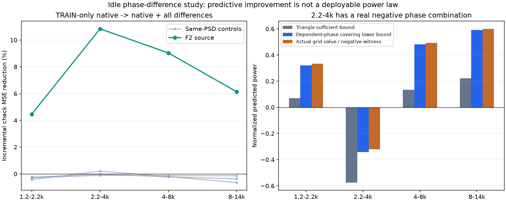
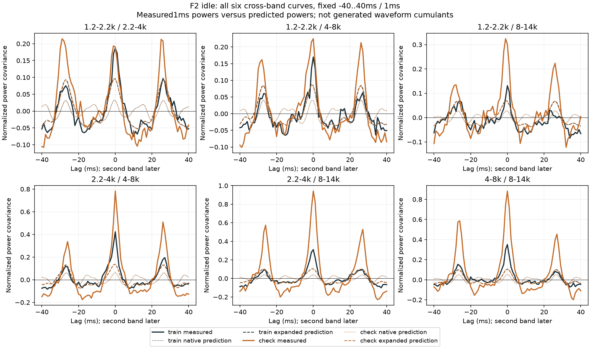
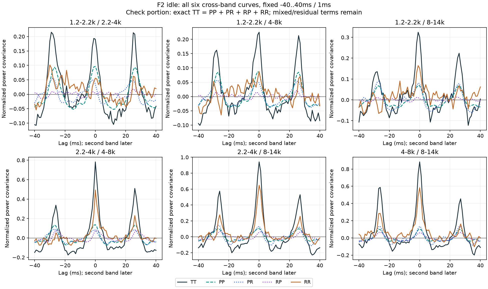

# 怠速相位差与颗粒 V1

继续从F2尾排怠速提取高频细节的时间关系。**三条低声线的相位差能增加跨段预测信息，但当前线性功率公式不适合直接生成声音。**本轮没有新增试听、修改C或替换现有音色。

## 提取什么

沿用冻结的6–9秒训练、9–12秒检查及三组原同频谱相位对照。仍是原生48kHz、原四个观察频带、两端各250ms裁除、48帧非重叠平均，未重新挑片段或拟合频率。

原模型用75.0368／112.4855／187.5286Hz三条独立声学相位的正余弦预测高频功率。新模型增加全部三对`z[j] * conj(z[i])`，先逐采样相乘再平均，对应名义差频37.4487／112.4918／75.0430Hz。它们来自原有声线，不是按上轮约27ms观察反推的新振荡器，也没有认定共同曲轴、RPM或点火周期。

每带仍只有训练段归一、普通最小二乘；原模型7参数，新模型13参数。检查段只预测，不重拟合。真实新矩阵满秩13，条件数8.24。原7参数模型及输入被完整复现。

| 高频带 | 检查MSE相对原模型下降 | 三个同谱对照的相对下降范围 |
|---|---:|---:|
| 1.2–2.2kHz | 4.46% | −0.43%～−0.24% |
| 2.2–4kHz | 10.84% | −0.11%～＋0.21% |
| 4–8kHz | 9.04% | −0.22%～−0.12% |
| 8–14kHz | 6.14% | −0.65%～−0.14% |

四带均改善且高于各自全部对照。仍是已观察过的同一条近单声道录音相邻片段，不能视作不同录音验证、机械源分离或主观音色改善。



## 为什么没有直接加到声音里

拟合的是相对功率`q = c + Σ(a cosφ + b sinφ)`，实际生成需要`√q`。把所有特征当作独立相位求三角界时，2.2–4kHz下界为−0.575；其他三带为正。相位差存在依赖，三角界失败本身不能证明实际负值。

因此在原拟合结束后另行声明了全相位检查，没有改系数或原准入规则：遍历三个原相位各32点，共32768组合；利用全局最低点梯度为零及二阶导上界，为网格覆盖误差留出解析余量，再减`1e−10`数值保护量。已知正值、负值、恰为零与坐标旋转反例先检查；这不是区间算术或统计置信。

**2.2–4kHz确实存在合法相位组合令q≈−0.32116**，索引`[7,25,2]`，即三相位`2π/32 × [7,25,2]`。源录音检查段的最小预测却为＋0.16754：短录音中没见到负值，不代表持续生成能安全使用。该组合不等于声称现有C声音在某一时刻已出现问题。

另外三带全局正下界约0.32168／0.48203／0.59110。原全四带生成前置条件仍失败；不裁负值、不降低强度补救、不凭改善百分比替换默认。

## 时间关系还缺多少

固定−40～＋40ms、每1ms观察四自带与六跨带，保留完整曲线。预测部分比原模型更接近两段的正负起伏，十对曲线的误差均下降；检查段的尖峰和剩余关联仍明显。



对每个源／对照、每个模型、两段都做完整分解：目标功率T＝预测P＋残差R，因此每个时间间隔都有

```text
Cov(T,T) = Cov(P,P) + Cov(P,R) + Cov(R,P) + Cov(R,R)
mean(T) = mean(P) + mean(R)
```

分母固定为训练目标标准差乘积，避免换模型就换尺度。PR与RP单独保留，不能删除混合项或把剩余差值全部当独立随机细节。**这是1ms平均带功率的完整账目，不是新生成波形的四阶累积量、亚毫秒结构或滤波输入预算。**



## 工程落点

保留原OSC声线／固定共振谱，继续验证“原低声线及其相位差控制多带细节幅度”的模块接口；下一项是输出始终为正的条件功率模型，例如明确声明的指数链接。要先在已知用例验证、训练限定、原检查段与全部同谱对照重算，再核对生成波形经过滤波后的能量／时间统计。不能靠裁负值、复制原音频包络或随意增加FM／PM解决本轮问题。

源码分为`features.py`（声学特征）、`model.py`（训练和预测）、`budget.py`（时间账目）、`positivity.py`（全相位边界）、`checks.py`（已知用例）；观察、两个独立审计、绘图、打包分别是入口。它们是离线研究模块，不是新C运行配置。

独立实虚乘积／标量均值／带主元QR核对全部特征与系数，全部800条曲线的81点用直接扩展精度原始矩重算；最大曲线差5.69e−14、系数差4.45e−15。另对6已知＋4真实／对照模型、每个32768点用标量复数相位重算，最大网格值差1.12e−16，负值证据确认。

首观察在原特征逐字节核对处因复数与实数累加顺序差异中止，执行源和失败报告保留；只改为原实列求和布局，observe2完整复现，没有改模型、数据、门槛。首图纵轴标签过长，plot1保留，plot2缩短标签后全图目视，数据不重跑。

612份C/H、67旧配置、认可行驶35%、已有怠速候选、二进制与take不变；无新下载、声音、C接入或旧61驾驶测试。原共同相位36／17／33／逐线14k／原E资格、多发动机、完整状态与实际7.1.4仍未完成。证据冻结`E:/VehicleSoundLab/baselines/idle_phase_difference_v1`，总目标继续。
