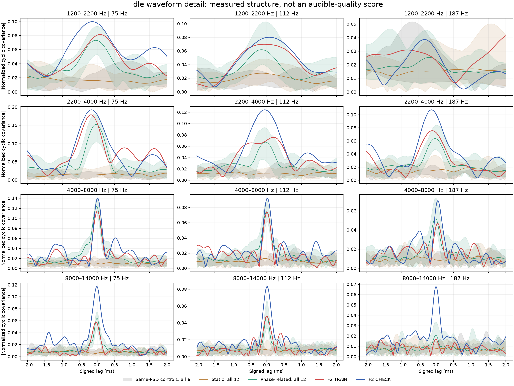
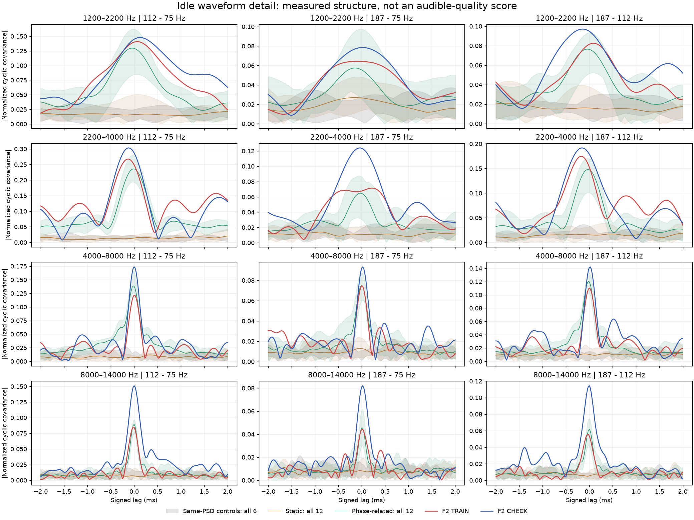
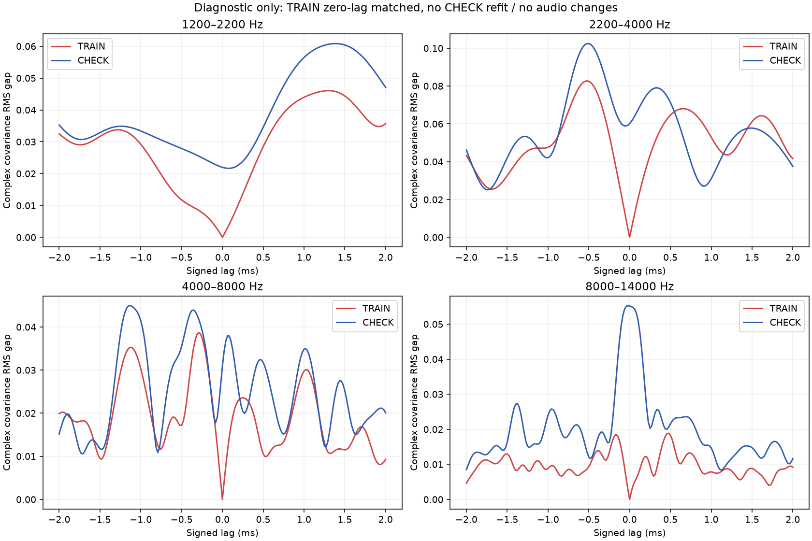

# 怠速短时声纹关联 V1

从已批准的F2尾排怠速继续提取后，发现当前候选已经恢复部分高频与低声线的关联，但**只控制高频强弱，仍不足以保存全部短时声纹**。本轮是新的素材／生成器对照证据，没有新音轨或C默认替换。

当前可听候选仍在[怠速声线关联试听页](http://127.0.0.1:8789/references/analysis/idle_phase_recipe_v1/review2/index.html)。它使用参数持续生成，不循环原录音；主声线和细节共用统计相位。其听感仍待确认，不能用下面的数值替代。

## 从录音多提取了什么

原F2的6–9秒训练、9–12秒检查，两端各裁250ms；不加入F3说话段，不把不同车辆／机位平均成一个声纹。复用原生48kHz四个观察带：1.2–2.2、2.2–4、4–8、8–14kHz。

过去主要问“此时高频多响”；本轮增加“此时的高频波形与前后2ms有什么关系”。具体测量解析带通信号的复相关，再看它随三条低声线及三组相对相位怎样变化；−96至+96样本共193个延迟，全部使用相同时间支撑。这是声学观察，不把约75／112／187Hz认成已知曲轴阶次。

两段原声、六份同频谱随机相位对照、旧静态与当前候选各三种子×四窗，共32组全部保留。以下是所有频带、相位特征、延迟合并后的曲线幅度RMS距离中位数，数值越小只表示这个观察更接近。

| 对照 | 训练录音 | 检查录音 |
|---|---:|---:|
| 旧静态细节 | 0.04211 | 0.04915 |
| 当前相位关联候选 | 0.02177 | 0.02676 |

约缩小48%／46%。它支持保留当前候选作听音，但不是音质提高百分比。最高带检查段的关联强度仍明显高于候选；原录音两段本身也有变化。

## 还差的是音量，还是内部结构

先用已知三音反例确认：两段声音可以拥有相同的谱线幅度、相同的零延迟关联，仍有不同的非零延迟关联。因此平均频谱和幅度规律都相同，不足以保证声音结构相同。

实际曲线首次计算完成后，另行声明了一个**后验诊断**：把当前候选全部12窗的均值，用每带／每特征一个复比例，在训练录音的零延迟处对齐；比例冻结后检查全部193点及另一段录音。训练零点误差约3e−17，但非零延迟仍存在明显差距，尤其中低细节带。这个比例只作用于观察曲线，不是合法的声音合成器参数，没有写回音频，也没有用检查段调参。有限随机误差、带通观察和录音相位估计仍可能贡献差距。

结论限于：当前模型的“固定细谱共振＋每带幅度变化”没有覆盖这些观测结构；不能把全部差距都解释为机械摩擦，也不能据此直接决定加多少高频。

## 可行的下一步

保留13条主OSC和已经提取的相位统计，重点研究**同一频带内部的共振比例怎样随低声线相位变化**。把宽频带的单一音量控制，细化为少数组素材拟合的共振形状及其关联控制；运行时用新随机激励，保留连续状态，避免每次重触发或另加独立高频云。

这种模型需从正功率／协方差因子参数化开始，防止把无法合成的曲线比例直接变成滤波器。提取、共振核、相位控制、驾驶适配仍分模块。它是下一项有依据的候选方向，尚未实现或听评；现有相位候选不因此被替换。后续以有限、同增益、原版可回退的试听检验收益，不把全部高阶统计精确相等当作再次听音的前提。

## 实现与验证

`tools/idle_cyclic_detail_v1/observer.py`只负责观察；独立入口负责素材／已存音轨、审计和图表。独立时域点积核对两段原声全部193点，每个生成／随机相位对照再核对七个正负延迟；用逐节lfilter和另一解析信号实现重算全部32组输入，并以另一插值实现重建候选相位。已知AM、纯载频和相同幅谱的相位反例先于实录执行。

完整证据位于`E:/VehicleSoundLab/baselines/idle_cyclic_detail_v1`。现有619份C/H（含7份独立成本实验）、67份旧声音配置、认可行驶35%、旧怠速、二进制和take均保持。本轮没有新下载、房间、加宽、HF提升或C移植；不重复未改变的61项驾驶测试，也不重复待答听评。原共同相位资格、实际RPM／负载、全状态／多发动机及物理7.1.4目标继续。
