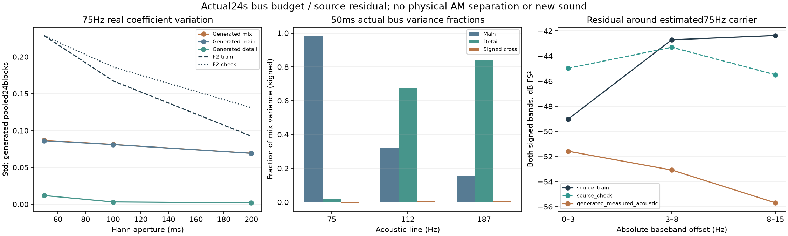

# 怠速短窗分层预算 V1

围绕用户“节奏太规整，像持续的合成器音符”的反馈，本轮把完整生成音轨拆开检查。**75Hz的短时变化主要受主声线控制，现有细节层几乎没有补回这一带的快变化；112／187Hz的情况不同，不能统一增加调制。** 同时确认原声75Hz附近的残差旁带更丰富。尚不能将该差距全部归为机械AM，未生成新候选或修改实时默认。

## 完整覆盖与模块

使用已有新配比＋完整AM的三个种子、各24秒，全部8个三秒段；程序实际相位／混音估计相位各观察一次，50／100／200ms同中心窗，共144组新混音／主线／细节观察。原8份F2源及同谱对照的24组三窗结果按原哈希复用，共168组。

每组保存全部51滞后的6×6有符号协方差：`混音 = 主线 + 细节 + 两向相关项`。保留负值及超过100%的比值，避免将抵消误判为少了一层。合并时先在每个三秒块内去均值，再平均24块协方差；不是整段24秒的全局协方差，也不包含被块内去均值去掉的长期漂移。

主线和细节是**实际生成器总线**。实录没有已知物理分轨，不对原声指定“真实主线／机械噪声”的拆分。

| 模块 | 职责 |
|---|---|
| `tools/idle_short_budget_v1/observe.py` | 一个分析基底同时观察实际多总线 |
| `tools/idle_short_budget_v1/spectral.py` | 原生常系数投影及75Hz附近残差谱 |
| `tools/idle_short_budget_v1/independent.py` | 审计专用独立QR／periodogram／CSD |
| `tools/observe_idle_short_budget_v1.py` | 完整原音轨、状态参数和源段的适配 |
| 对应 `audit_`／`assess_`／`verify_`／`package_` | 独立核对、统计、图表、冻结 |

## 谁承担了短时变化

下面采用与原声相同的混音相位估计，列75Hz归一化实部标准差。生成项来自全部24块合并，源仍是F2拟合6–9秒／已看过检查9–12秒。

| 窗口 | F2拟合／检查 | 生成混音 | 生成主线 | 生成细节 |
|---|---:|---:|---:|---:|
| 50ms | 0.22891／0.22881 | 0.08678 | 0.08615 | 0.01189 |
| 100ms | 0.16740／0.18615 | 0.08103 | 0.08092 | 0.00319 |
| 200ms | 0.09248／0.13111 | 0.06916 | 0.06908 | 0.00198 |

50ms窗口下各声线的混音方差分配为：

| 声线 | 主线 | 细节 | 有符号相关项 |
|---|---:|---:|---:|
| 75Hz | 98.54% | 1.88% | −0.42% |
| 112Hz | 31.96% | 67.45% | 0.59% |
| 187Hz | 15.42% | 84.08% | 0.50% |

这不是音源物理占比或听感评分。相位改用程序真值后，实部结论接近；虚部差异仍很大，混音估计相位会吸收细节，不能把这些观察坐标直接映射成原生相位激励。

## 主声线周围缺什么

对全部48份生成相位基底段及8份源／对照段，先在原生3秒上做13OSC＋DC的常系数投影，再用同一0.25–2.75秒区域分析残差。用`残差 × conj(75Hz声学相量)`观察载波周围的0–3／3–8／8–15Hz偏移；全有符号FFT、双侧功率，没有Hilbert乘2或单边谱误计。

这些是实际线性投影后、在混音依赖的声学坐标中的功率，单位FS²；并未额外按源归一化。载波偏移是声学相对频率，不是RPM变化。常系数投影会留下真实AM、PM误差、遗漏邻线和宽带残差，不能称已分离机械声。

| 75Hz附近绝对偏移 | F2拟合 | F2检查 | 生成混音，24块平均 |
|---|---:|---:|---:|
| 0–3Hz | 1.253e−5 | 3.181e−5 | 6.942e−6 |
| 3–8Hz | 5.361e−5 | 4.669e−5 | 4.921e−6 |
| 8–15Hz | 5.790e−5 | 2.821e−5 | 2.699e−6 |

生成声3–8Hz偏移功率约低9.8–10.4dB，8–15Hz约低10.2–13.3dB；整段30–120Hz原始功率差仅约0.3–0.5dB。支持处理**能量的时间／旁带分配**，而非整体加大低频音量。程序相位和混音估计相位下8–15Hz结果仍相差较大，因此不能将上述功率差照抄成原生AM／PM增益。

## 优化路线与验证

下一步建立从素材提取的75Hz附近时间形状／复包络假设，用同一观察器验证，再决定如何生成有限音色候选。幅度与相位的统计需共同保留，并明确扣除已有主线／残差能量，避免重复表达。已知控制先检查参数与功率，真实比较包含混音相位提取器；听感仍需单独验证。

不把短窗系数轨迹放入发生器，不整体放大旧AM，不以任意风声补残差缺口；187Hz细节的过量起伏仍单独处理。当前证据还不能证明所测差距就是“持续音符感”的唯一原因。

已知非线性FM无AM、多总线系数恒等、负相关预算、原生投影及7.2Hz双边带功率通过。原宿主先检查了邻线残留与AM解调功率；“同模型载波AM经过投影仍有残留”的对照在独立审计读取实源前补做，未在原观察前执行，这一点与原计划顺序不同，已明确留痕，没有据此改变源数据或晋级音色。

独立17052次窗口QR、56次实源／生成全局QR及2次已知全局QR通过；144组新总线系数误差约3.00e−14FS，全部48份旧200ms三总线结果精确复现。168组协方差／PSD、全部原生频谱和相关项独立复算；6组汇总与4组谱表另行独立核对，最大差约1.14e−13。图已目视。

证据冻结于`E:/VehicleSoundLab/baselines/idle_short_budget_v1`。619个C/H、67个旧voice、行驶35%、旧音轨／默认／待听保持；本轮无新下载、实源拟合、试听或C修改。完整驾驶工况、多发动机、stereo／7.1.4目标继续。
