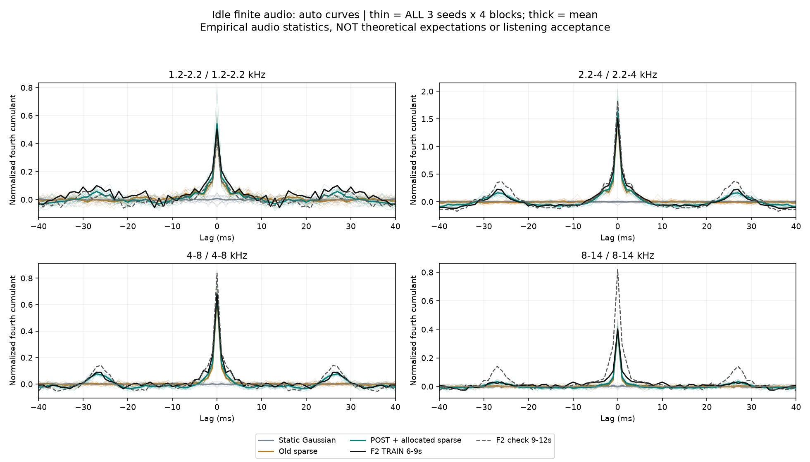
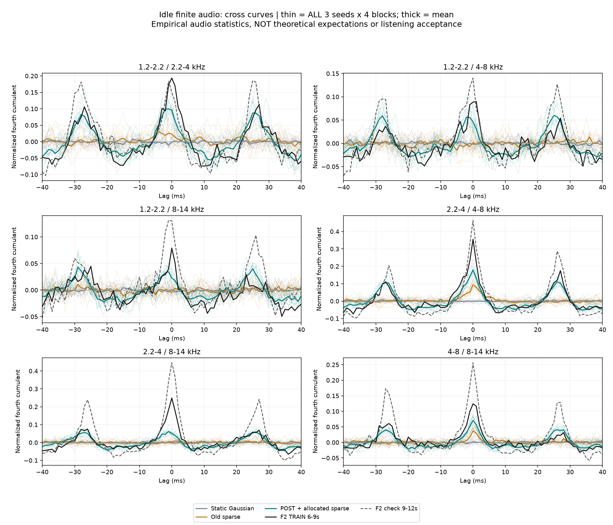

# 怠速细节关联试听 V1

已把前几轮从F2尾排怠速提取的统计关系做成可听候选：[本地单播放器](http://127.0.0.1:8789/references/analysis/idle_post_audio_v1/review1/index.html)。比较旧细谱、旧独立颗粒、新候选，也能独奏细节和切换两段原声。全部同增益1.0，不逐条补响度。生成12秒，原声每段3秒；三个既定随机种子全部保留。

这是离线试听候选，**尚无本轮听评认可，未替换C或驾驶Demo**。F2是LP610近单声道尾排情境，与Performante车外、Tecnica车内分别建模；本轮复用已经提取并审计的素材参数，没有下载或重新挑选片段。

## 优化思路

原来的共振细谱能保留频谱，却容易把细节变成均匀沙声。录音还包含“细节什么时候一起增强、什么时候减弱”的结构。前轮发现把调幅放在共振器前，会让部分关联在滤波后反向；改到共振器后才能较好保留学到的起伏。

本轮保持13个主OSC、六组8192抽头共振FIR、增益和左右比例，比较三条配方：

| 配方 | 随机细节 | 与主声线关联 |
|---|---|---|
| 旧细谱 | Gaussian通过原FIR | 无 |
| 旧独立颗粒 | 上四带使用旧κ稀疏激励 | 无 |
| 新候选 | 上四带使用重新预算的κ | FIR之后乘以逐采样√q |

q是从录音拟合的正功率规律：取现有第1／2／4号模态的相位和全部三组相位差，以正弦／余弦特征经过指数链接生成四带功率变化。它使用少量固定系数，运行时重新计算，不复制录音包络。低两组继续使用原Gaussian。每个高频分支仍有独立随机序列，并非一个点火触发器替代全部声纹。

新κ为99.20684／113.64048／31.25446／11.06986，比旧值低23%–35%；先扣除调幅本身增加的集中度，再分配独立颗粒。实际程序读取冻结JSON完整精度。κ控制独立随机细节的集中程度，不代表物理点火率。没有新增高频OSC云、音高／相位拟合或房间处理；原录音所含环境影响也尚未被物理分离。

## 验证和仍有的缺口

所有输出48kHz，沿用原48000帧预热，以复现旧声音；之前65535帧是合并理论响应的分析预历史，不是本次音频FIR所需。先跑96帧延迟共同源、慢速共同调幅反例及全部81间隔控制。之后检查每个种子、每种方法的全部四个连续3秒窗，各裁首尾100ms，不筛选“好听”的随机段。

独立程序以另一套随机数／三角函数／FFT卷积复算18条完整混音及独奏：最大波形差1.49e−8 FS，主要是FLOAT存储量化；旧两配方12条音轨与冻结输出逐样本一致。另以多项式滤波器传递函数、线性卷积和15种矩分拆复算38项真实观察的4条自带／6条跨带、全部81间隔；加两项已知控制共32400点，最大归一曲线差2.19e−11。两段原声还做全部间隔的直接时域核对。20条试听文件统一PCM24与首尾1024帧淡入淡出，量化误差≤2^-23，HTTP内容逐字节一致。

下图包含每种配方全部三种子×四窗细线，粗线为均值；两段原声均展示。新候选出现原声中部分延迟起伏结构，但零间隔跨带强度仍不足；8–14kHz检查段的集中程度也明显高于新候选。它不是完整复原，更不能由统计距离推出“更好听”。这里是有限音轨的经验曲线，**没有完成精确期望／理论时间曲线资格，也没有识别真实曲轴相位或转速**。6–9秒参与既有拟合，9–12秒以前也已检查，均不能声称全新盲测。





## 模块与复现

`tools/idle_post_audio_v1/render.py`只管生成；`independent.py`只管独立复算。入口分别是`run_idle_post_audio_v1.py`、`audit_idle_post_audio_v1.py`、`review_idle_post_audio_v1.py`、`plot_idle_post_audio_v1.py`和`package_idle_post_audio_v1.py`。固定方案见`idle_post_audio_v1_plan.json`；完整证据在`E:/VehicleSoundLab/baselines/idle_post_audio_v1`。

命令在仓库根目录执行，Python需能加载`E:/VehicleSoundLab/tools/python_deps`；入口自行添加此路径。第一次生成要求新输出目录，避免覆盖已执行版本：

```powershell
python tools/run_idle_post_audio_v1.py --workspace E:/VehicleSoundLab --out E:/VehicleSoundLab/references/analysis/idle_post_audio_v1/render1
python tools/audit_idle_post_audio_v1.py --workspace E:/VehicleSoundLab --input E:/VehicleSoundLab/references/analysis/idle_post_audio_v1/render1 --out E:/VehicleSoundLab/references/analysis/idle_post_audio_v1/audit1
python tools/review_idle_post_audio_v1.py --workspace E:/VehicleSoundLab --input E:/VehicleSoundLab/references/analysis/idle_post_audio_v1/render1 --audit E:/VehicleSoundLab/references/analysis/idle_post_audio_v1/audit1 --out E:/VehicleSoundLab/references/analysis/idle_post_audio_v1/review1
```

试听导出需原本地HTTP服务8789运行，根目录为`E:/VehicleSoundLab`。旧页面保持原样。612份C/H、67份旧模型、认可行驶35%、驾驶控制、二进制和take均未变；没有重复无关驾驶测试。下一步依据这份新候选的听感判断是否值得移植，保留原共同相位资格和完整驾驶／空间目标，不继续用未通过的白共同因子模型做排列或盲目加亮。
