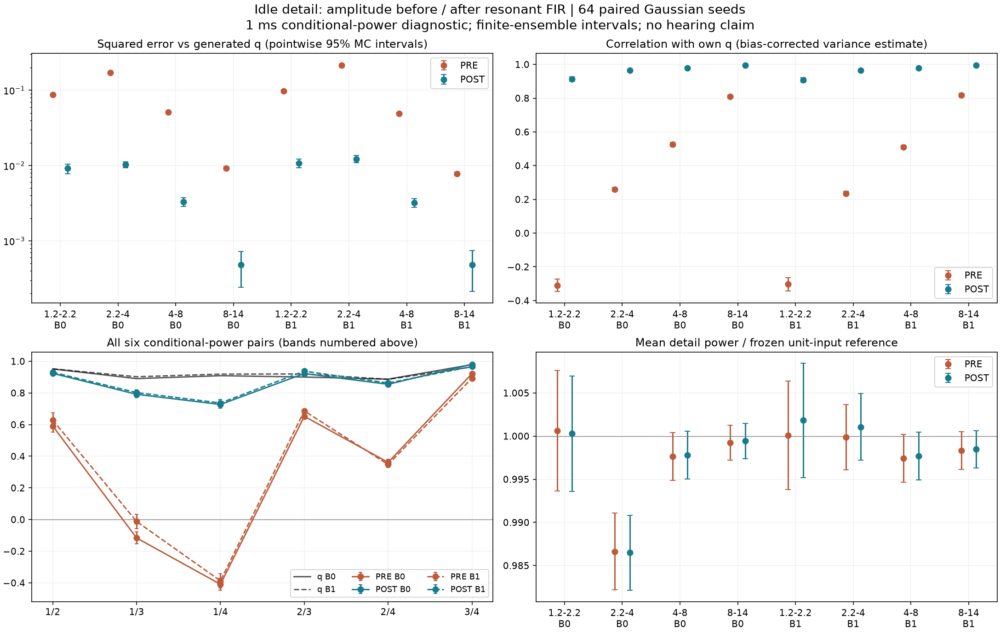

# 怠速细节调幅位置 V1

**已验证：同一套从F2怠速提取的细节起伏，放在共振塑形之后，比放在之前更能保住频段间的联动。**这是调制位置的输出验证，还没有生成新试听或替换实时C；不能据此宣称怠速已更好听。

## 素材与接法

延续已批准的F2尾排怠速：原6–9秒提取、9–12秒检查得到的正值功率规律q。q由既有三个声学OSC相位及其差生成，既不读取原片包络，也不循环原片。三个频率约75.037／112.486／187.529Hz，只是声学模式，未认定实际RPM或曲轴。

只比较细节支路的位置，六个原FIR、增益、四个后续观察滤波器、原始相位和65535帧预历史相同：

```text
滤波前调幅 PRE：随机输入 → √q调幅 → 各原共振FIR → 求和 → 观察滤波器
共振后调幅 POST：随机输入 → 各原共振FIR → √q调幅 → 求和 → 观察滤波器
```

低两个支路维持单位方差，上四个使用q。主OSC提供驱动相位，本轮统计不混入主OSC音频；它不是总混音听感对比。没有改延迟、相位、音量，没有加房间、额外高频或稀疏颗粒。

## 两段都改善，平均功率并没有明显抬升

固定64个高斯随机输入种子0–63，两种接法使用完全相同的随机序列。完整6秒分成两段3秒，各裁去两端100ms；先按1ms平均输出平方和q，再比较条件功率。下表是相对各带冻结单位输入功率的分析量，未改变实际播放增益。

| 频段 kHz | 第0段 PRE误差 | POST误差 | 第1段 PRE误差 | POST误差 |
|---|---:|---:|---:|---:|
| 1.2–2.2 | 0.086996 | 0.009157 | 0.097701 | 0.010759 |
| 2.2–4 | 0.170790 | 0.010295 | 0.214960 | 0.012200 |
| 4–8 | 0.051516 | 0.003312 | 0.049082 | 0.003212 |
| 8–14 | 0.009217 | 0.000479 | 0.007780 | 0.000479 |

8项平方误差点估计下降约**89%–95%**，配对差的8项Bonferroni近似95%同时区间上界均小于0。该区间只描述这套冻结模型的Monte Carlo误差，不包含素材估计误差或听觉不确定性。

第一带与自己目标q的相关从约−0.31变为＋0.91；四带POST与自己q相关约0.908–0.995。原先两对条件功率反向变化也恢复为同向：

| 配对 kHz | 第0段 PRE／POST | 第1段 PRE／POST |
|---|---:|---:|
| 1.2–2.2／4–8 | −0.116／＋0.791 | −0.012／＋0.802 |
| 1.2–2.2／8–14 | −0.409／＋0.727 | −0.387／＋0.736 |

POST仍未完全等于输入q的共同变化，观察滤波器仍在调幅之后。四带平均细节功率与PRE差异很小；不能把这项改善解释为增大音量。



## 怎样避免把随机误差当成细节

同一个随机输出的平方天然有自身波动，直接拿有限次平均做相关会高估条件功率的变化。本轮用**不同随机种子之间的乘积**估计条件时间协方差，并扣除集合均值噪声对平方误差的贡献；Pearson比值仍为估计，不裁到±1。64次逐一种子剔除的配对jackknife给出近似t区间，不把区间当作严格有限样本定理。

PRE另外有完整响应平方卷积的精确条件功率。36项标量对照均落在逐项95%区间内；这只是校验记录，不是挑选种子或模型的通过门槛。POST是有限集合估计，**没有冒称为精确时变四阶预算**。

已知双输入、双抽头及下游双抽头观察器先用完整局部二值集合和冲激基底相互核对，最大误差4.45e−16；恒定调幅可交换，时变调幅存在明确反例。独立程序再以不同卷积和逐节IIR方法重新生成全部64组配对结果，完整6000×4功率数组最大差1.69e−13；独立跨种子代数复算全部统计、jackknife与区间，最大差3.95e−13，精确PRE功率差1.34e−15。

## 对音色开发的含义

本轮支持的是：**先形成有色共振细节，再由低声线相位关系控制其强弱**。不应把测得的总带功率直接塞进白随机输入，让不同共振器再次改变其起伏。

还剩一个必要步骤：q描述录音的总带功率，并未物理分离主OSC与随机细节；而上一阶段已经证明，保留全部旧稀疏强度再加周期起伏会重复计入颗粒。接下来应以这个POST接法核算最终混合输出，联合分配周期起伏与独立颗粒的强度，再决定是否形成新的可选音色。不能凭本轮二阶结果直接叠加旧κ，也不能绕过待完成的听评。

离线代码保持分层：`render.py`负责接法与已知控制，`statistics.py`负责跨种子估计；观察、独立审计、绘图、冻结各有入口。未改612份C/H、67份旧声音配置、认可行驶35%、已有怠速候选、二进制和take；没有下载新素材、重复听评提问或运行无关旧驾驶测试。

完整输入身份、全部64组功率、执行源、计划、审计及图冻结在`E:/VehicleSoundLab/baselines/idle_modulation_placement_v1`。仍限近单声道F2尾排情境；立体声对象、完整驾驶状态、多发动机与原共同相位资格继续保留为后续工作。
