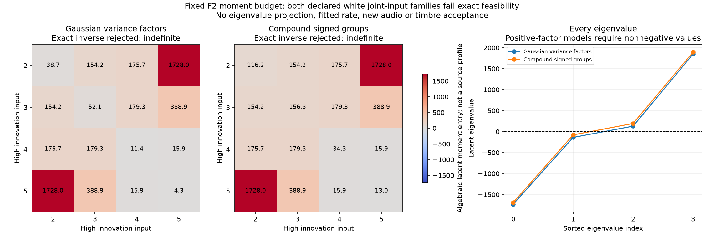

# 怠速联合激励预算 V1

承接[跨频带颗粒调查](怠速跨频带颗粒V1.md)，本轮把素材统计转成完整生成预算。结果是：**两种简单、逐采样独立的共同激励，在保留当前共振器并精确匹配训练矩时都不成立。**没有导出新试听或改C驾驶默认。这个结论限定于本轮模型，不是否定全部联合合成方法。

## 两种明确分开的模型

都保留13条主OSC、6组FIR／增益／左右比例。只有高四带输入改变联合统计，低两带仍是独立高斯。所有输入保持均值0、方差1、二阶互不相关和时间白性；因此若能构造，原平均功率与左右频谱预算可以保持。这里只做可行性检查，尚未构造新的运行声源。

| 模型 | 输入结构 | 潜在矩阵要求 |
|---|---|---|
| 高斯共同方差 | 独立高斯载体，幅度方差共同变化 | 方差协方差D必须半正定；对角四阶量为3Dᵢᵢ，混合项为Dᵢⱼ |
| 有符号共同跳变 | 共同泊松统计组，每带每次独立正负号，另留高斯底 | C是非负因子的外积和，必须半正定；对角和混合四阶项均由C给出 |

后者只是统计激励假设，不是把跳变命名为点火。原随机激励与主OSC的分工保留。两类都独立执行并保留结果，没有把第二类作为隐藏回退。

## 完整滤波预算

不只匹配每带峰度，还同时匹配四个对角量和六个混合量。设高四带输入到观察带的实际有效响应为h，潜在矩阵某个对角元素的贡献为：

```text
A_diag = d · Σ h_bi² h_ci²      d=3或1，按模型定义
A_off  = Σ[h_bi²h_cj² + h_bj²h_ci² + 4h_bi h_bj h_ci h_cj]
```

交叉项包含有符号响应及相位重叠，不能只用两条功率包络相乘代替。训练目标来自冻结F2原生6–9秒的完整四阶矩，按旧模型方差换算并减去原主OSC的有限项。10×10线性系统每类只求解一次，没有投影到最近半正定矩阵、修改目标或扫描参数。原声单带和跨带矩均是有限录音观察，不是已标定的真实总体矩。

## 实际结果

两类系统都满秩10；列坐标归一后的条件数约3.405，归一输出线性残差约2.30e−16。代数拟合准确，但矩阵不是可用的共同统计结构。

| 模型 | 潜在矩阵最小特征值 | 训练目标必须改变的归一10维矩范数下界 | 同一训练约束用于9–12秒检查的下界 |
|---|---:|---:|---:|
| 高斯共同方差 | −1732.25 | 0.04974 | 0.07207 |
| 有符号共同跳变 | −1689.92 | 0.04849 | 0.07074 |

最后两列是必要改变的下界，**不是最近可行解、误差百分比、统计置信区间或听感差距**。检查段没有重新拟合，且此前已观察过，是同录音复核。潜在矩阵里的数值没有导出为音色参数；无效代数解的误差下降也不能称为合成改善。

证明方法：取训练矩阵的负特征向量v，构造对偶u，使得任何半正定潜在矩阵都满足`uᵀy≥0`。两段观察均违反同一训练约束；对偶残差低于6e−16。所需改变范数至少为`−uᵀy/||u||`，没有另做优化或放宽门槛。



## 下一步如何走

“几个频带共同起颗粒”不是完整算法。当前失败可能涉及激励的时间相关、带间相位／非对称四阶关系、固定共振器限制或有限统计误差；本轮尚未区分这些原因，不能宣称只加一个延时就能解决。

下一步先从同一批准素材观察跨频带四阶关系随时间间隔怎样变化，再与当前有效响应的时间支持比较；同时保留同谱控制和原单带指标。没有证据前，不扫描共享延时、不盲加同一个幅度开关或再堆独立OSC云。现有怠速试听仍待反馈，不重复提问或默认接入。完整系统的RPM／负载、共同曲轴时钟、多发动机与7.1.4验收仍未完成，原共同相位36／17／33／逐线14k／原E条件不豁免。

## 工程与留痕

`tools/idle_joint_budget_v1/budget.py`只负责完整矩映射、一次求解与充分的非负因子证书；`checks.py`负责已知分布及逆问题控制。观察、独立审计、约束证明、绘图、打包分开，没有把驾驶器或IO混入声源。

真实输入之前，精确共同方差双抽头FIR集合与泊松／二项分布控制先通过。两类各验证可行、不定与秩不足三个控制，秩不足明确为未知，不使用伪逆当已识别解。独立审计展开完整四阶张量的全部非零排列，复核全部映射、标量集合矩、SVD解与四份对偶证明；最大归一映射误差1.28e−17，SVD相对解差1.17e−14。

首轮审计曾在逐行检查时重复解压NPZ，确认进程554640后手动中断；原执行源与中断原因保留。只把审计数组改为一次读取，audit2通过，素材提取、两类求解与证明均未重跑。完整图已目视。

612份C/H、67旧配置、认可行驶35%、怠速候选、旧二进制与take保持，无新声音、运行配置、下载或旧61项测试。全部证据与精确源码冻结`E:/VehicleSoundLab/baselines/idle_joint_budget_v1`。
