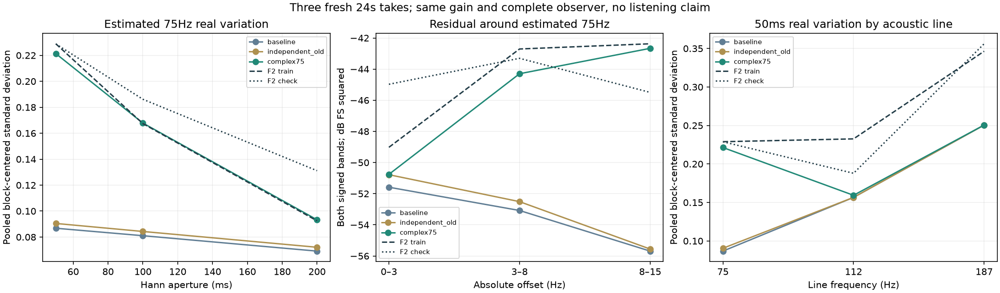

# 怠速联合起伏 V1

针对“节奏太规整，像持续的合成器音符”，本轮做出**一个素材驱动的新离线候选**：替换75Hz主声线的力度变化，加入从素材提取的幅度／相位联合变化。它不是新加一层风噪、锯齿波或房间效果。实时C、行驶35%配方和旧声音均保留；听评待定。

试听：[原版／新版／独立随机流对照](http://127.0.0.1:8789/references/analysis/idle_complex75_v1/review1/index.html)。三个固定种子各24秒，可听完整声音／主声线；另有F2两段3秒参考。全部增益1，仅首尾约21ms淡入淡出，不逐条匹配响度。

## 从素材到持续生成

1. 只用已批准F2尾排6–9秒拟合；9–12秒是已看过的检查段，不宣称盲测。沿用已有13条声线及三个声学相位，在原生48kHz录音上投影常系数主线。
2. 将剩余声音相对75Hz解调，经固定15Hz低通，形成相对复包络。它同时包含力度和相位信息；不是物理燃烧源或真实曲轴的独立提取。完整滤波前后历史各250ms，取250个100Hz节点。
3. 对复包络的`log幅度／相位角`估计2×2联合频谱，编译128抽头、两输入两输出FIR。只保存统计滤波器，不保存源PCM或节点轨迹。色彩变换匹配零滞后协方差，**不保证原录音每个滞后和谱点都精确相等**。
4. 新高斯随机流经过FIR和三次插值，持续驱动同一条OSC。全部480个原生插值位置修正完整2×2协方差，保持幅度／相位关系，不把它们拆成无关随机量。

设生成潜变量为`xR,xI`、协方差为`C`：

```text
g = exp(xR - Crr + i*(xI - Cri))
75Hz贡献 = 原RMS幅度 × Re(原相量 × g)
E|g|² = 1
```

这是理论增益功率，不代表每条有限音轨RMS完全相同，也不保证原生实信号每个采样的期望功率恒定。其余12条主线／原细节配方不变；原75Hz附近细节仍存在，未称物理分离。新模型与原相位过程独立是本轮假设。

为排除随机实现差异，增加“原力度改用独立随机流”对照：保留原三维力度模型的75Hz边缘分布。它与新版都移除了旧75Hz到112／187Hz的力度关联，因此需同时保留完整原版比较。

## 实际生成后检查

全部三种子×8个三秒块，程序相位／从混音重新提取相位，两种基底×50／100／200ms三窗，共288份新三总线观察；原168份观察按哈希复用。保留51滞后6×6有符号协方差及96份新原生残差谱。

采用混音估计相位，75Hz归一化实部标准差如下。生成项先每块去均值再合并24块，并非听感评分。

| 分析窗 | 原版 | 独立随机流 | 新版 | F2拟合／检查 |
|---|---:|---:|---:|---:|
| 50ms | 0.08678 | 0.09047 | 0.22134 | 0.22891／0.22881 |
| 100ms | 0.08103 | 0.08429 | 0.16781 | 0.16740／0.18615 |
| 200ms | 0.06916 | 0.07212 | 0.09332 | 0.09248／0.13111 |

75Hz附近3–8Hz偏移功率从4.92e−6增至3.72e−5，F2为5.36e−5／4.67e−5；8–15Hz从2.70e−6增至5.41e−5，F2为5.79e−5／2.82e−5。新版高偏移已经超过检查段，低偏移仍不足，不能宣称完全还原或普遍最优。整段30–120Hz功率只增加约0.034dB，主要变化在时间／旁带分配。



## 工程边界和验证

| 文件 | 职责 |
|---|---|
| `tools/idle_complex75_v1/extract.py` | 原生复包络提取 |
| `tools/idle_complex75_v1/model.py` | 联合FIR编译、持续随机生成、插值、复增益 |
| `tools/idle_complex75_v1/known.py` | 已知FM／复调制／邻线／退化秩控制 |
| `tools/fit_`、`render_`、`observe_idle_complex75_v1.py` | 离线拟合、音轨渲染、接入既有观察器 |
| `tools/audit_idle_complex75*.py` | 独立QR／卷积／模型／全音轨／全部预算核对 |
| `tools/assess_`、`review_`、`package_idle_complex75_v1.py` | 统计图表、单播放器、归档 |

已知无AM的非线性FM未被误判为力度；精确复调制含负频镜像、纯AM／纯相位／零秩／延迟耦合及高斯增益矩通过。独立重建源提取、全部FIR抽头、480个完整协方差、三组随机流／原生增益和12条FLOAT音轨；最大音轨差1.49e−8FS。全部33408窗口QR、96原生投影／谱及有符号预算通过；20条试听文件的HTTP、量化、浏览器静音播放／切换／定位／手机布局通过，图和截图目视。

首次独立审计对旧Cholesky调用漏写`lower=True`，在读源之后的旧模型插值核查失败；原源码／失败报告保留于audit1，audit2仅修正审计器。生成算法、数据和门槛未变。

本轮仍仅是单一F2怠速声学坐标模型，未解决187Hz细节、完整RPM／负载覆盖或其他发动机。没有重新资格验证通用相位提取器；原failed36／all17／full33／individual14k／originalE要求保持。下一步先听此候选是否减少长音符感且没有新增颤音，再决定独立C移植；不默认推广到全工况。619份C/H和67份旧声音逐项哈希保持，未重复无关55项C测试，完整驾驶／多音色／stereo到7.1.4目标继续。

冻结：`E:\VehicleSoundLab\baselines\idle_complex75_v1`；精确源、失败、数据、模型、音轨和校验见manifest。`research/idle_complex75_v1_profile.json`只作研究配方快照，不是已接入实时的声音。
