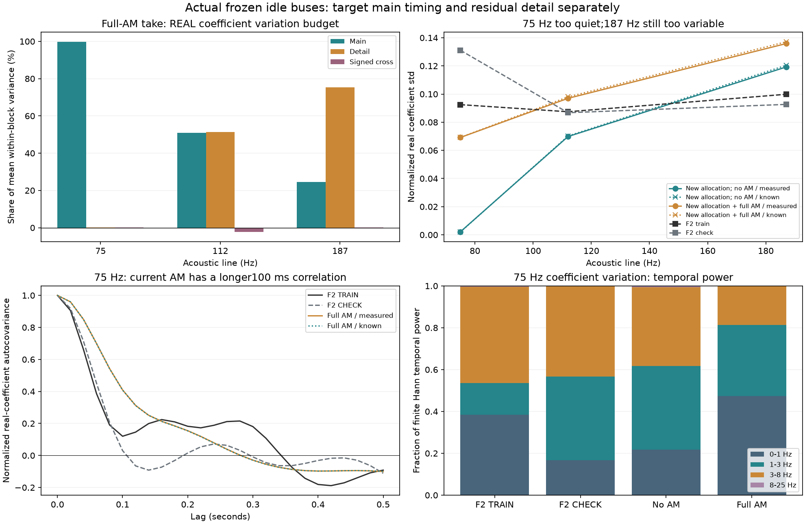
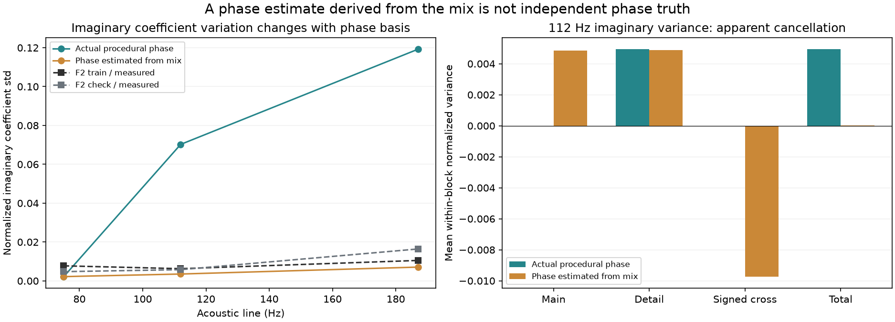

# 怠速起伏分层核查 V1

本轮定位了两个不同问题：**约75Hz主声线的力度起伏偏少、偏慢；约187Hz过量起伏主要来自现有细节层。** 两种相位观察法的实部结果基本一致，支持分模块处理，不能统一调大三条主声线的AM。没有新增声音、改C或替换待听版本。

这里“主声线／细节层”是Sound DNA内部的OSC与录音残差共振子模块。低频轰鸣、NVH及空间层继续各自独立。本轮不是给系统加入风噪或新的低频pad。

## 实际检查范围

复用上轮主声线配比的全部三个种子、三个条件、各24秒FLOAT音轨：旧细节基准／新配比无AM／新配比＋完整AM。每条都有已保存的主声线与混音；细节由二者相减得到，没有重新随机生成或改变音频。

每条分为八个三秒块，全部72块各用两种相位观察：程序实际生成相位，以及从该块混音估计的声学相位。混音／主声线／细节在同一窗口、同一矩阵下联合投影。另有F2原两段、全部六个同谱对照及一段已知程序控制，共153组、每组116窗。

13OSC＋DC、200ms Hann／20ms步长／250ms裁剪保持原方案。F1多车街景、F3说话段没有用于怠速提取。真实素材仍仅是F2同一次录音的6–9／9–12秒，不扩大到其他车型或录音视角。

## 力度变化落在哪层

将三条复系数除以固定参考系数后，分别检查实部和虚部。真实源／对照各用自己的拟合段全局系数，检查段不改参考；生成声用对应配方的固定主声线幅度。表中是每块去均值后方差的合并平方根，**不是响度、log标准差或音质评分**。

| 约Hz声线 | F2拟合／检查 | 新配比无AM | 新配比＋完整AM |
|---|---:|---:|---:|
| 75 | 0.0925／0.1311 | 0.00214 | 0.0692 |
| 112 | 0.0874／0.0868 | 0.0698 | 0.0970 |
| 187 | 0.0998／0.0927 | 0.1192 | 0.1359 |

完整AM版本的实部方差分配如下。这里统计的是**生成器已有两层**，真实录音只观察整体，没有声称把它物理拆分。

| 声线 | 主声线 | 细节 | 有符号相关项 |
|---|---:|---:|---:|
| 75Hz | 99.78% | 0.08% | +0.13% |
| 112Hz | 50.92% | 51.40% | −2.32% |
| 187Hz | 24.52% | 75.38% | +0.10% |

所以75Hz需要研究主声线力度的时间结构；187Hz应优先检查细节子模块，直接增加主声线AM会继续增大总起伏。112Hz的两层贡献接近，需要保留相关项，不能把两层方差孤立相加。

## 变化速度

75Hz实部在100ms滞后的归一化自协方差，生成声约0.409，F2拟合／检查约0.120／0.030。采用程序实际相位时为0.409，说明这项偏慢不是由混音相位估计单独造成。

以50Hz的窗口系数序列计算有限Hann时间谱，75Hz变化在3–8Hz的功率份额：F2约46.1%／43.2%，完整AM约18.6%。**这里3–8Hz是幅度变化速度，不是发动机声学频率或RPM。** 窗口已经低通、重叠，不能直接把这些数字设为原生调制器带宽。

## 相位观察器还会藏掉什么

全部六个实／虚分量都保存了，没有只看较好的一半。实际程序相位与混音估计相位对实部影响较小，但虚部差异很大：

| 声线 | 用程序实际相位的虚部标准差 | 用混音估计相位 |
|---|---:|---:|
| 112Hz | 0.07025 | 0.00352 |
| 187Hz | 0.11921 | 0.00709 |

相位估计来自混音，观察坐标本身会跟随细节变化。在112Hz虚部，测得的主声线／细节各自方差都比总方差大约数百倍，又由很大的负相关项抵消。两层生成器未变化；变化的是分析坐标。因此小的观察虚部，不能解释为很小的原生相位噪声，也不能把这种抵消认作真实机械源耦合。

这项图是在第一版统计后明确追加的固定数据诊断；保留assessment1、执行源码与原图，assessment2增加虚部说明，没有重拟合、换种子或新声音。后续联合力度／相位模型必须把相位提取器放进前向比较，不能将录音的观察协方差直接等同于未知原生激励。

## 验证与下一步

所有51个正负滞后、完整6×6协方差都核对了`混音=主声线+细节+两向相关项`；没有对log方差作错误的线性相加。已知负相关反例保留了负项及大于100%的单层比率。

独立17748次加权QR覆盖153组全部窗口／所有总线，窗口复系数最大差约1.4e−14FS；完整协方差差约1.3e−15。程序相位用另一自然插值及显式映射复算，原生最大差约3.6e−12；估计相位用手写解析信号频域乘子复算。全部时间谱、频段、引用、合并预算保持一致。

首次审计在三秒末端、解析幅度约4.3e−7时，NumPy与SciPy FFT约1.2e−16的复信号差被归一化放大成3.5e−11相位差，触发原1e−11检查。失败与原脚本保留；第二版手写解析信号使用与原Hilbert相同的SciPy FFT后端，阈值和主观察结果未变，通过全部原生检查。该数值边界不是听感问题的解释。

下一步分别约束75Hz主声线力度的变化速度和187Hz细节的时间结构，同时维护有符号相关功率。先让候选经过完整观察链再判断统计接近程度；音色仍由试听验收。单次短素材、重叠窗口、每块去均值和少量随机种子不能提供置信区间、机械因果或原生创新参数。

| 模块 | 职责 |
|---|---|
| `idle_variation_budget_v1/observe.py` | 同一个13OSC窗口联合观察多条总线 |
| `idle_variation_budget_v1/variation.py` | 有符号时间协方差、分层预算与有限时间谱 |
| `observe_idle_variation_budget_v1.py` | 只读取冻结素材／旧音轨，不渲染声音 |
| `audit_`／`assess_`／`package_` | 独立QR、两种相位检查、说明与归档 |

全部证据冻结于`E:/VehicleSoundLab/baselines/idle_variation_budget_v1`。619个C/H、67个旧voice、已认可行驶35%、原怠速／驾驶默认及立体声／7.1.4接口保持；上轮均值模型仍因触边不采用。原共同相位资格、完整驾驶工况、多发动机与空间化继续未完成，最新怠速配比保留待原听评。
