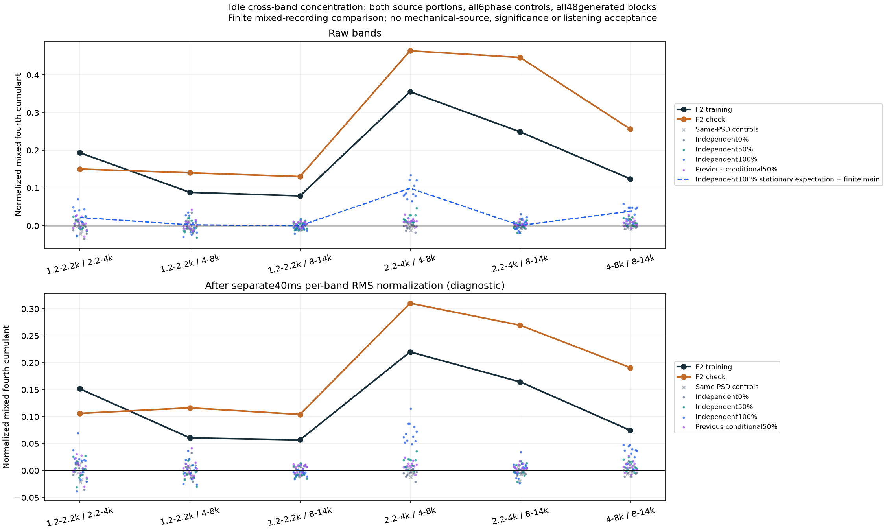

# 怠速跨频带颗粒 V1

本轮从已批准F2尾排怠速继续找缺口：**每带单独恢复颗粒，仍会漏掉不同频带一起变化的关系。**没有生成新的试听候选或替换C驾驶默认；现有[怠速颗粒试听](http://127.0.0.1:8789/references/analysis/idle_excitation_moments_v1/review1/index.html)继续独立等待听评。

## 观察了什么

沿用冻结原生48kHz的6–9秒训练、9–12秒检查，四个原观察带通、两端各100ms；检查段已见过，同一录音内比较，不是独立新验证。两段各保留三组同频谱随机相位对照，保留完整左右交叉谱。另检查既有独立激励0／50／100%三种子和主声线带动50%三种子的全部12秒输出，每条分四个3秒窗，48窗全部报告。

对居中的频带信号计算混合四阶累积量：

```text
K_bc = E[x_b² x_c²] − Var(x_b)Var(x_c) − 2Cov(x_b,x_c)²
Q_bc = K_bc / [Var(x_b)Var(x_c)]
```

对角线就是上轮的超额峰度，非对角线补充共同集中程度。扣除协方差平方项，可避免把高斯信号的普通频带重叠直接算作非高斯共同颗粒。另对每个40ms块、每带各自RMS归一，再计算同样指标；这会改变统计，只有诊断意义，不是分离机械源或严格去除全部慢包络。

## 找到的缺口

| 频带配对，kHz | F2训练Q | 同录音检查Q | 当前独立激励100%理论Q |
|---|---:|---:|---:|
| 1.2–2.2／2.2–4 | 0.194 | 0.150 | 0.0217 |
| 1.2–2.2／4–8 | 0.0886 | 0.140 | 0.00236 |
| 1.2–2.2／8–14 | 0.0790 | 0.130 | 0.00000154 |
| 2.2–4／4–8 | 0.355 | 0.464 | 0.0995 |
| 2.2–4／8–14 | 0.249 | 0.446 | 0.000751 |
| 4–8／8–14 | 0.124 | 0.256 | 0.0384 |

全部六对在两段原声中都高于各自三组相位对照；40ms归一后仍如此。当前全部生成窗也没有达到这两段原声的六对共同集中程度，包括前轮主声线带动50%。这是完整有限样本对比，不是统计显著性或听感优劣证明。

独立激励并不代表输出频带的混合累积量绝对为0：同一个输入通过多个有重叠的滤波器，也能产生小的非对角项。本轮用冻结有效响应明确计算：

```text
K_bc(independent) = Σ_i κ_i Σ_n h_bi[n]² h_ci[n]²
```

再加原主OSC在该3秒内的有限确定性项，并按冻结模型方差归一。它是平稳随机创新的理论预算加有限主声线项，不是每条12秒输出的精确预测；不能套用到局部RMS归一后的声音。此前四阶预算主要约束对角线，所以即使单带颗粒统计接近，六对关系仍可能不足。没有因此修改旧参数或提高强度。



## 怎样影响下一步算法

应研究具有共同变化的多频带创新，同时保留各带自己的分布、固定共振与OSC主声线。新增关系要一起约束平均功率、左右谱关系、单带和跨带四阶量，不能把所有频带绑到同一个周期触发器，也不能认为复制一个共用幅度就已充分。

精确控制说明这种架构区别确实存在：四个单位方差、零交叉协方差的统计输入，可以保持每带超额峰度9不变；独立伯努利标记的非对角Q为0，共用标记则为3。普通共同随机幅度也能产生这种关系，**不能凭这些矩就给出点火、摩擦或机械来源名称**。真实F2还有频带滤波、主声线、风和录音影响；新机制是否能同时满足完整预算须另行验证，不能直接把控制例子当素材配方。

因此下一步先做训练限定的联合创新可行性与解析滤波预算控制，再决定是否值得导出对照。已有候选的听感优先，不盲调种子、频带或参数；只有听感成立的配方才考虑可选C接入。实际RPM／负载、共同曲轴时钟和多发动机还原仍未建立，原共同相位36／全部17／完整33／逐线14k／原E资格不豁免。

## 模块与核对

`tools/idle_joint_cumulant_v1/moments.py`负责观测与独立创新预算；`checks.py`负责精确有限集合反例；观察、独立审计、绘图和打包是单独入口。没有把驾驶控制、空间、文件IO或新的声源混在一起。

三组精确集合控制通过，包括独立双抽头FIR的完整混合累积量公式。独立标量补偿求和、FFT／SOS多项式滤波、已知波形逐行重建与谱身份核查覆盖57组观察、114个4×4矩阵、全部六对总结；最大矩误差7.31e−13、滤波误差1.29e−15FS。完整图已目视。

612份C/H、67旧声音配置、认可行驶35%、怠速候选、旧播放器及take保持。无新音轨、配置、额外下载、重复听评问题或旧61项驾驶测试。精确源码、控制、观察、独立核对与父归档身份冻结`E:/VehicleSoundLab/baselines/idle_joint_cumulant_v1`。
