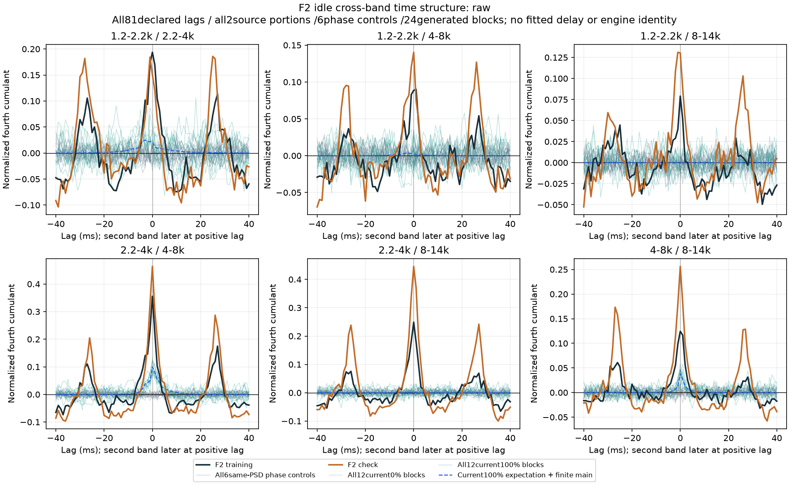
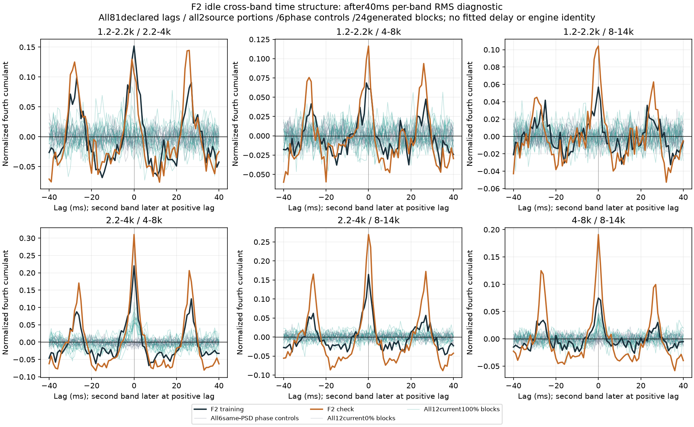
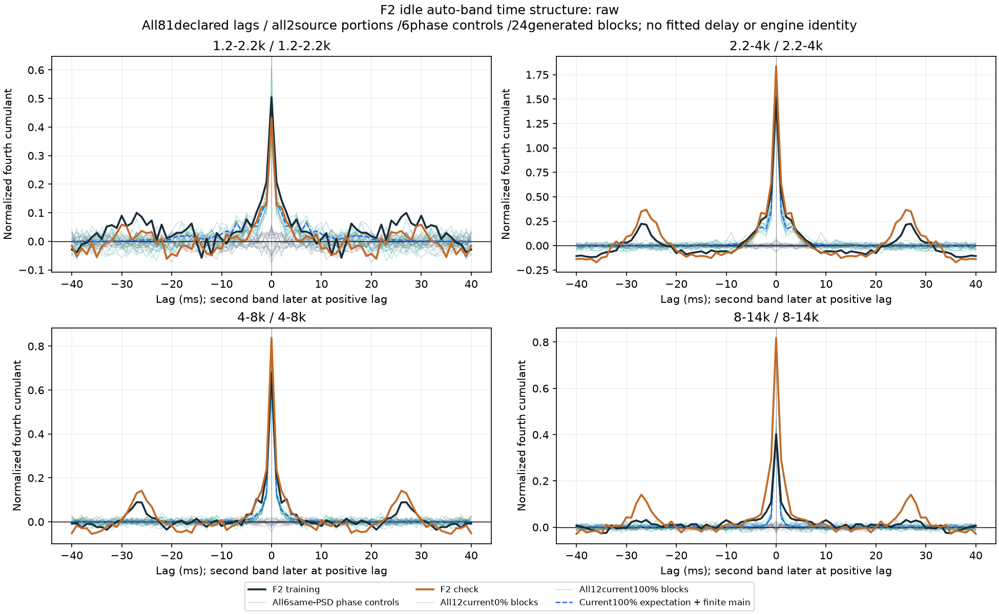

# 怠速颗粒时间结构 V1

本轮继续解释[联合激励预算失败](怠速联合激励预算V1.md)：原声的跨带颗粒不只在零时刻共同增强，还存在明确的正负时间结构。**当前独立颗粒模型没有表达这部分关系。**没有新增试听或替换C驾驶默认；已有怠速候选继续独立等待听评。

## 同一素材、完整时间观察

仍用冻结的F2尾排6–9／9–12秒，原生48kHz、原四个观察带通、两端各100ms。两段原声、各三组同频谱相位对照、既有0／100%三种子全部四个3秒窗，加原主OSC，共33组。没有挑选种子、片段或增益。

观察−40至＋40ms、每1ms一个点，共81个固定时间间隔。正间隔表示第二个命名频带更晚；只取真实线性重叠，不循环拼接。每个重叠区间重新去均值，计算混合四阶累积量，再按整个窗口的固定方差归一。零间隔与前轮矩阵一致。每组同时保留四条自带和六条跨带曲线；全部660条四阶曲线及对应二阶曲线存档。

原始版本与每带40ms RMS归一诊断分别观察。后者会改变统计并引入块边界，不能叫机械源分离；所有对照接受同一变换。

## 发现的是正负结构

零时刻六对原声均为正关联。预先指定的`8≤|间隔|≤20ms`区域平均值则在两段原声中全部为负；同谱对照在每对的对应两段都没有达到这种负值。下表列原始版本，已保留两侧所有26个网格点。

| 频带配对，kHz | 第一段8–20ms均值 | 第二段均值 | 当前100%理论均值＋有限主声线 |
|---|---:|---:|---:|
| 1.2–2.2／2.2–4 | −0.04679 | −0.04197 | 0.00308 |
| 1.2–2.2／4–8 | −0.02093 | −0.01945 | 0.000273 |
| 1.2–2.2／8–14 | −0.01847 | −0.01039 | 0.000000232 |
| 2.2–4／4–8 | −0.03272 | −0.06147 | 0.00240 |
| 2.2–4／8–14 | −0.02091 | −0.04718 | 0.0000258 |
| 4–8／8–14 | −0.00626 | −0.02514 | 0.000179 |

40ms归一诊断仍保留六对负均值。完整曲线还显示约±26–28ms附近的再次增强；这是1ms网格上的描述，**没有从峰值拟合周期、真实转速、点火间隔或曲轴相位**。有限录音、相干声线拍频、非平稳性、麦克风与风都可能参与。个别随机生成窗也会出现负值，不能把一项有限矩当统计显著性或发动机探测器。





## 与当前共振器比较

保留原有效响应与原独立输入峰度，直接算所有间隔的旧模型期望：

```text
K_bc(τ) = Σ_i κ_i Σ_n h_bi[n]² h_ci[n+τ]²
```

再加原主OSC有限窗口项，使用冻结模型方差。它没有选新延迟或重新拟合；零时刻也复现前轮理论预算。独立输入κ为非负时，随机项本身是非负的平方响应相关，无法单独表达上述负均值。这里是对当前结构的说明，不是否定全部合成方法，也不代表录音总体矩已经精确确定。

24条响应全部保留能量重心与5–95%能量区间。四个高输入对应主频带自身的90%宽度分别约18.98／5.65／4.00／2.21ms；不是实际机械事件时长。完整自带曲线也显示，恢复单带零时刻峰度，并不会自动恢复它在其他间隔的形状。



## 下一步生成方法

下一项应检验从已有低声线相位及相位差得到的多频带幅度调制，观察它能否在另一段继续预测这些正负关系；先做训练限定、已知反例、正功率边界与完整预算，再考虑生成对照。相位差是声学坐标候选，不是新增物理曲轴时钟。

周期调制、随机细颗粒与固定OSC／共振谱应分别维护。当前仅增加单带稀疏强度或一个共同的慢随机幅度，不足以解释本轮结果；不能因此随意增加FM／PM，或把27ms直接硬编码为发动机周期。现有听评不重复提问，未认可配方不直接替换C默认。

## 模块、验证与边界

`tools/idle_joint_lag_v1/observe.py`只做线性时间观察、摘要与响应支持，`checks.py`包含已知延后2ms的共同颗粒和非发动机的慢共同幅度反例。观察入口、独立审计、绘图和打包各自分开。

已知2ms方向被正确恢复；已知用例全部81间隔与直接去均值算式一致。独立审计对真实全部曲线改用SciPy线性卷积及通用四阶累积量的15种集合分拆复算，另在计划列明的11个时间点直接逐段核对。原计划文字误写13，但括号实际列11，执行计划原样保留并在审计注明，没有改时间观察、门槛或重新提取。最大四阶曲线差2.19e−11、直接检查差2.99e−13、观察滤波差1.29e−15FS；全部来源身份、零点、摘要与24响应核查通过。三张完整图已目视。

612份C/H、67旧声音配置、认可行驶35%、已有怠速候选、旧二进制与take保持；无新音轨、运行配置、下载或旧61项驾驶测试。实际RPM／负载、多发动机、7.1.4及共同相位36／17／33／逐线14k／原E资格仍未完成。完整证据冻结`E:/VehicleSoundLab/baselines/idle_joint_lag_v1`。
