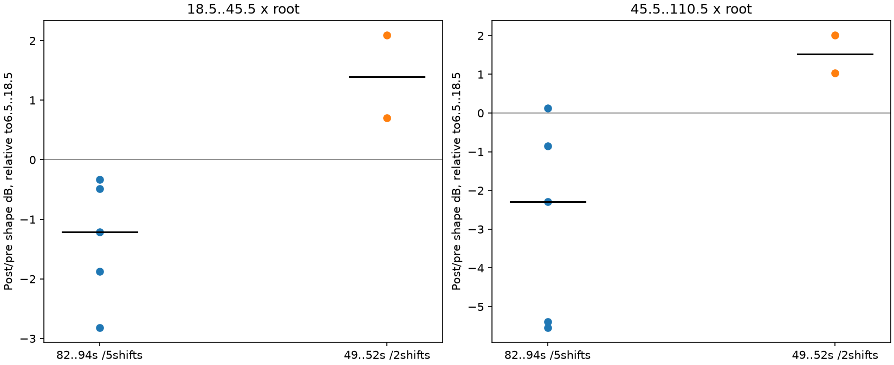

# 换挡跨片段复核 V1

2026-11-12。同一份已批准的 E 素材中，第一段 Corsa 的两次升挡没有重复第二段五次升挡的高频相对变化。**不能把“换挡统一削高频”作为通用实录标定。** 本轮只补充离线证据；C、驾驶映射、模型与已认可的 DNA／相干低频均未改动。

## 观察与结论

读取登记的 `E_corsa_first_context`（47–55秒）原始双声道 float，不滤波、归一化或降噪。33帧原视频裁切保留整数PTS、源帧号与SHA；五张接触表均已目视核对。仪表1→2显示变化在49.75–50.00秒；2→3在51.00–51.50秒，51.25秒为动画。51.5–55秒保持3挡，显示车速126降到98km/h，转速也下降，可作为减速语境，不能据此确认松踏板、断油或负载。

本段两个持续声线回落标记为49.805／50.905秒。它们是声学窗口的诊断位置，不能当成ECU、离合或切扭时刻；A/V同步和仪表延迟未辨识。起步段可能混有轮滑／牵引干预。

下表比较换挡前200–100ms与后100–200ms的功率。频带随观察根音移动，再扣除6.5–18.5倍根音中频的共同电平变化。根音是同一相对声学坐标，不是新测得的转速遥测。

| 片段／升挡 | 18.5–45.5倍根音相对中频 dB | 45.5–110.5倍根音相对中频 dB |
|---|---:|---:|
| 第二段1→2 | −0.48 | +0.13 |
| 第二段2→3 | −2.82 | −5.39 |
| 第二段3→4 | −1.87 | −5.55 |
| 第二段4→5 | −1.21 | −2.29 |
| 第二段5→6 | −0.33 | −0.85 |
| 第一段1→2 | +0.70 | +2.01 |
| 第一段2→3 | +2.09 | +1.03 |

第一段两次在上述频带的**绝对功率仍下降**；正数表示比中频下降得少。旧五次中位数预测新两次，误差约1.91–4.30dB。就连同挡位对照也不一致，因此应保留独立声层和工况包络，继续按条件建立目标，而不是把一条固定EQ推广到全部换挡。起步、挡位、速度、机位传递与潜在录音处理仍相互混杂，无法归因为真实负载变化。

## 核查与限制

80／60／40ms频带比较共用一条80ms时钟；两组不同起点追踪在重叠处完全相同，不能视为独立时钟方法。短窗下相对颜色最大变化0.23dB。已知变音高＋时变整体增益／已知频谱变化控制误差最大0.0081dB，直接FFT复核功率误差约5.6e−17；这些控制验证比较算式，不证明实录时钟准确。

前后时钟分别施加−2%／0／+2%的九组工程扰动：第一段1→2的两列范围为+0.64..+0.83／+1.46..+2.80dB；2→3为+2.06..+2.19／−0.12..+1.88dB。第二次的最高带可跨零，不能宣称其变亮符号稳健。扰动网格不是测量置信区间；两次中高频相对变化均仍与旧五次的普遍削弱不同。

两段全长低通／降至4kHz后的波形延迟搜索最大绝对相关低于0.065；已知同波形仅改变增益的控制相关为1。低相关只排除了此检测条件下的直接复制，**没有执行频谱去重，也不能证明是独立ECU试验**。实际执行源码保留在 `exact_sources`；发布版仅纠正exploration的一条注释，两版AST一致。

复查上游V6提交 `ac2b37d8639027d79934a2023cf8d1d37d3b2f96`：`v10_state_renderer~`有steady／accel／decel × 六RPM锚点及独立权重；该文件也有18条循环参考纹理支路。这里应借鉴多状态、多锚点和独立控制接口；尚未完整追踪该参考支路在默认公开链中的连接，不能把它的存在当成公开主声源全是采样循环，也不能把参考纹理效果声称为纯OSC移植。另只读查看的 `v10_powertrain~` 声明使用程序连续合成；本轮保存的是三份指定文本文件，不包含新媒体下载。

421项C/H索引及文件SHA全部一致。没有修改实时C，因此未重复运行与本轮无关的37项CTest和设备测试。验证的pass仅指输入身份、FFT／已知控制和索引核查；没有推出通用换挡配方，也不表示新增音色听评通过。

## 复现与交接

按顺序运行 `tools/explore_shift_repeat_v1.py`、人工核对原PTS接触表并登记标注、`tools/analyze_shift_repeat_v1.py`、`tools/verify_shift_repeat_v1.py`。每一步显式传 `--workspace`，分析各用新的 `--out`，验证另传 `--analysis`；不覆盖已完成目录。本轮输出位于 `E:/VehicleSoundLab/references/analysis/shift_repeat_v1/`，摘要与SHA见 [shift_repeat_v1_summary.json](shift_repeat_v1_summary.json)。

发布摘要使用 `tools/summarize_shift_repeat_v1.py`；提交后用 `tools/freeze_shift_repeat_v1.py` 冻结到新的 `E:/VehicleSoundLab/baselines/shift_repeat_v1/`。冻结包保留原PTS帧、图、实际执行源码、验证、源码ZIP与逐文件清单；`input_metadata` 单独保存实际使用的数据目录登记、批准清单与原始视频PTS索引，不用Git中的登记副本替代。原始E视频／float主文件按既有交接Release和摘要哈希恢复。

发布时摘要JSON的Windows换行被Git视为行末空白，已显式改用LF并通过复核；修订前摘要／脚本与失败、成功记录保留在 `publication1`，不涉及数值重算。

下一步可从新减速片段补充E车内的条件化DNA／残差观察，先验证声学时钟与条件差异，再考虑驾驶映射。旧 `state_colour_v2` 仍未通过完整时钟校验，禁止直接接入状态机。A移动尾排相干低频的固定情境听感认可独立保留，不能转作A驻车／E车内或全转速验收。
