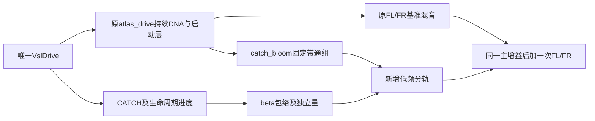

# 接火低频建立 V1

2026-11-12。新增独立C接火低频附加层及[0／50／100%试听](http://127.0.0.1:8789/research/接火低频建立V1.html)。同一A车内DNA、启动前段和驾驶器保持，新增量来自DNA的固定滤波成分。**这是离线候选，未替换原生窗口，未获听评，完整启动仍未还原。**

## 从素材提取什么

批准A的37.22–38.18秒有低频增强，以38.53–39.46秒的趋稳观察为功率基准。100ms Hann、10ms步长分别测30–120／120–300／300–600Hz；最低频先增强，高一带随后更明显。因此只拟合宽带颜色和共同平滑包络，不宣称恢复逐时刻曲轴／真实机械事件。

快速音高探索保留93组FFT／chirplet／独立参考尝试，86组不连续、7组缺参考，0组建立合格完整路径；不据此外推接火扫频。原先用38.25–39.0秒作基准的增强数值与本次不同，基准变化影响比值，不能混用。

三个正功率差频带的加权几何中心为97.67／186.82／380.96Hz，Q约1.09／1.04／1.27。每带用固定RBJ带通；对实际C的相干分量保留交叉项，再非负拟合增益。中间模式的最优增益接近0，不人为补满。共同beta形状约0.3525／0.5802；5／35ms起落及18ms量跟随是工程平滑值。

| 30–120／120–300／300–600Hz | 相对趋稳段的功率增强 dB |
|---|---|
| A实录训练目标 | 4.98／6.07／11.54 |
| 原C同一接火段 | −1.63／−0.08／+0.21 |
| 新候选100%，相干预测 | 4.93／6.92／10.90 |

这些是训练片段宽带均值；包含变调、声源和空间变化，**不是物理传递函数或自然度评分**。共同包络没有复现各频带完整时序。原DNA的300Hz以上细节亏损、快速音高和收尾仍缺，低频补足不能代替它们。

## 模块及状态连接

`modules/catch_bloom`分开profile／filter／envelope／voice四项职责。持续处理现有DNA，滤波不改极点、不增加随机源，关闭时仍推进状态。`experiments/catch_bloom_v1/probe.c`每240帧调用原渲染器，再读取该块驾驶状态，不推进第二个驾驶器；捕获的包络后DNA作为输入。它只负责离线适配／分轨，不改默认实时接口或schema4。

新层只加前置L/R，12通道其余10声道为0；没有把带车内观察空间的声音重复投影到BODY／排气对象，也未复制到LFE／高度。这不等于实际7.1.4验收。

V6固定版本`ac2b37d`的实际连线另有留痕：Catch Bloom控制31→32→33→34→81，音源为`cycle~`79；92Hz `reson~`76属于Crank／Activation Body。这里只参考独立声层调度，没有复制其声源、频率或增益；未运行Max／BEAP。

## 验证与留痕

- 原456份C/H及职责不变；新增8份模块C/H、2份离线宿主／检查，共466份索引。已有43项系统测试对应的核心未改，本轮只运行新增独立契约，没有重复宣称全系统测试／设备验收。
- 新C检查通过：解析beta／指数响应、复数频响、最低频高Q冲激衰减、mono、量0状态连续、1／240分块、同址、非法控制与事务读取。已知频带功率与beta恢复控制通过。
- 六次实际C渲染为2／12通道×0／50／100%。均两次启动、六生命周期；驾驶轨迹完全相同，raw／DNA／启动前段分轨保持原基准字节。0量mix与base字节一致，FL/FR跨布局逐样本一致、其余10通道静音。独立Python与C附加量最大误差1.49e−8满幅，单次叠加误差5.59e−9；最高峰0.1093，未限幅。
- 两次启动的新层都产生增强：独立100ms观察约5.02／7.02／11.09dB和6.08／5.91／10.30dB。两次共享同一训练配方，不是独立录音或车型验证。
- 六条试听共同0.5增益／5ms首尾淡化，独奏保留混音中的0.25主增益；无逐条响度匹配、压缩或限幅。FFmpeg解码、HTTP字节通过；未宣称已听过或操作网页。

证据`E:/VehicleSoundLab/references/analysis/catch_bloom_v1`包含build1索引计数失败／build2通过，fit1误用了库默认Tukey窗而被已知纯音控制拒绝／fit2显式Hann通过，以及render1／review1／V6连线失败与修订。build1在源码快照之前失败，只留下失败报告；build2、各拟合／渲染与V6审计保存了实际执行源码。快速音高全部失败另在`startup_flare_v1/exploration1`，不改阈值掩盖失败。

复现依次执行`build_catch_bloom_v1.py`、`fit_catch_bloom_v1.py`、`render_catch_bloom_v1.py`、`review_catch_bloom_v1.py`；统一`--workspace E:/VehicleSoundLab`，每步需新的`--out`目录，当前下游显式绑定成功的build2／fit2／render1。审计与冻结由`finalize_catch_bloom_v1.py`完成。摘要为`catch_bloom_v1_summary.json`，冻结目录`E:/VehicleSoundLab/baselines/catch_bloom_v1`。

下一步先判断低频发动机感与嗡鸣风险，再补快速接火音高／高频声纹，并把合格层接入同一原生UI与自包含行程；驻车完整动作、收油、换挡、跨发动机和长期运行继续完成，目标未完成。
