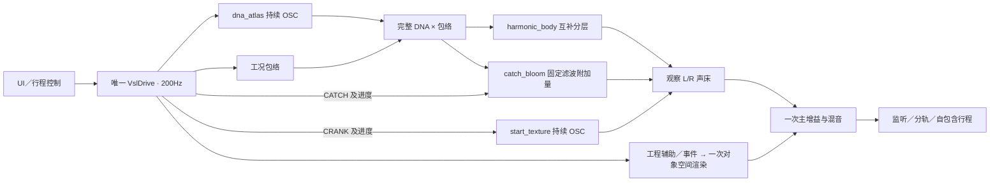

# 接火低频统一驾驶 V1

2026-11-12。`catch_bloom` 已可选接入同一 C 驾驶链、原生监听和自包含行程。新增 [统一链试听](http://127.0.0.1:8789/research/接火低频统一驾驶V1.html) 与 `Launch-Catch-Study.cmd`。本轮验证接入一致性，没有重新拟合音色；启动／接火候选尚未获得听评认可。

## 素材与对照覆盖

| 状态 | 已批准参考 | 可比较内容与边界 |
|---|---|---|
| 启动／接火 | A 33–40s，车内 | 本轮同 A 启动纹理＋趋稳 DNA＋接火低频；原录音与 C 时序不同，不能称同步复刻 |
| 驻车低转／补油降转 | A 208–211s、238–248s，车外 | [驻车局部对照](http://127.0.0.1:8789/research/驻车状态局部对照V1.html)已有录音／C DNA；不是完整暖怠速或同动作全层对照 |
| 收油减速 | E 52–54.4s，车内；B 475–485s候选 | 已有参考及功能回放，减速声纹尚未合格拟合 |
| 换挡 | E 82–94s；D 20–32s台架 | 已有录音与时序分析；切扭／恢复可触发，状态音色未完成实录匹配 |
| 机舱／进排气 | A 270–277s | 混合录音；工程辅助层不是已分离的真实独立声源 |
| 熄火／独立回火／独立进气 | 尚缺已确认干净的专项片段 | 有工程状态行为，不能据此声称实录还原 |

全部六类参考及两条功能回放见[状态素材页](http://127.0.0.1:8789/research/状态素材与系统回放V1.html)。A／B／D／E仍是四份录音，主要为同家族 V10；未新增下载或车型。

## C 模块边界

- `atlas_drive/control.*`：校验独立 `catch_gain`，范围0–1；`render.*`：拥有 `CbVoice`，按同一驾驶器 CATCH 的 `life_seconds/(rise+settle)` 调度。初始化及后续正量均要求提供有效 `catch_profile`。
- 新层输入取互补低频重分配之前的完整包络后 DNA，避免调整 `body_mix` 时抽走接火层声源。原 `catch_bloom` 八份 C/H 未改；固定滤波器继续推进，关闭不重置相位、随机源或驾驶器。
- `AdCapture.catch_bloom` 是主增益／宽度处理前的独立双声道附加量。干声路径加一次；布局路径经 `sb_route` 加一次 FL/FR，不再进入排气／BODY对象、房间、LFE或高度。
- `atlas_take/assets.*` 拥有启动与接火模型副本；`parameters.*` 新增第27字段 `catch_gain`；`take/player` 和原生设备均预分配捕获缓冲，新层按帧纳入源哈希。
- `atlas_take_io/codec.c` 显式序列化可选模式、beta及时间常数；当前 `.vslrun` 为 **schema5／27字段**。渲染身份包含接火源码，不静默兼容旧schema4。旧播放器保存在本阶段 `before/bin`，实际验证可重放旧文件。
- `experiments/catch_drive_v1/checks.c`负责集成契约；`probe.c`负责统一链两次启停与分轨。当前索引468份 C/H；具体变更及旧职责保持情况由摘要逐文件记录。

## 监听与录制

运行 `Launch-Catch-Study.cmd`，使用独立 `build-catch-drive-v1`。默认停止，A启动车内趋稳DNA、台架怠速工程映射、宽度100%、启动纹理50%、接火低频0%。先开始监听、点火；“声层量”选择“接火低频”，调至50%或100%，熄火后再次点火比较。可使用原录制／保存／载入／回放按钮。

切换到其他音色会清除接火模型与量；A趋稳单锚点没有残差模型，残差控制关闭。它不是覆盖已认可的车外配方。旧 DNA Drive、Stereo Bed 和 Startup Study 窗口／二进制保留。

本轮只检查新窗口的进程、标题、路径、响应与二进制哈希；默认值由源码核对，**未完成新增UI交互或目视验收**。试听页六条音频通过解码与HTTP字节校验；共同0.5增益和5ms首尾淡化，无逐条响度补偿。最后一条行程是功能演示，不作实录音色对比。

## 运行证据

45项CTest通过，编译日志无警告匹配。新增契约涵盖两次启动／六生命周期、无模型及量0精确旁路、低频量独立性、1／240分块、2／12前置单次叠加、独立 `CbVoice` 对照及非法控制。

关闭新层后，四场景的108条历史WAV和全部控制CSV字节相同。六次统一链导出为2／12通道×0／50／100%：原raw／DNA／启动分轨及驾驶轨迹保持；量0完全一致；混音误差最大7.45e−9满幅、附加量误差1.49e−8；FL/FR跨布局相同，其余10通道为0。

实际静音stereo设备、48kHz／512帧块：

| 场景 | 帧数 | 队列断流／预算超时 | 最大处理耗时 |
|---|---:|---:|---:|
| 台架／空间切换 | 288000 | 0／0 | 4.78ms |
| 踏板／换挡／收油／停火 | 576000 | 0／0 | 5.38ms |
| 手动停止 | 25088 | 0／0 | 3.51ms |
| 车内模型重启 | 48000 | 0／0 | 3.74ms |

上述设备采用控制的离线float重算均精确相同。144123帧自包含行程完成设备录制、保存／载入、回放／取消／手动停止；清空外部模型后仍可回放。录放hash均 `bb9e74ee2468b305`，队列及预算计数均0；2／12导出源hash均 `acf97eaa2e12f56a`。

**结论：短时功能可运行，状态音色尚未完整还原。** 本轮并非长期压力或实际7.1.4扬声器验证。快速接火音高仍缺；趋稳DNA的300Hz以上不足及固定共包络不能由低频层代替。换挡／收油的状态谱形、完整驻车动作、跨发动机仍需完善。固定A车外DNA＋相干低频的既有认可范围保持独立。

## 留痕与复现

证据根目录：`E:/VehicleSoundLab/references/analysis/catch_drive_v1`。`before`保存466份旧C/H与schema4播放器；`build1`已通过45项测试后因摘要格式断言失败，保留；`build2`保存通过构建的精确源码、命令及二进制身份。`verification1`为分轨／设备／行程验证，`review1`为六条试听与网页，`native1`为进程观察。

依次使用 `prepare_catch_drive_v1.py`（改源码之前）、`build_catch_drive_v1.py`、`verify_catch_drive_v1.py`、`review_catch_drive_v1.py`。每次指定新的 `--out`，不覆盖已有执行记录；分析依赖本地Python工具及FFmpeg，运行端不依赖Python。`finalize_catch_drive_v1.py`校验身份、生成 `catch_drive_v1_summary.json`，提交后以 `--freeze` 保存 `baselines/catch_drive_v1`。
