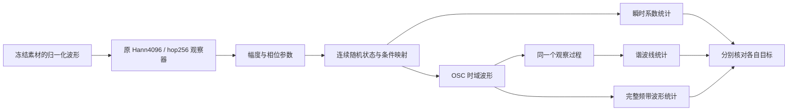

# 条件相位时域复测 V1

2026-11-15。**静态幅相分布更接近素材，不保证实际生成的声纹更接近素材。** 本轮完成六份冻结 F3 声纹、三个种子、五种方案共90条时域生成及独立复核。条件相位方案在参数级改善左右关联，经过原分析窗重新测量后却明显退步；保持当前认可声音，不进入实时 C 或新听评。

上一轮 ADI V7 形成新的成本证据并单独提交 `433803b`，没有改变声源。本轮承接此前已准备好的 `known1`，先完成独立核查，再实际生成波形；不是重复静态 LP 或调整强度、阶数、ρ。

六个观察分别为 F3 两段五挡升速的 early／mid／late。它们是同款 V10 的局部录音情境，不是六种发动机，也不证明完整转速／负载覆盖。固定相位、原相对相位、父条件、密度优化、梯度优化五种方案共享幅度表、根频率、增益与频率渐消；后三者共用一条独立于幅度的新相位随机流。独立流改变了共同／相对相位的联合结构，不宣称全部相位依赖关系都得到保留。

每条直接在1024采样／声学周期坐标内生成64周期／65536点，原每周期4个纹理端点、12因子和AR参数保持。**这是时间模型探针，不是原生48kHz音频、ECU转速、物理发动机时间律或抗混叠资格。** 没有房间、额外扩宽或逐条响度补偿。

原素材只有39–41行观察，生成完整片段有241行。除完整片段外，还保留105个相同行数短段，共420个左右频带坐标；相邻短段的Hann孔径重叠，种子也不等于独立录音，不据此给置信区间。

| 方案 | 瞬时系数左右误差 | 重测谐波左右误差 | 完整频带左右误差 | 完整频带功率平均绝对误差 |
|---|---:|---:|---:|---:|
| 固定相位 | 0.11960 | 0.11892 | 0.12201 | 3.557 dB |
| 原相对相位 | 0.08255 | 0.06208 | 0.08589 | 3.026 dB |
| 父条件映射 | 0.02684 | 0.36614 | 0.43404 | 5.180 dB |
| 密度优化 | 0.02883 | 0.39343 | 0.46962 | 4.285 dB |
| 梯度优化 | 0.02980 | 0.40632 | 0.48888 | 3.898 dB |

左右误差是复数相干度的绝对差，按六源×三种子×四频带72坐标平均，越低越好；不是空间真实性评分。功率按144个左右频带坐标平均，比较对应的完整频带原声目标。频带为3–6、6–8、8–10、10–14kHz。

梯度优化相对原相对相位：参数级左右误差66／72坐标改善，但重测谐波和完整频带左右误差均57／72退步。相同行数短段的谐波左右误差为0.42722，对比原相对相位0.11312，323／420坐标退步。完整频带功率CV误差0.17373，对比0.08805，98／144坐标退步；相同行数CV误差0.12898，对比0.08182。全部改善和退步都保留，未按频带挑选赢家。

各方案的瞬时分音功率相同，偏离原短素材的平均绝对误差均约0.233 dB；相位计算导致的末位浮点差异不能解释为功率改善。生成后重测谐波功率平均绝对误差，固定相位0.259 dB、原相对相位1.172 dB、梯度优化3.297 dB。这说明只对齐瞬时幅度／左右矩，仍没有控制实际生成波形的频谱与窗口后统计。

梯度优化的每分音最大相位步进中位数0.326 rad，原相对相位0.0474 rad；最大分别5.340与0.369 rad／坐标采样。这些是归一化坐标中未按2π折回的步进，不是原生48kHz相位速度或直接可听性判定。P表范围外比例中位数0，最大单分音2.0813%；所有逐源／种子／分音计数保留。当前证据显示时间生成环节的重要性，**尚未定位过量高频来自哪些载频，也未证明单一因素造成全部退步**。

7个已知控制覆盖恒定、共同／差分AM、共同／相对PM、非整数边带与静音。独立有限几何级数／Bessel公式误差最大5.743e−14 FS，标量条件解码误差1.111e−16 rad。六原素材经过原观察器与冻结训练行逐项精确一致；全部1728映射的原1025点路径与优化解码差最大4.407e−12 rad。首源首种子的37／1024分块比较通过原2e−12 FS门槛。

独立实源审计不导入生产生成器、解码器或观察／统计模块：用 `lfilter` 重建两条随机状态流，用独立分位插值和二分CDF复算全部瞬时统计，标量OSC复核每条37点，再由SciPy STFT核对全部21930行观察、完整频带功率／交叉谱、协方差、CV、M/S、1–8阶滞后矩和相同行数短段。最大波形样本误差4.178e−15 FS、观察系数误差1.361e−13 FS、统计缩放误差3.331e−14，原门槛未变。发布的90行比较及全部聚合、计数也独立复算；两张图逐张目视确认。

图片位于独立数据工作区 `E:\VehicleSoundLab\references\analysis\conditional_phase_time_v1\review1`，随本地冻结包保存，未放入源码库。完整数值见该目录 `summary.json` 和仓库阶段汇总。

模块边界：`tools/conditional_phase_time_v1/mapping.py`维护连续条件逆CDF，`generator.py`维护配对OSC探针，`observer.py`维护原观察器及完整频带功率，`fixtures.py`维护解析控制，`metrics.py`维护分开的比较目标；运行、已知／实源／发布审计、科学图与归档宿主分别维护。它们均不持有驾驶状态、声场、PCM循环或实时设备。

下一步先用已知控制验证**按载频组分轨的线性频谱归账**：同一冻结波形按载频来源分组，保留组内能量及有符号组间交叉项，查明哪些分音把能量带到目标高频，而非把余项一概称为独立机械噪声。之后再约束经过原观察器的时间模型，完成原生48kHz／听评／CPU资格后才考虑C移植。不能通过继续加亮、盲扫ρ／rank／强度或直接降低调制速率掩盖问题。

工程体系继续沿用上游V6的DNA／BODY／DETAIL／EVENT／AUX分层及唯一驾驶器。录音L/R仍是观察声道，不等于两条物理排气源；未来7.1.4空间层继续独立，声源只渲染一次。原670份C/H、82参数、3份F2、C索引、认可moving35、默认／owned录放／房间和已有听评保持；无新听评问题、未改68CTest重复、下载或推送。全转速状态、多发动机标定与物理7.1.4目标尚未完成。

复现入口：`tools/run_conditional_phase_time_v1.py`先`--stage known`；已知审计通过后`--stage real`，再运行实源审计、review、发布指标审计与package。既有输出目录不覆盖。归档为数据工作区`baselines/conditional_phase_time_v1`，仓库汇总为`research/conditional_phase_time_v1_summary.json`。
