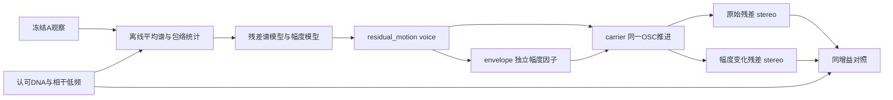

# 残差幅度细节 V1

2026-11-12。为独立残差 OSC 增加可选幅度统计变化。**C行为与已知立体声控制通过；当前实录统计改善很小，自然度提升尚未建立。** 已认可的 DNA／实测相位低频没有改变，新模块尚未接入驾驶、设备UI或行程。

## 输入与方法

只使用已获认可的 A 移动尾排 316.10–317.25s 及其固定周期观察，不混入 A 驻车、B／E 车内或 D 台架。固定音高参考长1.217s。输入经过冻结清单、原始素材／float主文件和认可模型SHA核对。

先以八带1.2–8kHz平均谱补出独立残差，再测量2048点Hann／480点步长的频带RMS包络。每次观察移除一条线性趋势，这是区分慢变化的工程假设，不能解释为已知恒定负载。静态OSC本身已有拍频：拟合时先扣除它和已有DNA／低频的包络协方差，只保留正半定差额的最多四个共同因子。

因子在100Hz更新：`x_next = rho*x + sqrt(1-rho²)*random_sign`，随后线性插值。每带使用共同L/R幅度：

`gain = (1 + amount * Σ basis*x) / sqrt(1 + amount² * Σ basis²*interpolation_variance)`。

分母保持统计预期功率；并非逐片段响度匹配。模型限制最坏幅度偏差≤0.75，故不反相；细节量约18ms跟随。幅度与载频／相位解耦，0量仍推进独立随机流。本轮没有PCM时间线、素材循环、PM或FM。

## 模块边界



| C文件 | 责任 |
|---|---|
| `modules/residual_motion/profile.*` | 非实时事务读取、范围与谱模型频带配对 |
| `envelope.*` | 独立RNG、AR因子、正幅度及预期功率补偿 |
| `carrier.*` | 同一载波状态生成raw／变化后输出，不修改旧模块 |
| `voice.*` | 拥有模型／状态；`rm_voice_init/set/process`；交错stereo double |
| `experiments/residual_motion_v1/probe.c` | 离线WAV与控制轨迹，文件I/O在宿主 |
| `checks.c` | 契约回归，与实际音色判断分开 |

最多16带／8因子，当前8带／4因子。48kHz，有限变调0.9–1.1×。音频处理无分配、文件读写或UI。驾驶／空间适配仍在外层；录音L/R不是两个物理引擎对象，本轮没有新增空间展宽。

## 结果与边界

- **38项CTest通过**。新增契约覆盖0量输出及整个旧载波状态精确一致、raw隔离、任意分块一致、独立随机流、mono、事务拒绝和控制变化。既有421个C/H字节未变；新增10个C/H。
- 实际C导出在0.9／1／1.1×均持续8秒；0量和raw与旧probe逐样本相同。
- 三个独立已知stereo种子、各16秒：幅度变化前后最大频带功率差0.0648dB，复相关变化0.00144，分别低于预设0.5dB／0.04界限。包络CSV采样在插值节点，测得均方1.0025／0.9973；中间插值功率另有解析契约检查。
- 正幅度边界使拟合basis统一缩至原估计的15.35%。残差占整段能量较小的频带不施加AM，实际主要影响1.2–1.5、2.4–3、3–3.8kHz。

同一短实录、三个未参与拟合的程序种子：

| 种子 | 静态协方差距离 | 加AM后距离 | 距离下降 |
|---|---:|---:|---:|
| 78283 | 0.106951 | 0.106958 | −0.0069% |
| 41719 | 0.105718 | 0.105577 | 0.1336% |
| 61927 | 0.103796 | 0.103103 | 0.6681% |

这是程序种子留出，**没有未见实录验证**；此距离也不是感知自然度。结果未显示明确改善，不能把“verification pass”解读为音色通过。负协方差差额总量约0.0632，新增AM无法消除已有的过量变化或错误跨带关系；载波拍频仍在。

参考在6–8kHz没有正平均功率缺口，这次不支持直接增加该频段。A这段近乎mono；已知stereo控制只能验证算法约束，不能证明实录声场宽度改善。还没有设备预算、长时间运行、工况泛化或7.1.4听评结论。

## 试听与复现

[同增益诊断页](http://127.0.0.1:8789/research/残差幅度细节V1.html)提供录音短参考、认可干声、静态细节、幅度变化50%／100%及两条独奏。共同增益0.5、5ms首尾淡化、PCM24；没有逐条归一化／EQ／限制器。七条音频的HTTP与本地加载、默认停止、互斥播放、全部停止和窄屏检查通过；浏览器QA全程静音，不构成听评。

```powershell
# 使用能导入numpy/scipy/soundfile的Python；输出目录必须尚不存在。
python tools/fit_residual_motion_v1.py --workspace E:/VehicleSoundLab --probe E:/VehicleSoundLab-Git/handoff-build/bin/Release/VslResidual_probe.exe --out E:/VehicleSoundLab/references/analysis/residual_motion_v1/fit1
python tools/verify_residual_motion_v1.py --workspace E:/VehicleSoundLab --fit E:/VehicleSoundLab/references/analysis/residual_motion_v1/fit1 --probe E:/VehicleSoundLab-Git/handoff-build/Release/VslResidualMotion_probe.exe --static-probe E:/VehicleSoundLab-Git/handoff-build/bin/Release/VslResidual_probe.exe --out E:/VehicleSoundLab/references/analysis/residual_motion_v1/verification2
```

新probe实际在`handoff-build/Release`；第一次误用`bin/Release`导致启动失败，`verification1`保留原脚本和据工具输出补记的错误，未伪造缺失的堆栈。成功版本、二进制、模型、控制轨迹、试听、CTest及输入SHA见 `residual_motion_v1_summary.json`。冻结入口为 `tools/freeze_residual_motion_v1.py`。

下一步以本轮听评区分静态细节是否有用与AM是否有用；缺少收益时保留为可选诊断，不把参数强行映射到驾驶状态。进一步研究应取得更长、独立的同情境包络证据，并先定位静态OSC变化过量／跨带关系错误，避免只增加调制深度或整体提亮。声源、状态控制和一次空间渲染继续独立维护。
