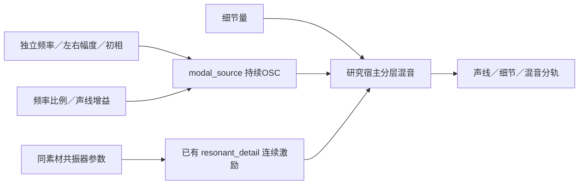

# 独立怠速声源 C 移植 V1

上一轮 F2 固定怠速候选已移植为独立 C 声源，三组随机种子的声线、细节和混音与 Python 输出最大差异 **1.49e−8 FS**。这次整理实现与接口，**没有重新拟合音色，也没有把尚待听评的候选接入默认驾驶器**。

## 生成与模块



| 文件 | 职责与边界 |
|---|---|
| `modules/modal_source/profile.c/.h` | 不可变模型校验；最多64条独立频率，无车型／阶次／RPM常量 |
| `modules/modal_source/voice.c/.h` | 连续振子、左右初相差、频率比例／增益平滑、近Nyquist淡出；不读文件、不分配内存 |
| `modules/modal_source/io.c/.h` | 独立非实时库；严格限界文本读取，整数溢出／负号／残缺／尾随内容拒绝，失败不改原模型 |
| `experiments/modal_idle_v1/models.c/.h` | 非实时组合两个参数文件；拒绝周期细节包络，避免伪装共同发动机时钟 |
| `experiments/modal_idle_v1/probe.c` | 离线参数控制与三分轨导出；不维护车辆状态 |
| `experiments/modal_idle_v1/checks.c` | 独立解析信号、调参／静音连续性、模型／IO契约 |

`MsProfile`由调用方持有且在声源运行期间不变。调用顺序为非实时`ms_profile_load`／`ms_voice_init`，实时`ms_voice_set`／`ms_voice_tick`或`ms_voice_process`。声线参数与文件IO、声源状态、实验宿主各自分开。

控制在864样本（18ms）内单调到达目标；反复提交相同目标不延长过渡。零增益与超出可听范围时仍推进振子；每4096样本校正模长，不重置相位。19.2–21.6kHz做平滑淡出。核的比例范围0.25–4属于实现限制，**不是F2声纹有效范围**；当前固定怠速研究仍限于约0.9–1.1的有限比较。

原`resonant_detail`核、激励序列与参数完全复用。现有Rdt文件格式要求`base_hz`；这里仅保存首条实测声线作为参考元数据。所有周期包络阶数为零，渲染传入固定0相位，该字段不产生发动机时钟。频率比例只调OSC，细节共振器保持固定Hz；这不是整套声音的统一变调或实测RPM控制。

## 验证结果

- 两项独立CTest通过：一般声源契约，以及实际F2参数组合；没有改主构建或重跑旧55项。
- 已知离栅立体声、另一种非整数频率模型、64声线、静音推进、块／单样本一致性、调参解析轨迹、反复提交／中途改目标、限界与事务IO均通过。
- 已知双音60秒直接余弦对照最大误差 **2.71e−12 FS**，只证明振子没有额外数值相位漂移，不证明发动机相位已恢复。
- 三组12秒、两声道、声线／细节／完整混音全部与原Python文件比较，最大 **1.49e−8 FS**；0.9／1.1声线比例另与独立直接余弦和比较，时长固定。
- 原540份C/H与67份运行声音文件哈希保持。新增10份C/H，当前索引550份；只在独立研究构建中使用。当前原生驾驶、行程格式、一次空间路由和行驶35%保持。

初次完整验证后，补充了过大／带负号整数拒绝、全零模型与抗混叠过渡带检查，再执行第二次完整验证。两次源码／构建／测试／音轨与报告均保存；没有改随机种子或声音参数。

## 拍频边界

移植准确不能解决独立频率模型本身的相位关系。冻结参数里，`f3−f1−f2≈−0.01210Hz`，12秒对应−0.145周期；`f6−2f3≈0.35443Hz`，12秒对应4.253周期。因此起始时从录音取得的相对相位，并不会永远形成同一周期波形。

这是**候选参数的代数性质**，不能据此认定实车存在这些独立机械阶次；有限窗估计、原声变化和话筒因素都未分离。本轮没有强制取整频率、加抖动或把差值当FM来掩盖它。是否出现可闻嗡鸣／拍频仍要听评，后续如需共同发动机相位，仍必须单独完成原提取器资格验证。

## 使用与交接

在仓库运行`Build-Idle-Modal-Study.ps1`编译并检查独立实验。输出工具为`build-modal-idle-v1/Release/modal_idle_probe.exe`，参数依次为：

```text
modal.msource detail.rdetail output_prefix seconds seed modal_ratio detail_amount
```

固定参数在`experiments/modal_idle_v1/F2_fixed_idle.msource`及`.rdetail`。例如`seconds=12, seed=149921, modal_ratio=1, detail_amount=1`对应上一轮完整候选；输出前缀所在目录须预先存在，产生`_modal.wav`、`_detail.wav`、`_mix.wav`。

证据位于本地`references/analysis/idle_modal_c_v1`，完整冻结在`baselines/idle_modal_c_v1`。原[怠速试听页](http://127.0.0.1:8789/references/analysis/idle_modal_v1/review2/index.html)仍用于音色评价；C版没有新的音色验收、实时UI／设备验证或完整驾驶状态覆盖。下一步按声线／共振细节听评继续改善，再设计范围与状态过渡，保持唯一驾驶器和独立声层接口。
